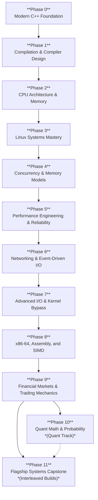
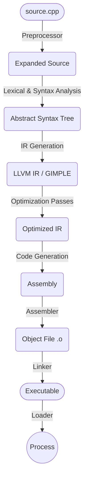
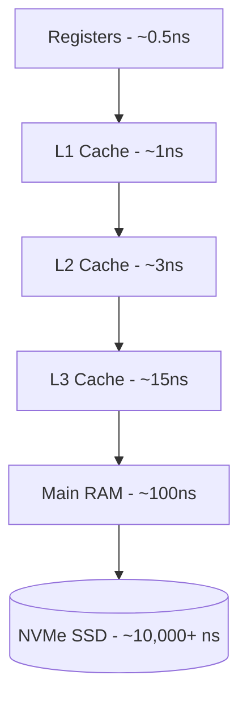
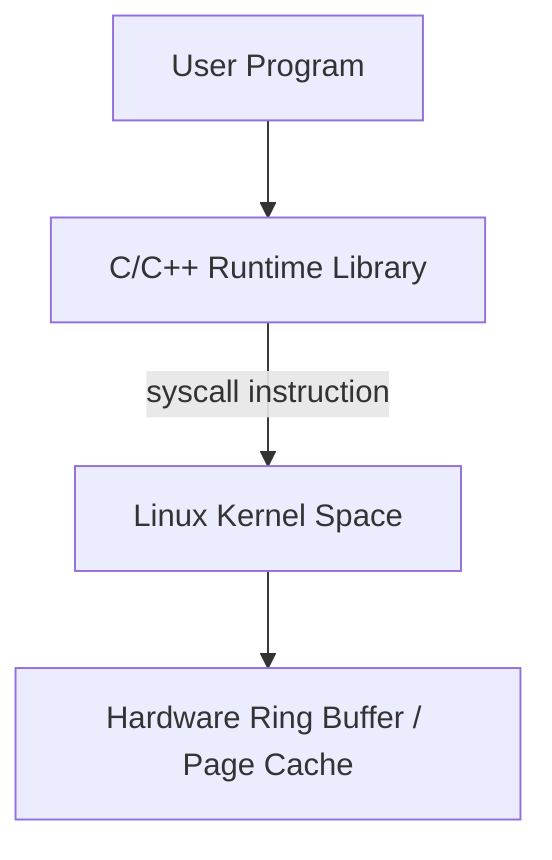
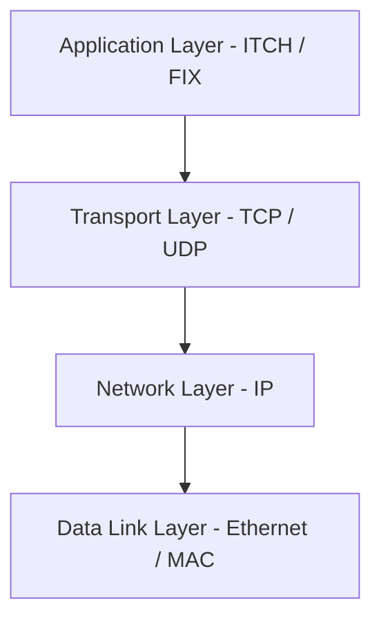
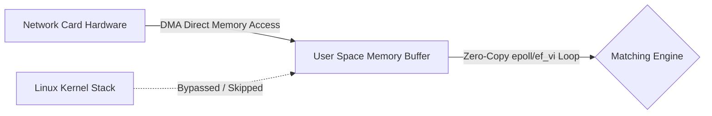

# C++ Systems & Performance Engineering Roadmap

# Table of Contents

1. [The Overall Roadmap](#1-the-overall-roadmap)
2. [Phase 0: Modern C++ Foundation](#2-phase-0-modern-c-foundation)
3. [Phase 1: What Happens Beneath C++ & Compiler Design](#3-phase-1-what-happens-beneath-c--compiler-design)
4. [Phase 2: CPU Architecture, Memory, and Hardware](#4-phase-2-cpu-architecture-memory-and-hardware)
5. [Phase 3: OS Fundamentals & Linux Systems Mastery](#5-phase-3-os-fundamentals--linux-systems-mastery)
6. [Phase 4: Concurrency & Memory Models](#6-phase-4-concurrency--memory-models)
7. [Phase 5: Performance Engineering & Reliability](#7-phase-5-performance-engineering--reliability)
8. [Phase 6: Networking and I/O](#8-phase-6-networking-and-io)
9. [Phase 7: Advanced I/O and Kernel Bypass](#9-phase-7-advanced-io-and-kernel-bypass)
10. [Phase 8: x86-64, Assembly, and SIMD](#10-phase-8-x86-64-assembly-and-simd)
11. [Phase 9: Financial Markets & Trading Mechanics](#11-phase-9-financial-markets--trading-mechanics)
12. [Phase 10: Quantitative Math & Probability (Quant Track)](#12-phase-10-quantitative-math--probability-quant-track)
13. [Phase 11: The Hardcore Flagship Projects (The Capstone Suite)](#13-phase-11-the-hardcore-flagship-projects-the-capstone-suite)
14. [Free Video Courses & Interactive Portals](#14-free-video-courses--interactive-portals)
15. [The Principal Engineer Benchmarking & Resume Playbook](#15-the-principal-engineer-benchmarking--resume-playbook)

# 1. The Overall Roadmap



> [!IMPORTANT]
> Do not try to learn all of this simultaneously. Depth matters more than touching everything once.

The goal is not to become someone who knows the most C++ syntax.
The goal is to become someone who can answer:
- What does this code compile into?
- Where is this object stored?
- Who owns this memory?
- What is its lifetime?
- How does this affect the cache?
- Is this operation thread-safe?
- What does the compiler optimize?
- Where is the actual bottleneck?

---

# 2. Phase 0: Modern C++ Foundation

> **Overview:** Master the core language, memory lifetime, value semantics, and the modern standard library without runtime overhead.

> [!TIP]
> 🎓 **Recommended Long-Form Playlists for Video-First Learners:**
> - **[The Cherno  -  C++ Series (100+ Videos Full Course)](https://www.youtube.com/playlist?list=PLlrATfBNZ98dudnM48yfGUldqGD0S4FFb)** `[Search: "The Cherno C++ Playlist"]`: The canonical visual code walkthrough of pointers, references, stack/heap, classes, templates, move semantics, and modern C++.
> - **[CppCon  -  Back to Basics Official Track](https://www.youtube.com/playlist?list=PLHTh1InhhwT4TJaHBVWzvBOYhp27UO7mI)** `[Search: "CppCon Back to Basics Playlist"]`: 40+ full-length (1-hour) conference keynotes on move semantics, value categories, abstract machine, and class design.

## Core Topics & Deep Study Guides

- **Pointers and References**
  - *Core Concept:* Raw memory addresses vs type-safe aliases. In HFT, understanding pointer arithmetic and indirection is critical for cache-friendly flat structures.
  - 🎥 **Watch 1:** [POINTERS in C++](https://www.youtube.com/watch?v=DTxHyVn0ODg) `[Search: "The Cherno POINTERS in C++"]`
  - 🎥 **Watch 2:** [REFERENCES in C++](https://www.youtube.com/watch?v=IzoFn3dfsPA) `[Search: "The Cherno REFERENCES in C++"]`
  - 📖 **Read (Supplementary Reference - Optional):** [cppreference - Pointer Declaration](https://en.cppreference.com/w/cpp/language/pointer) `[Search: "cppreference pointer declaration"]`
  - 📖 **Read (Supplementary Reference - Optional):** [LearnCpp - Introduction to Pointers](https://www.learncpp.com/cpp-tutorial/introduction-to-pointers/) `[Search: "learncpp introduction to pointers"]`

- **Object Lifetime & Storage Duration**
  - *Core Concept:* Automatic (stack), dynamic (heap), static, and thread-local storage. Knowing exactly when constructors and destructors execute eliminates dangling pointers and memory leaks.
  - 🎥 **Watch 1:** [Object Lifetime in C++ (Stack/Scope Lifetimes)](https://www.youtube.com/watch?v=iNuTwvD6ciI) `[Search: "The Cherno Object Lifetime in C++"]`
  - 🎥 **Watch 2:** [Back to Basics: The Abstract Machine - Bob Steagall - CppCon 2020](https://www.youtube.com/watch?v=ZAji7PkXaKY) `[Search: "CppCon Back to Basics: The Abstract Machine"]`
  - 📖 **Read (Supplementary Reference - Optional):** [cppreference - Lifetime](https://en.cppreference.com/w/cpp/language/lifetime) `[Search: "cppreference object lifetime"]`
  - 📖 **Read (Supplementary Reference - Optional):** [cppreference - Storage Duration](https://en.cppreference.com/w/cpp/language/storage_duration) `[Search: "cppreference storage duration"]`

- **Stack vs Heap Allocation**
  - *Core Concept:* Stack memory is instant (pointer bump); heap allocation requires OS syscalls, heap locks, and causes unpredictable latency spikes.
  - 🎥 **Watch 1:** [Stack vs Heap Memory in C++](https://www.youtube.com/watch?v=wJ1L2nSIV1s) `[Search: "The Cherno Stack vs Heap Memory in C++"]`
  - 🎥 **Watch 2:** [Stack vs Heap Memory - Simple Explanation](https://www.youtube.com/watch?v=5OJRqkYbK-4) `[Search: "Computerphile Stack vs Heap"]`
  - 📖 **Read (Supplementary Reference - Optional):** [LearnCpp - The Stack and the Heap](https://www.learncpp.com/cpp-tutorial/the-stack-and-the-heap/) `[Search: "learncpp the stack and the heap"]`
  - 📖 **Read (Supplementary Reference - Optional):** [GeeksforGeeks - Stack vs Heap Memory Allocation](https://www.geeksforgeeks.org/stack-vs-heap-memory-allocation/) `[Search: "geeksforgeeks stack vs heap allocation"]`

- **const Correctness & Immutability**
  - *Core Concept:* Compile-time enforcement of read-only state. Enables aggressive compiler optimizations, thread safety reasoning, and prevents accidental state mutation.
  - 🎥 **Watch 1:** [CONST in C++](https://www.youtube.com/watch?v=4fJBrditnJU) `[Search: "The Cherno CONST in C++"]`
  - 🎥 **Watch 2:** [Back to Basics: Const as a Promise - Dan Saks - CppCon 2019](https://www.youtube.com/watch?v=NZtr93iL3R0) `[Search: "CppCon Back to Basics: Const as a Promise Dan Saks"]`
  - 📖 **Read (Supplementary Reference - Optional):** [isocpp FAQ - Const Correctness](https://isocpp.org/wiki/faq/const-correctness) `[Search: "isocpp faq const correctness"]`
  - 📖 **Read (Supplementary Reference - Optional):** [cppreference - cv-qualifiers](https://en.cppreference.com/w/cpp/language/cv) `[Search: "cppreference cv qualifiers const volatile"]`

- **Value Categories (lvalues, rvalues, prvalues, xvalues)**
  - *Core Concept:* The semantic taxonomy of expressions in C++. Understanding value categories is the prerequisite for writing efficient move constructors and perfect forwarding.
  - 🎥 **Watch 1:** [lvalues and rvalues in C++](https://www.youtube.com/watch?v=fbYknr-HPYE) `[Search: "The Cherno lvalues and rvalues in C++"]`
  - 🎥 **Watch 2:** [Back to Basics: Understanding Value Categories - Ben Saks - CppCon 2019](https://www.youtube.com/watch?v=XS2JddPq7GQ) `[Search: "CppCon Back to Basics Value Categories"]`
  - 🎥 **Watch 3:** [Back to Basics: Understanding Value Categories - Ben Saks - CppCon 2019](https://www.youtube.com/watch?v=XS2JddPq7GQ) `[Search: "CppCon Back to Basics Understanding Value Categories Ben Saks"]`
  - 📖 **Read (Supplementary Reference - Optional):** [cppreference - Value Categories](https://en.cppreference.com/w/cpp/language/value_category) `[Search: "cppreference value categories"]`
  - 📖 **Read (Supplementary Reference - Optional):** [LearnCpp - Value Categories: lvalues and rvalues](https://www.learncpp.com/cpp-tutorial/value-categories-lvalues-and-rvalues/) `[Search: "learncpp value categories"]`

- **Move Semantics & std::move**
  - *Core Concept:* Resource theft from temporaries instead of deep copying. Eliminates buffer allocations when passing messages between network and trading threads.
  - 🎥 **Watch 1:** [Move Semantics in C++](https://www.youtube.com/watch?v=ehMg6zvXuMY) `[Search: "The Cherno Move Semantics in C++"]`
  - 🎥 **Watch 2:** [Back to Basics: Move Semantics (part 1 of 2) -  Klaus Iglberger - CppCon 2019](https://www.youtube.com/watch?v=St0MNEU5b0o) `[Search: "CppCon Back to Basics: Move Semantics"]`
  - 🎥 **Watch 3:** [Back to Basics: Move Semantics - Klaus Iglberger - CppCon 2019](https://www.youtube.com/watch?v=St0MNEU5b0o) `[Search: "CppCon Back to Basics Move Semantics Klaus Iglberger"]`
  - 📖 **Read (Supplementary Reference - Optional):** [cppreference - std::move](https://en.cppreference.com/w/cpp/utility/move) `[Search: "cppreference std move"]`
  - 📖 **Read (Supplementary Reference - Optional):** [cppreference - Move Constructors](https://en.cppreference.com/w/cpp/language/move_constructor) `[Search: "cppreference move constructor"]`

- **Constructors, Destructors & Rule of 0/3/5**
  - *Core Concept:* Deterministic resource management. Custom copy/move operations ensure correct ownership semantics when wrapping OS resources or shared memory.
  - 🎥 **Watch 1:** [Constructors in C++](https://www.youtube.com/watch?v=FXhALMsHwEY) `[Search: "The Cherno Constructors in C++"]`
  - 🎥 **Watch 2:** [Destructors in C++](https://www.youtube.com/watch?v=D8cWquReFqw) `[Search: "The Cherno Destructors in C++"]`
  - 📖 **Read (Supplementary Reference - Optional):** [cppreference - Rule of Three / Five / Zero](https://en.cppreference.com/w/cpp/language/rule_of_three) `[Search: "cppreference rule of three five zero"]`
  - 📖 **Read (Supplementary Reference - Optional):** [cppreference - Constructors and Member Initializer Lists](https://en.cppreference.com/w/cpp/language/initializer_list) `[Search: "cppreference constructors member initializer"]`

- **RAII (Resource Acquisition Is Initialization)**
  - *Core Concept:* Binds the life cycle of a resource (locks, sockets, memory) to object lifetime, guaranteeing leak-free cleanup even during early returns or errors.
  - 🎥 **Watch 1:** [Back to Basics: RAII in C++ - Andre Kostur - CppCon](https://www.youtube.com/watch?v=Rfu06XAhx90) `[Search: "CppCon Back to Basics RAII in C++ Andre Kostur"]`
  - 🎥 **Watch 2:** [Back to Basics: RAII and the Rule of Zero - Arthur O'Dwyer - CppCon 2019](https://www.youtube.com/watch?v=7Qgd9B1KuMQ) `[Search: "CppCon Back to Basics RAII Arthur O'Dwyer"]`
  - 🎥 **Watch 3:** [Back to Basics: RAII and the Rule of Zero - Arthur O'Dwyer - CppCon 2019](https://www.youtube.com/watch?v=7Qgd9B1KuMQ) `[Search: "CppCon Back to Basics: RAII and the Rule of Zero Arthur O'Dwyer"]`
  - 📖 **Read (Supplementary Reference - Optional):** [cppreference - RAII](https://en.cppreference.com/w/cpp/language/raii) `[Search: "cppreference RAII resource acquisition"]`
  - 📖 **Read (Supplementary Reference - Optional):** [Bjarne Stroustrup - Resource Management](https://www.stroustrup.com/bs_faq2.html#finally) `[Search: "stroustrup resource management RAII"]`

- **Exceptions vs std::expected (C++23) & -fno-exceptions**
  - *Core Concept:* Stack unwinding has nondeterministic latency. HFT disables exceptions (-fno-exceptions) and uses monadic error handling with std::expected or std::optional.
  - 🎥 **Watch 1:** [CppCon 2018:  Brand & Nash “What Could Possibly Go Wrong?: A Tale of Expectations and Exceptions”](https://www.youtube.com/watch?v=GC4cp4U2f2E) `[Search: "CppCon Brand Nash Expectations and Exceptions"]`
  - 🎥 **Watch 2:** [Pacific++ 2017: Jason Turner "Rethinking Exceptions"](https://www.youtube.com/watch?v=OkgvqjJzH_Y) `[Search: "Pacific++ Jason Turner Rethinking Exceptions"]`
  - 📖 **Read (Supplementary Reference - Optional):** [cppreference - std::expected](https://en.cppreference.com/w/cpp/utility/expected) `[Search: "cppreference std expected"]`
  - 📖 **Read (Supplementary Reference - Optional):** [cppreference - Exceptions](https://en.cppreference.com/w/cpp/language/exceptions) `[Search: "cppreference exceptions"]`

- **Templates & C++20 Concepts**
  - *Core Concept:* Compile-time polymorphism with zero runtime virtual dispatch overhead. Concepts restrict template arguments to produce clean compiler error messages.
  - 🎥 **Watch 1:** [Templates in C++](https://www.youtube.com/watch?v=I-hZkUa9mIs) `[Search: "The Cherno Templates in C++"]`
  - 🎥 **Watch 2:** [C++20 Concepts: A Day in the Life - Saar Raz - CppCon 2019](https://www.youtube.com/watch?v=qawSiMIXtE4) `[Search: "CppCon Concepts in C++20"]`
  - 🎥 **Watch 3:** [Back to Basics: Templates in C++ - Nicolai Josuttis - CppCon 2022](https://www.youtube.com/watch?v=HqsEHG0QJXU) `[Search: "CppCon Back to Basics Templates Nicolai Josuttis"]`
  - 📖 **Read (Supplementary Reference - Optional):** [cppreference - Templates](https://en.cppreference.com/w/cpp/language/templates) `[Search: "cppreference templates"]`
  - 📖 **Read (Supplementary Reference - Optional):** [cppreference - Constraints and Concepts](https://en.cppreference.com/w/cpp/language/constraints) `[Search: "cppreference constraints and concepts"]`

- **Lambdas & Closures**
  - *Core Concept:* Inline anonymous functors. Understanding capture by value ([=]) vs capture by reference ([&]) and how they translate to compiler-generated structs.
  - 🎥 **Watch 1:** [Lambdas in C++](https://www.youtube.com/watch?v=mWgmBBz0y8c) `[Search: "The Cherno Lambdas in C++"]`
  - 🎥 **Watch 2:** [Back to Basics: Lambdas - Nicolai Josuttis - CppCon 2021](https://www.youtube.com/watch?v=IgNUBw3vcO4) `[Search: "CppCon Back to Basics Lambdas"]`
  - 🎥 **Watch 3:** [Back to Basics: Lambdas - Nicolai Josuttis - CppCon 2021](https://www.youtube.com/watch?v=IgNUBw3vcO4) `[Search: "CppCon Back to Basics Lambdas Nicolai Josuttis"]`
  - 📖 **Read (Supplementary Reference - Optional):** [cppreference - Lambda Expressions](https://en.cppreference.com/w/cpp/language/lambda) `[Search: "cppreference lambda expressions"]`
  - 📖 **Read (Supplementary Reference - Optional):** [LearnCpp - Introduction to Lambdas](https://www.learncpp.com/cpp-tutorial/introduction-to-lambdas-anonymous-functions/) `[Search: "learncpp introduction to lambdas"]`

- **constexpr & consteval (Compile-Time Metaprogramming)**
  - *Core Concept:* Moving computation from runtime to compile time. Used in HFT to compute lookup tables, math constants, and protocol hashes before code ever executes.
  - 🎥 **Watch 1:** [Back to Basics: const and constexpr  - Rainer Grimm - CppCon 2021](https://www.youtube.com/watch?v=tA6LbPyYdco) `[Search: "CppCon Back to Basics const and constexpr Rainer Grimm"]`
  - 🎥 **Watch 2:** [CppCon 2017: Ben Deane & Jason Turner “constexpr ALL the Things!”](https://www.youtube.com/watch?v=PJwd4JLYJJY) `[Search: "CppCon constexpr all the things"]`
  - 🎥 **Watch 3:** [constexpr ALL the Things! - Ben Deane & Jason Turner - CppCon 2017](https://www.youtube.com/watch?v=PJwd4JLYJJY) `[Search: "CppCon constexpr ALL the Things Jason Turner"]`
  - 📖 **Read (Supplementary Reference - Optional):** [cppreference - constexpr](https://en.cppreference.com/w/cpp/language/constexpr) `[Search: "cppreference constexpr"]`
  - 📖 **Read (Supplementary Reference - Optional):** [cppreference - consteval](https://en.cppreference.com/w/cpp/language/consteval) `[Search: "cppreference consteval"]`

- **STL Containers (std::vector, std::array, std::deque)**
  - *Core Concept:* Contiguous memory layout gives std::vector and std::array maximum L1/L2 cache locality, making node-based containers (std::list) obsolete in high-performance paths.
  - 🎥 **Watch 1:** [Dynamic Arrays in C++ (std::vector)](https://www.youtube.com/watch?v=PocJ5jXv8No) `[Search: "The Cherno Dynamic Arrays in C++ std vector"]`
  - 🎥 **Watch 2:** [Static Arrays in C++ (std::array)](https://www.youtube.com/watch?v=Hw42GkHPyvk) `[Search: "The Cherno std array in C++"]`
  - 📖 **Read (Supplementary Reference - Optional):** [cppreference - std::vector](https://en.cppreference.com/w/cpp/container/vector) `[Search: "cppreference std vector"]`
  - 📖 **Read (Supplementary Reference - Optional):** [cppreference - std::array](https://en.cppreference.com/w/cpp/container/array) `[Search: "cppreference std array"]`

- **Smart Pointers (std::unique_ptr vs std::shared_ptr)**
  - *Core Concept:* Explicit ownership semantics. In low-latency systems, std::shared_ptr is banned in hot paths due to atomic reference counting overhead; std::unique_ptr is zero-cost.
  - 🎥 **Watch 1:** [SMART POINTERS in C++ (std::unique_ptr, std::shared_ptr, std::weak_ptr)](https://www.youtube.com/watch?v=UOB7-B2MfwA) `[Search: "The Cherno SMART POINTERS in C++"]`
  - 🎥 **Watch 2:** [CppCon 2019: Arthur O'Dwyer “Back to Basics: Smart Pointers”](https://www.youtube.com/watch?v=xGDLkt-jBJ4) `[Search: "CppCon Back to Basics Smart Pointers Arthur O'Dwyer"]`
  - 🎥 **Watch 3:** [Back to Basics: Smart Pointers and RAII - Inbal Levi - CppCon 2021](https://www.youtube.com/watch?v=07rJOzFRs6M) `[Search: "CppCon Back to Basics Smart Pointers Inbal Levi"]`
  - 📖 **Read (Supplementary Reference - Optional):** [cppreference - std::unique_ptr](https://en.cppreference.com/w/cpp/memory/unique_ptr) `[Search: "cppreference std unique_ptr"]`
  - 📖 **Read (Supplementary Reference - Optional):** [cppreference - std::shared_ptr](https://en.cppreference.com/w/cpp/memory/shared_ptr) `[Search: "cppreference std shared_ptr"]`

- **Vocabulary Types (std::optional, std::variant, std::span, std::string_view)**
  - *Core Concept:* Type-safe, non-owning views and sum types that eliminate dynamic allocation and string copying across APIs.
  - 🎥 **Watch 1:** [How to make your STRINGS FASTER in C++!](https://www.youtube.com/watch?v=ZO68JEgoPeg) `[Search: "The Cherno std string_view in C++"]`
  - 🎥 **Watch 2:** [How to Deal with OPTIONAL Data in C++](https://www.youtube.com/watch?v=UAAiwObNhQ0) `[Search: "The Cherno std optional in C++"]`
  - 📖 **Read (Supplementary Reference - Optional):** [cppreference - std::span](https://en.cppreference.com/w/cpp/container/span) `[Search: "cppreference std span"]`
  - 📖 **Read (Supplementary Reference - Optional):** [cppreference - std::string_view](https://en.cppreference.com/w/cpp/string/basic_string_view) `[Search: "cppreference std string_view"]`

- **Algorithms & C++20 Ranges**
  - *Core Concept:* High-performance standard library algorithms that compile into vectorized SIMD loops, and composable ranges without temporary container allocations.
  - 🎥 **Watch 1:** [CppCon 2018: Jonathan Boccara “105 STL Algorithms in Less Than an Hour”](https://www.youtube.com/watch?v=2olsGf6JIkU) `[Search: "CppCon 105 STL Algorithms in Less Than an Hour Jonathan Boccara"]`
  - 🎥 **Watch 2:** [C++20 Ranges in Practice - Tristan Brindle - CppCon 2020](https://www.youtube.com/watch?v=d_E-VLyUnzc) `[Search: "CppCon C++20 Ranges in Practice"]`
  - 📖 **Read (Supplementary Reference - Optional):** [cppreference - Algorithms Library](https://en.cppreference.com/w/cpp/algorithm) `[Search: "cppreference algorithms library"]`
  - 📖 **Read (Supplementary Reference - Optional):** [cppreference - Ranges Library](https://en.cppreference.com/w/cpp/ranges) `[Search: "cppreference ranges library"]`

---

# 3. Phase 1: What Happens Beneath C++ & Compiler Design

> **Overview:** Understand the journey from source code to machine execution: the preprocessor, compiler frontend/backend, linker, and ABI.



## Core Topics & Deep Study Guides

- **Build Systems, Toolchains & Modern CMake**
  - *Core Concept:* Systems projects require deterministic, high-performance builds. Modern CMake uses target-based modeling (`add_library`, `target_include_directories`, `target_compile_options`), Ninja for parallel generation, low-latency compiler optimization flags (`-O3 -march=native -mtune=native -fno-exceptions -fno-rtti -flto`), and debug sanitizer instrumentation (`-fsanitize=address,undefined`).
  - 🎥 **Watch 1:** [CppCon 2017: Mathieu Ropert "Using Modern CMake Patterns to Enforce a Good Modular Design"](https://www.youtube.com/watch?v=eC9-iRN2b04) `[Search: "CppCon 2017 Mathieu Ropert Using Modern CMake Patterns"]`
  - 🎥 **Watch 2:** [How to Properly Setup C++ Projects](https://www.youtube.com/watch?v=5glH8dGoeCA) `[Search: "The Cherno How to Properly Setup C++ Projects"]`
  - 📖 **Read (Supplementary Reference - Optional):** [An Introduction to Modern CMake - CLIUtils](https://cliutils.gitlab.io/modern-cmake/) `[Search: "cliutils an introduction to modern cmake"]`

- **Translation Units & The Preprocessor**
  - *Core Concept:* Each .cpp file is preprocessed into an isolated translation unit. Unintended macro expansions or redundant includes cause bloated compile times and subtle bugs.
  - 🎥 **Watch 1:** [How C++ Works](https://www.youtube.com/watch?v=SfGuIVzE_Os) `[Search: "The Cherno How C++ Works"]`
  - 🎥 **Watch 2:** [How the C++ Compiler Works](https://www.youtube.com/watch?v=3tIqpEmWMLI) `[Search: "The Cherno How the C++ Compiler Works"]`
  - 📖 **Read (Supplementary Reference - Optional):** [cppreference - Translation Phases](https://en.cppreference.com/w/cpp/language/translation_phases) `[Search: "cppreference translation phases"]`
  - 📖 **Read (Supplementary Reference - Optional):** [LearnCpp - The Compiler, Linker, and Libraries](https://www.learncpp.com/cpp-tutorial/introduction-to-the-compiler-linker-and-libraries/) `[Search: "learncpp compiler linker libraries"]`

- **Headers & Include Guards (#pragma once)**
  - *Core Concept:* Headers declare types and function signatures. Include guards prevent duplicate declarations inside the same translation unit.
  - 🎥 **Watch 1:** [C++ Header Files](https://www.youtube.com/watch?v=9RJTQmK0YPI) `[Search: "The Cherno Header Files in C++"]`
  - 🎥 **Watch 2:** [Back to Basics: Compiling and Linking - Ben Saks - CppCon](https://www.youtube.com/watch?v=cpkDQaYttR4) `[Search: "CppCon Back to Basics Compiling and Linking Ben Saks"]`
  - 📖 **Read (Supplementary Reference - Optional):** [cppreference - Source File Inclusion](https://en.cppreference.com/w/cpp/preprocessor/include) `[Search: "cppreference source file inclusion"]`
  - 📖 **Read (Supplementary Reference - Optional):** [LearnCpp - Header Guards](https://www.learncpp.com/cpp-tutorial/header-guards/) `[Search: "learncpp header guards"]`

- **The One Definition Rule (ODR)**
  - *Core Concept:* A class or inline function can be defined across multiple translation units, but must be identical; non-inline functions must have exactly one definition across the whole program.
  - 🎥 **Watch 1:** [Back to Basics: The Structure of a Program - Bob Steagall - CppCon 2020](https://www.youtube.com/watch?v=3KoXeegncrs) `[Search: "CppCon Back to Basics: The Structure of a Program Bob Steagall"]`
  - 🎥 **Watch 2:** [C++ Linkers and the One Definition Rule - Roger Orr - ACCU 2024](https://www.youtube.com/watch?v=HakSW8wIH8A) `[Search: "C++ Linkers and the One Definition Rule Roger Orr ACCU"]`
  - 📖 **Read (Supplementary Reference - Optional):** [cppreference - Definitions and ODR](https://en.cppreference.com/w/cpp/language/definition) `[Search: "cppreference definitions one definition rule"]`
  - 📖 **Read (Supplementary Reference - Optional):** [Wikipedia - One Definition Rule](https://en.wikipedia.org/wiki/One_Definition_Rule) `[Search: "wikipedia one definition rule"]`
  - 📖 **Read (Supplementary Reference - Optional):** [LearnCpp - Programs with Multiple Files & The One Definition Rule](https://www.learncpp.com/cpp-tutorial/programs-with-multiple-code-files/) `[Search: "learncpp programs with multiple code files one definition rule"]`

- **Name Mangling & extern "C"**
  - *Core Concept:* C++ encodes parameter types into symbol names to support overloading. extern "C" disables mangling to allow interop with C libraries and OS syscalls.
  - 🎥 **Watch 1:** [extern "C": Talking to C Programmers about C++ - Dan Saks - CppCon 2016](https://www.youtube.com/watch?v=D7Sd8A6_fYU) `[Search: "Dan Saks extern C Talking to C Programmers about C++ CppCon"]`
  - 🎥 **Watch 2:** [The C++ ABI From the Ground Up - Louis Dionne - CppCon 2019](https://www.youtube.com/watch?v=DZ93lP1I7wU) `[Search: "Louis Dionne The C++ ABI From the Ground Up CppCon"]`
  - 📖 **Read (Supplementary Reference - Optional):** [cppreference - Language Linkage (extern C)](https://en.cppreference.com/w/cpp/language/language_linkage) `[Search: "cppreference language linkage extern c"]`
  - 📖 **Read (Supplementary Reference - Optional):** [Wikipedia - Name Mangling](https://en.wikipedia.org/wiki/Name_mangling) `[Search: "wikipedia name mangling"]`
  - 📖 **Read (Supplementary Reference - Optional):** [GeeksforGeeks - Name Mangling in C++ and extern C](https://www.geeksforgeeks.org/cpp/extern-c-in-c/) `[Search: "geeksforgeeks extern c in c++ name mangling"]`

- **Object Files (.o) & ELF Binary Layout**
  - *Core Concept:* Executable and Linkable Format (ELF) stores machine code (.text), initialised data (.data), zero-initialised data (.bss), and symbol tables.
  - 🎥 **Watch 1:** [Why Use Binary? - Computerphile](https://www.youtube.com/watch?v=thrx3SBEpL8) `[Search: "Computerphile Dissecting Binaries"]`
  - 🎥 **Watch 2:** [In-depth: ELF - The Extensible & Linkable Format](https://www.youtube.com/watch?v=nC1U1LJQL8o) `[Search: "stacksmashing In-depth: ELF - The Extensible & Linkable Format"]`
  - 📖 **Read (Supplementary Reference - Optional):** [Wikipedia - Executable and Linkable Format (ELF)](https://en.wikipedia.org/wiki/Executable_and_Linkable_Format) `[Search: "wikipedia ELF executable linkable format"]`
  - 📖 **Read (Supplementary Reference - Optional):** [Linux Manual - elf(5)](https://man7.org/linux/man-pages/man5/elf.5.html) `[Search: "man7 elf manual"]`
  - 📖 **Read (Supplementary Reference - Optional):** [Ian Lance Taylor - Linkers part 1 & ELF Section Headers](https://www.airs.com/blog/archives/38) `[Search: "ian lance taylor linkers part 1 elf archives 38"]`

- **Symbol Resolution & Linker Mechanics**
  - *Core Concept:* How the linker resolves undefined symbol references across object files and static archives (.a), detecting multiple definitions or missing symbols.
  - 🎥 **Watch 1:** [How the C++ Linker Works](https://www.youtube.com/watch?v=H4s55GgAg0I) `[Search: "The Cherno How the C++ Linker Works"]`
  - 🎥 **Watch 2:** [CppCon 2017: Michael Spencer “My Little Object File: How Linkers Implement C++”](https://www.youtube.com/watch?v=a5L66zguFe4) `[Search: "CppCon 2017: Michael Spencer My Little Object File How Linkers Implement C++"]`
  - 📖 **Read (Supplementary Reference - Optional):** [GNU ld Linker Documentation](https://sourceware.org/binutils/docs/ld/) `[Search: "gnu ld linker documentation"]`
  - 📖 **Read (Supplementary Reference - Optional):** [Linux Manual - nm(1) Symbol Table Examiner](https://man7.org/linux/man-pages/man1/nm.1.html) `[Search: "man7 nm symbol table examiner"]`

- **Static vs Dynamic Linking (PLT & GOT Overhead)**
  - *Core Concept:* Static linking embeds code directly into the binary; dynamic linking (.so) resolves symbols at runtime via the Procedure Linkage Table (PLT) and Global Offset Table (GOT), adding branch indirection.
  - 🎥 **Watch 1:** [Linkers, Loaders and Shared Libraries in Windows, Linux, and C++ - Ofek Shilon - CppCon 2023](https://www.youtube.com/watch?v=_enXuIxuNV4) `[Search: "CppCon Linkers, Loaders and Shared Libraries in Windows, Linux, and C++"]`
  - 🎥 **Watch 2:** [Using Libraries in C++ (Static Linking)](https://www.youtube.com/watch?v=or1dAmUO8k0) `[Search: "The Cherno Static vs Dynamic Linking"]`
  - 📖 **Read (Supplementary Reference - Optional):** [Ulrich Drepper - How To Write Shared Libraries](https://akkadia.org/drepper/dsohowto.pdf) `[Search: "ulrich drepper how to write shared libraries"]`
  - 📖 **Read (Supplementary Reference - Optional):** [Wikipedia - Dynamic Linker](https://en.wikipedia.org/wiki/Dynamic_linker) `[Search: "wikipedia dynamic linker PLT GOT"]`
  - 📖 **Read (Supplementary Reference - Optional):** [Eli Bendersky - Position Independent Code (PIC) in Shared Libraries](https://eli.thegreenplace.net/2011/11/03/position-independent-code-pic-in-shared-libraries/) `[Search: "eli bendersky position independent code pic shared libraries"]`

- **Application Binary Interface (ABI)**
  - *Core Concept:* The calling convention, register usage, stack frame layout, and struct memory padding agreed upon between compilers and libraries. Incompatible ABIs cause silent memory corruption.
  - 🎥 **Watch 1:** [What is an ABI, and Why is Breaking it Bad? - Marshall Clow - CppCon 2020](https://www.youtube.com/watch?v=7RoTDjLLXJQ) `[Search: "CppCon What is an ABI and Why is Breaking it so Hard"]`
  - 🎥 **Watch 2:** [CppCon 2018: Titus Winters “Standard Library Compatibility Guidelines (SD-8)”](https://www.youtube.com/watch?v=BWvSSsKCiAw) `[Search: "Titus Winters The Day The Standard Library Stopped Improving"]`
  - 📖 **Read (Supplementary Reference - Optional):** [Wikipedia - Application Binary Interface](https://en.wikipedia.org/wiki/Application_binary_interface) `[Search: "wikipedia application binary interface"]`
  - 📖 **Read (Supplementary Reference - Optional):** [Itanium C++ ABI Specification](https://itanium-cxx-abi.github.io/cxx-abi/abi.html) `[Search: "itanium cxx abi specification"]`
  - 📖 **Read (Supplementary Reference - Optional):** [Red Hat Developer - How C++ ABI Works in Practice](https://developers.redhat.com/blog/2019/04/22/c-abi-stability-in-fedora) `[Search: "red hat developer c++ abi stability"]`

- **Compiler Pipeline: Frontend, Middle-End (IR), and Backend**
  - *Core Concept:* Clang/GCC transforms tokens into an Abstract Syntax Tree (AST), emits Intermediate Representation (LLVM IR / GIMPLE) for optimization passes, and generates target machine assembly.
  - 🎥 **Watch 1:** [Understanding Compiler Optimization - Chandler Carruth - Opening Keynote Meeting C++ 2015](https://www.youtube.com/watch?v=FnGCDLhaxKU) `[Search: "Understanding Compiler Optimization Chandler Carruth Meeting C++"]`
  - 🎥 **Watch 2:** [Building an LLVM-based tool. Lessons learned](https://www.youtube.com/watch?v=3ynGoOsbRxI) `[Search: "Alex Denisov Introduction to LLVM"]`
  - 📖 **Read (Supplementary Reference - Optional):** [LLVM Project Documentation](https://llvm.org/docs/) `[Search: "llvm project documentation"]`
  - 📖 **Read (Supplementary Reference - Optional):** [Compiler Explorer (Godbolt)](https://godbolt.org/) `[Search: "compiler explorer godbolt"]`

- **Link-Time Optimization (LTO) & Profile-Guided Optimization (PGO)**
  - *Core Concept:* LTO enables inlining and dead-code stripping across translation units at link time. PGO instruments a binary, gathers production branch probabilities, and reorganizes code layout for maximum cache hit rate.
  - 🎥 **Watch 1:** [CppCon 2017: Teresa Johnson “ThinLTO: Scalable and Incremental Link-Time Optimization”](https://www.youtube.com/watch?v=p9nH2vZ2mNo) `[Search: "CppCon Link Time Optimization"]`
  - 🎥 **Watch 2:** [ECE 459: Profiler-Guided Optimization (PGO) - Jeff Zarnett](https://www.youtube.com/watch?v=fLoaDIEfPzg) `[Search: "ECE 459 Lecture 27 Profiler Guided Optimization Jeff Zarnett"]`
  - 📖 **Read (Supplementary Reference - Optional):** [GCC Documentation - Options That Control Optimization](https://gcc.gnu.org/onlinedocs/gcc/Optimize-Options.html) `[Search: "gcc optimize options lto pgo"]`
  - 📖 **Read (Supplementary Reference - Optional):** [LLVM - Link Time Optimization](https://llvm.org/docs/LinkTimeOptimization.html) `[Search: "llvm link time optimization"]`

---

# 4. Phase 2: CPU Architecture, Memory, and Hardware

> **Overview:** Mechanical empathy: design contiguous data structures aligned with CPU cache hierarchies, prefetchers, and memory controllers.

> [!TIP]
> 🎓 **Recommended Long-Form Playlist for Video-First Learners:**
> - **[Prof. Onur Mutlu  -  Computer Architecture (ETH Zürich / Carnegie Mellon)](https://www.youtube.com/playlist?list=PL5Q2soXY2Zi-LfDdGgWyLcTSqzm6a26wD)** `[Search: "Onur Mutlu Computer Architecture ETH Zurich Playlist"]`: The definitive full-semester university course covering Caches, Cache Coherence (MESI/MOESI), Memory Ordering & Consistency, Hardware Prefetchers, Branch Prediction, and Out-of-Order Execution.



## Core Topics & Deep Study Guides

- **Memory Hierarchy (Registers, L1, L2, L3, RAM)**
  - *Core Concept:* Registers (~0.5ns), L1 cache (~1ns), L2 (~3ns), L3 (~15ns), RAM (~100ns). Low-latency C++ is about keeping the working set inside L1/L2 caches to eliminate pipeline stalls.
  - 🎥 **Watch 1:** [code::dive conference 2014 - Scott Meyers: Cpu Caches and Why You Care](https://www.youtube.com/watch?v=WDIkqP4JbkE) `[Search: "code::dive conference 2014 - Scott Meyers: Cpu Caches and Why You Care"]`
  - 🎥 **Watch 2:** [How CPU Memory & Caches Work - Computerphile](https://www.youtube.com/watch?v=SAk-6gVkio0) `[Search: "Computerphile How CPU Memory & Caches Work"]`
  - 📖 **Read *(CRITICAL MUST-READ: Canonical 100-page hardware bible on caches, virtual memory, TLB, and NUMA)*:** [Ulrich Drepper - What Every Programmer Should Know About Memory](https://people.freebsd.org/~lstewart/articles/cpumemory.pdf) `[Search: "what every programmer should know about memory ulrich drepper"]`
  - 📖 **Read (Supplementary Reference - Optional):** [Wikipedia - CPU Cache](https://en.wikipedia.org/wiki/CPU_cache) `[Search: "wikipedia cpu cache hierarchy"]`
  - 📖 **Read (Supplementary Reference - Optional):** [Latency Numbers Every Programmer Should Know (Interactive Reference)](https://gist.github.com/jboner/2841832) `[Search: "latency numbers every programmer should know jboner gist"]`

- **Cache Lines (64 Bytes) & Data Alignment (alignas)**
  - *Core Concept:* CPUs transfer data from RAM in 64-byte chunks. Misaligned data structures spanning multiple cache lines cause dual memory fetches. Use alignas(64) to align hot data.
  - 🎥 **Watch 1:** [Why do CPUs Need Caches? - Computerphile](https://www.youtube.com/watch?v=6JpLD3PUAZk) `[Search: "Computerphile Why do CPUs Need Caches?"]`
  - 🎥 **Watch 2:** [CppCon 2014: Mike Acton "Data-Oriented Design and C++"](https://www.youtube.com/watch?v=rX0ItVEVjHc) `[Search: "CppCon Data-oriented Design and Cache Locality"]`
  - 🎥 **Watch 3:** [CppCon 2014: Mike Acton "Data-Oriented Design and C++"](https://www.youtube.com/watch?v=rX0ItVEVjHc) `[Search: "CppCon 2014 Mike Acton Data-Oriented Design"]`
  - 📖 **Read (Supplementary Reference - Optional):** [cppreference - alignas Specifier](https://en.cppreference.com/w/cpp/language/alignas) `[Search: "cppreference alignas specifier"]`
  - 📖 **Read (Supplementary Reference - Optional):** [cppreference - std::hardware_destructive_interference_size](https://en.cppreference.com/w/cpp/thread/hardware_destructive_interference_size) `[Search: "cppreference hardware destructive interference size"]`

- **Spatial & Temporal Locality & Hardware Prefetchers**
  - *Core Concept:* Spatial locality accesses consecutive memory addresses, triggering the CPU stream prefetcher. Temporal locality reuses recently accessed data before cache eviction.
  - 🎥 **Watch 1:** [CppCon 2017: Chandler Carruth “Going Nowhere Faster”](https://www.youtube.com/watch?v=2EWejmkKlxs) `[Search: "CppCon 2017: Chandler Carruth Going Nowhere Faster"]`
  - 🎥 **Watch 2:** [Digital Design and Computer Architecture - Lecture 24: Prefetching (Spring 2023)](https://www.youtube.com/watch?v=cLTCEOrB428) `[Search: "Onur Mutlu Lecture 24 Prefetching Computer Architecture"]`
  - 🎥 **Watch 3:** [Cpu Caches and Why You Care - Scott Meyers - code::dive](https://www.youtube.com/watch?v=WDIkqP4JbkE) `[Search: "Scott Meyers CPU Caches and Why You Care code::dive"]`
  - 📖 **Read (Supplementary Reference - Optional):** [Wikipedia - Locality of Reference](https://en.wikipedia.org/wiki/Locality_of_reference) `[Search: "wikipedia locality of reference"]`
  - 📖 **Read (Supplementary Reference - Optional):** [Data-Oriented Design (Richard Fabian)](https://www.dataorienteddesign.com/dodbook/) `[Search: "data oriented design richard fabian"]`
  - 📖 **Read (Supplementary Reference - Optional):** [Gallery of Processor Cache Effects (Concrete Code Benchmarks)](https://igoro.com/archive/gallery-of-processor-cache-effects/) `[Search: "gallery of processor cache effects igoro"]`

- **Virtual Memory, Paging, and TLB**
  - *Core Concept:* The Memory Management Unit (MMU) translates virtual addresses to physical frames using page tables. The Translation Lookaside Buffer (TLB) caches translations; a TLB miss costs a multi-level page table walk.
  - 🎥 **Watch 1:** [What's Virtual Memory? - Computerphile](https://www.youtube.com/watch?v=5lFnKYCZT5o) `[Search: "Computerphile Virtual Memory & Paging"]`
  - 🎥 **Watch 2:** [MIT 6.004: Virtual Memory, Page Tables, and TLB](https://www.youtube.com/watch?v=W7Scg6LfZhY) `[Search: "MIT 6.004 Virtual Memory Page Tables TLB"]`
  - 🎥 **Watch 3:** [What's Virtual Memory? - Computerphile](https://www.youtube.com/watch?v=5lFnKYCZT5o) `[Search: "Computerphile What's Virtual Memory"]`
  - 📖 **Read (Supplementary Reference - Optional):** [Wikipedia - Translation Lookaside Buffer](https://en.wikipedia.org/wiki/Translation_lookaside_buffer) `[Search: "wikipedia translation lookaside buffer tlb"]`
  - 📖 **Read (Supplementary Reference - Optional):** [Wikipedia - Virtual Memory](https://en.wikipedia.org/wiki/Virtual_memory) `[Search: "wikipedia virtual memory paging"]`
  - 📖 **Read (Supplementary Reference - Optional):** [Gustavo Duarte - How The Linux Kernel Manages Your Memory](https://manybutfinite.com/post/how-the-kernel-manages-your-memory/) `[Search: "gustavo duarte how the kernel manages your memory"]`

- **HugePages (2MB / 1GB) & Page Fault Elimination**
  - *Core Concept:* Default 4KB pages exhaust the TLB with large working sets. Configuring 2MB or 1GB static HugePages reduces page table entries by orders of magnitude, eliminating TLB thrashing.
  - 🎥 **Watch 1:** [Mentorship Session: Huge Page Concepts in Linux](https://www.youtube.com/watch?v=n67gCNiKVcw) `[Search: "Huge Pages in Linux Explained"]`
  - 🎥 **Watch 2:** [Matrix Multiplication Deep Dive || Cache Blocking, SIMD & Parallelization - Aliaksei Sala - CppCon](https://www.youtube.com/watch?v=GHctcSBd6Z4) `[Search: "CppCon HugePages Performance"]`
  - 📖 **Read (Supplementary Reference - Optional):** [Linux Kernel Documentation - HugeTLB Pages](https://www.kernel.org/doc/html/latest/admin-guide/mm/hugetlbpage.html) `[Search: "linux kernel hugetlb pages documentation"]`
  - 📖 **Read (Supplementary Reference - Optional):** [Red Hat Documentation - HugePages](https://access.redhat.com/documentation/en-us/red_hat_enterprise_linux/7/html/performance_tuning_guide/chap-red_hat_enterprise_linux-performance_tuning_guide-memory) `[Search: "red hat memory performance tuning hugepages"]`

- **Cache Coherence & MESI / MOESI Protocols**
  - *Core Concept:* Modified, Exclusive, Shared, Invalid states. When Core 1 writes to a shared cache line, it broadcasts an invalidate message to Core 2's L1 cache via the cache coherence bus.
  - 🎥 **Watch 1:** [Cache Coherence Problem & Cache Coherency Protocols](https://www.youtube.com/watch?v=r_ZE1XVT8Ao) `[Search: "Computerphile Cache Coherence"]`
  - 🎥 **Watch 2:** [Lecture 29. Cache Coherence - Carnegie Mellon - Computer Architecture 2015 - Onur Mutlu](https://www.youtube.com/watch?v=X6DZchnMYcw) `[Search: "Carnegie Mellon Cache Coherence Protocols"]`
  - 📖 **Read (Supplementary Reference - Optional):** [Wikipedia - MESI Protocol](https://en.wikipedia.org/wiki/MESI_protocol) `[Search: "wikipedia MESI protocol cache coherence"]`
  - 📖 **Read (Supplementary Reference - Optional):** [Wikipedia - MOESI Protocol](https://en.wikipedia.org/wiki/MOESI_protocol) `[Search: "wikipedia MOESI protocol"]`
  - 📖 **Read (Supplementary Reference - Optional):** [C++ Core Guidelines - Concurrency and Shared State](https://isocpp.github.io/CppCoreGuidelines/CppCoreGuidelines#cp-concurrency) `[Search: "isocpp core guidelines concurrency shared state"]`

- **Store Buffers, Invalidation Queues & Memory Fences**
  - *Core Concept:* CPUs buffer pending writes in store buffers to avoid waiting on cache invalidation acknowledgments. This hardware optimization causes out-of-order memory visibility across cores without memory fences.
  - 🎥 **Watch 1:** [Computer Architecture - Lecture 20: Memory Ordering (Memory Consistency)](https://www.youtube.com/watch?v=Suy09mzTbiQ) `[Search: "Onur Mutlu Lecture 20 Memory Ordering Memory Consistency ETH Zurich"]`
  - 🎥 **Watch 2:** [Advanced Topics: Hardware Memory Barriers](https://www.youtube.com/watch?v=nh9Af9z7cgE) `[Search: "CoffeeBeforeArch Advanced Topics: Hardware Memory Barriers"]`
  - 📖 **Read *(CRITICAL MUST-READ: The classic hardware view of store buffers, invalidate queues, and memory barriers)*:** [Paul McKenney - Memory Barriers: a Hardware View for Software Hackers](https://www.kernel.org/doc/Documentation/memory-barriers.txt) `[Search: "linux kernel memory barriers documentation paul mckenney"]`
  - 📖 **Read (Supplementary Reference - Optional):** [Wikipedia - Memory Barrier](https://en.wikipedia.org/wiki/Memory_barrier) `[Search: "wikipedia memory barrier store buffer"]`
  - 📖 **Read (Supplementary Reference - Optional):** [Preshing on Programming - Memory Barriers Are Like Source Control Operations](https://preshing.com/20120710/memory-barriers-are-like-source-control-operations/) `[Search: "preshing memory barriers are like source control operations"]`

- **False Sharing & Cache Contention**
  - *Core Concept:* When two threads on separate cores modify independent variables located on the same 64-byte cache line, the line constantly bounces between cores, destroying throughput.
  - 🎥 **Watch 1:** [false sharing and impact on system's performance || c++ advanced techniques & optimizations for HFT](https://www.youtube.com/watch?v=OJNhcAe1GZM) `[Search: "false sharing and impact on system's performance c++ HFT"]`
  - 🎥 **Watch 2:** [CppCon 2016: Timur Doumler “Want fast C++? Know your hardware!"](https://www.youtube.com/watch?v=BP6NxVxDQIs) `[Search: "CppCon 2016: Timur Doumler Want fast C++ Know your hardware"]`
  - 📖 **Read (Supplementary Reference - Optional):** [Wikipedia - False Sharing](https://en.wikipedia.org/wiki/False_sharing) `[Search: "wikipedia false sharing"]`
  - 📖 **Read (Supplementary Reference - Optional):** [Intel - Avoid False Sharing in Multithreaded Code](https://www.intel.com/content/www/us/en/developer/articles/technical/avoiding-and-identifying-false-sharing-among-threads.html) `[Search: "intel avoid false sharing multithreaded code"]`
  - 📖 **Read (Supplementary Reference - Optional):** [Preshing on Programming - You Can Do Any Kind of Atomic Read-Modify-Write](https://preshing.com/20150402/you-can-do-any-kind-of-atomic-read-modify-write-operation/) `[Search: "preshing atomic read modify write operation"]`

- **Branch Prediction Internals & BTB (Branch Target Buffer)**
  - *Core Concept:* Modern CPU pipelines speculate instructions ahead of time. Branch mispredictions cost 15-20 cycles flushing the pipeline. Use [[likely]] / [[unlikely]] and branchless code in hot decision paths.
  - 🎥 **Watch 1:** [How Branch Prediction Works in CPUs - Computerphile](https://www.youtube.com/watch?v=nczJ58WvtYo) `[Search: "Computerphile How Branch Prediction Works in CPUs"]`
  - 🎥 **Watch 2:** [Branchless Programming in C++ - Fedor Pikus - CppCon 2021](https://www.youtube.com/watch?v=g-WPhYREFjk) `[Search: "CppCon Branchless Programming in C++ Fedor Pikus"]`
  - 📖 **Read (Supplementary Reference - Optional):** [Wikipedia - Branch Predictor](https://en.wikipedia.org/wiki/Branch_predictor) `[Search: "wikipedia branch predictor btb"]`
  - 📖 **Read (Supplementary Reference - Optional):** [cppreference - Attributes: likely / unlikely](https://en.cppreference.com/w/cpp/language/attributes/likely) `[Search: "cppreference attributes likely unlikely"]`
  - 📖 **Read (Supplementary Reference - Optional):** [Dan Luu - Branch Prediction and Branch Target Buffer Performance](https://danluu.com/branch-prediction/) `[Search: "dan luu branch prediction performance"]`

- **NUMA (Non-Uniform Memory Access) & CPU Affinity**
  - *Core Concept:* Accessing memory attached to a remote CPU socket over the interconnect (QPI/UPI) incurs a ~2x latency penalty. Thread pinning (pthread_setaffinity_np) ensures core execution matches memory node binding.
  - 🎥 **Watch 1:** [What is NUMA? Non-Uniform Memory Access & Multi-Socket Architecture](https://www.youtube.com/watch?v=M-Q02b5uvfY) `[Search: "What is NUMA Level1Techs non uniform memory access"]`
  - 🎥 **Watch 2:** [Non-Uniform Memory Architecture (NUMA): A Nearly Unfathomable Morass of Arcana - Fedor Pikus  CppNow](https://www.youtube.com/watch?v=f0ZKBusa4CI) `[Search: "CppCon High Performance Code on Modern Hardware NUMA"]`
  - 📖 **Read (Supplementary Reference - Optional):** [Wikipedia - Non-Uniform Memory Access](https://en.wikipedia.org/wiki/Non-uniform_memory_access) `[Search: "wikipedia numa non uniform memory access"]`
  - 📖 **Read (Supplementary Reference - Optional):** [Linux Manual - pthread_setaffinity_np(3)](https://man7.org/linux/man-pages/man3/pthread_setaffinity_np.3.html) `[Search: "man7 pthread_setaffinity_np"]`
  - 📖 **Read (Supplementary Reference - Optional):** [LWN.net - What Every Programmer Should Know About NUMA (Ulrich Drepper)](https://lwn.net/Articles/254445/) `[Search: "lwn net what every programmer should know about memory numa"]`

- **Hardware Spatial Prefetchers & 128-Byte False Sharing (alignas(128))**
  - *Core Concept:* Modern Intel and AMD x86-64 processors feature hardware stream and adjacent-cache-line prefetchers that fetch pairs of 64-byte cache lines (128-byte aligned blocks). On high-throughput multi-core workloads, two separate atomic variables padded with standard `alignas(64)` can still trigger false sharing because the CPU pulls both lines into L2 cache together. Enforcing 128-byte cache-line isolation (`alignas(128)`) on producer/consumer cursors completely neutralizes adjacent-cache-line prefetch invalidations.
  - 🎥 **Watch 1:** [Single Producer Single Consumer Lock-free FIFO From the Ground Up - Charles Frasch - CppCon 2023](https://www.youtube.com/watch?v=K3P_Lmq6pw0) `[Search: "Single Producer Single Consumer Lock-free FIFO From the Ground Up - Charles Frasch - CppCon 2023"]`
  - 🎥 **Watch 2:** [Why Adding CPU Cores Made My C++ Code 30x SLOWER! ⚡ (False Sharing & MESI)](https://www.youtube.com/watch?v=z_zh2NGYBWc) `[Search: "Why Adding CPU Cores Made My C++ Code 30x SLOWER! ⚡ (False Sharing & MESI)"]`
  - 🎥 **Watch 3:** [Introduction to Wait-free Algorithms in C++ Programming - Daniel Anderson - CppCon 2024](https://www.youtube.com/watch?v=kPh8pod0-gk) `[Search: "Introduction to Wait-free Algorithms in C++ Programming - Daniel Anderson - CppCon 2024"]`
  - 🎥 **Watch 4:** [Lock-free programming with modern C++ - Timur Doumler [ACCU 2017]](https://www.youtube.com/watch?v=qdrp6k4rcP4) `[Search: "Lock-free programming with modern C++ - Timur Doumler [ACCU 2017]"]`
  - 📖 **Read 1:** *(CRITICAL MUST-READ: Detailed hardware breakdown of adjacent cache line prefetchers)* [Ulrich Drepper - What Every Programmer Should Know About Memory (Section 3.3)](https://people.freebsd.org/~lstewart/articles/cpumemory.pdf) `[Search: "what every programmer should know about memory ulrich drepper"]`

- **32-Bit Slab Indices vs 64-Bit Raw Pointers (Cache Compacting)**
  - *Core Concept:* In 64-bit architectures, raw pointers (`T*`) take 8 bytes. For an intrusive doubly-linked list (`next`, `prev`), pointers alone consume 16 bytes per node. In high-density order books or memory pools, storing 32-bit integer array offsets (`uint32_t`) halves pointer overhead from 16 bytes to 8 bytes, allowing an entire order record (`OrderNode`: ID, price, shares, timestamps, flags, and links) to fit inside a single 64-byte cache line with zero spillover.
  - 🎥 **Watch 1:** [Trading at light speed: designing low latency systems in C++ - David Gross - Meeting C++ 2022](https://www.youtube.com/watch?v=8uAW5FQtcvE) `[Search: "Trading at light speed: designing low latency systems in C++ - David Gross - Meeting C++ 2022"]`
  - 🎥 **Watch 2:** [Using Modern C++ to Eliminate Virtual Functions - Jonathan Gopel - CppCon 2022](https://www.youtube.com/watch?v=gTNJXVmuRRA) `[Search: "Using Modern C++ to Eliminate Virtual Functions - Jonathan Gopel - CppCon 2022"]`
  - 🎥 **Watch 3:** [CppCon 2014: Mike Acton "Data-Oriented Design and C++"](https://www.youtube.com/watch?v=rX0ItVEVjHc) `[Search: "CppCon 2014: Mike Acton "Data-Oriented Design and C++""]`
  - 📖 **Read 1:** *(CRITICAL MUST-READ: Cache-line packed intrusive lists and slot maps)* [Data-Oriented Design - Handles and Slot Maps](https://www.dataorienteddesign.com/dodbook/) `[Search: "data oriented design handles slot maps"]`

- **Flat Open-Addressing Hash Tables & Backward-Shift Deletion**
  - *Core Concept:* Chained hash tables (`std::unordered_map`) scatter nodes across the heap, triggering a dTLB and L1d cache miss on every lookup. Flat open-addressing hash tables store keys and values in contiguous memory. In high-frequency cancellation streams, tombstone deletion causes collision chains to grow indefinitely, degrading lookups to O(N). Backward-shift deletion (or Robin Hood hashing) shifts subsequent colliding keys back by one slot upon deletion, completely eliminating tombstones and keeping lookup probe lengths strictly optimal.
  - 🎥 **Watch 1:** [C++Now 2018: You Can Do Better than std::unordered_map: New Improvements to Hash Table Performance](https://www.youtube.com/watch?v=M2fKMP47slQ) `[Search: "C++Now 2018: You Can Do Better than std::unordered_map: New Improvements to Hash Table Performance"]`
  - 🎥 **Watch 2:** [Advanced Topics in Programming Languages: A Lock-Free...](https://www.youtube.com/watch?v=k5FltpgKcVk) `[Search: "Advanced Topics in Programming Languages: A Lock-Free..."]`
  - 🎥 **Watch 3:** [CppChat[24] Shakespeare is Trivial (Howard and Malte) [2017-06-03]](https://www.youtube.com/watch?v=cdHESYQsd-0) `[Search: "CppChat[24] Shakespeare is Trivial (Howard and Malte) [2017-06-03]"]`
  - 📖 **Read 1:** *(CRITICAL MUST-READ: The classic algorithm for tombstone-free open-addressing deletion)* [Robin Hood Hashing with Backward Shift Deletion](https://codecapsule.com/2013/11/17/robin-hood-hashing-backward-shift-deletion/) `[Search: "robin hood hashing backward shift deletion emmanuel goasdoue"]`

- **Dense BBO Tick-Arrays & Bitset Scanning (TZCNT / std::countl_zero)**
  - *Core Concept:* Limit order books require finding the next active price level instantly upon best bid/offer depletion. Storing price levels in a hybrid structure: a dense array for ticks near the inside market combined with a 64-bit occupancy bitset: allows finding the next non-empty price level in a single CPU instruction using Count Trailing Zeros (`_tzcnt_u64` / `std::countl_zero`), eliminating pointer chasing and tree traversals.
  - 🎥 **Watch 1:** [Branchless Programming in C++ - Fedor Pikus - CppCon 2021](https://www.youtube.com/watch?v=g-WPhYREFjk) `[Search: "Branchless Programming in C++ - Fedor Pikus - CppCon 2021"]`
  - 🎥 **Watch 2:** [C++ Crash Course: Intro to SIMD Intrinsics](https://www.youtube.com/watch?v=ee932A3iJwc) `[Search: "C++ Crash Course: Intro to SIMD Intrinsics"]`
  - 🎥 **Watch 3:** [Learn these 10 Bitwise Tricks Or Regret Later | Competitive Programming Tricks Part 2](https://www.youtube.com/watch?v=LGrE0siZ-ZA) `[Search: "Learn these 10 Bitwise Tricks Or Regret Later | Competitive Programming Tricks Part 2"]`

---

# 5. Phase 3: OS Fundamentals & Linux Systems Mastery

> **Overview:** Master the Linux operating system as a low-level systems programmer: kernel space vs user space, syscall overhead, and deterministic core isolation.

> [!TIP]
> 🎓 **Recommended Long-Form Playlist for Video-First Learners:**
> - **[Neso Academy  -  Operating Systems Complete Course](https://www.youtube.com/playlist?list=PLBlnK6fEyqRiVhbXDGLXDk_OQAeuVcp2O)** `[Search: "Neso Academy Operating Systems Playlist"]`: Comprehensive visual curriculum covering processes, threads, context switching, system calls, CPU scheduling algorithms, deadlocks, and virtual memory paging.



## Core Topics & Deep Study Guides

- **Process vs Thread Execution Models**
  - *Core Concept:* Processes isolate memory spaces; threads share the heap and file descriptor table but maintain private stack frames, registers, and Thread-Local Storage (TLS).
  - 🎥 **Watch 1:** [Multithreading Code - Computerphile](https://www.youtube.com/watch?v=7ENFeb-J75k) `[Search: "Computerphile Processes vs Threads"]`
  - 🎥 **Watch 2:** [Threads in C++](https://www.youtube.com/watch?v=wXBcwHwIt_I) `[Search: "The Cherno Threads in C++"]`
  - 📖 **Read (Supplementary Reference - Optional):** [Wikipedia - Process (computing)](https://en.wikipedia.org/wiki/Process_%28computing%29) `[Search: "wikipedia process computing"]`
  - 📖 **Read (Supplementary Reference - Optional):** [Wikipedia - Thread (computing)](https://en.wikipedia.org/wiki/Thread_%28computing%29) `[Search: "wikipedia thread computing"]`
  - 📖 **Read (Supplementary Reference - Optional):** [GeeksforGeeks - Difference Between Process and Thread](https://www.geeksforgeeks.org/operating-systems/difference-between-process-and-thread/) `[Search: "geeksforgeeks difference between process and thread"]`

- **Context Switches & OS Scheduler Latency**
  - *Core Concept:* The kernel saving CPU register states, switching page tables, and restoring another thread's state. Incurs direct execution overhead and wipes L1 cache and TLB lines.
  - 🎥 **Watch 1:** [OS Context Switching - Computerphile](https://www.youtube.com/watch?v=DKmBRl8j3Ak) `[Search: "Computerphile Context Switching"]`
  - 🎥 **Watch 2:** [Context Switching | OS Process Management Explained](https://www.youtube.com/watch?v=ajs6sWOXlpc) `[Search: "Operating System Context Switching Explained"]`
  - 🎥 **Watch 3:** [Context Switch - Neso Academy](https://www.youtube.com/watch?v=vTgccrbYHYs) `[Search: "Neso Academy Context Switch Operating System"]`
  - 📖 **Read (Supplementary Reference - Optional):** [Wikipedia - Context Switch](https://en.wikipedia.org/wiki/Context_switch) `[Search: "wikipedia context switch"]`
  - 📖 **Read (Supplementary Reference - Optional):** [Linux Kernel Documentation - Real-Time Scheduler](https://www.kernel.org/doc/html/latest/scheduler/sched-rt-group.html) `[Search: "linux kernel real time scheduler documentation"]`
  - 📖 **Read (Supplementary Reference - Optional):** [Eli Bendersky - Measuring Context Switching and Memory Overheads for Linux Threads](https://eli.thegreenplace.net/2018/measuring-context-switching-and-memory-overheads-for-linux-threads/) `[Search: "eli bendersky measuring context switching and memory overheads linux threads"]`

- **System Calls (Syscalls) & User-to-Kernel Transitions**
  - *Core Concept:* Syscall instructions (syscall on x86) transition execution rings, flush CPU pipelines, and invoke kernel privilege checks. Low-latency systems avoid syscalls entirely in the hot path.
  - 🎥 **Watch 1:** [System Calls](https://www.youtube.com/watch?v=lhToWeuWWfw) `[Search: "Neso Academy System Calls Operating System"]`
  - 🎥 **Watch 2:** [How a Single Bit Inside Your Processor Shields Your Operating System's Integrity (User vs Kernel Mode)](https://www.youtube.com/watch?v=H4SDPLiUnv4) `[Search: "How a Single Bit Inside Your Processor Shields Your Operating System Core Dumped"]`
  - 📖 **Read (Supplementary Reference - Optional):** [Linux Manual - syscalls(2)](https://man7.org/linux/man-pages/man2/syscalls.2.html) `[Search: "man7 syscalls linux manual"]`
  - 📖 **Read (Supplementary Reference - Optional):** [Wikipedia - System Call](https://en.wikipedia.org/wiki/System_call) `[Search: "wikipedia system call"]`
  - 📖 **Read (Supplementary Reference - Optional):** [LWN.net - Anatomy of a Linux System Call](https://lwn.net/Articles/604287/) `[Search: "lwn net anatomy of a system call"]`

- **File Descriptors & Kernel Object Tables**
  - *Core Concept:* Integer indexes into the process file descriptor table pointing to open file descriptions, sockets, pipes, timerfds, and eventfds.
  - 🎥 **Watch 1:** ["Everything is a file" in UNIX](https://www.youtube.com/watch?v=dDwXnB6XeiA) `[Search: "Everything is a File in UNIX"]`
  - 🎥 **Watch 2:** [Linux File Descriptors Explained | Fix "Too Many Open Files" in 2026](https://www.youtube.com/watch?v=lQ4KD2erlYE) `[Search: "File Descriptors in Linux Explained"]`
  - 📖 **Read (Supplementary Reference - Optional):** [Wikipedia - File Descriptor](https://en.wikipedia.org/wiki/File_descriptor) `[Search: "wikipedia file descriptor"]`
  - 📖 **Read (Supplementary Reference - Optional):** [Linux Manual - fcntl(2)](https://man7.org/linux/man-pages/man2/fcntl.2.html) `[Search: "man7 fcntl file control options"]`
  - 📖 **Read (Supplementary Reference - Optional):** [Bottom Up Computer Science - File Descriptors and Kernel Tables](https://bottomupcs.com/ch01s03.html) `[Search: "bottom up computer science file descriptors kernel tables"]`

- **Memory-Mapped Files (mmap) & Zero-Copy IPC**
  - *Core Concept:* mmap maps files or shared memory (/dev/shm) directly into process virtual memory, eliminating buffer copies between kernel and user space for ultra-fast logging and inter-process communication.
  - 🎥 **Watch 1:** [Let's code a Linux Driver - 32: The mmap Callback](https://www.youtube.com/watch?v=tWaEXpG7h0U) `[Search: "mmap Linux System Call Tutorial"]`
  - 🎥 **Watch 2:** [Understanding mmap: The Workhorse Behind Keeping Memory Access Efficient in Linux - Chris Kanich](https://www.youtube.com/watch?v=8hVLcyBkSXY) `[Search: "understanding mmap the workhorse behind keeping memory access efficient in linux Chris Kanich"]`
  - 📖 **Read (Supplementary Reference - Optional):** [Linux Manual - mmap(2)](https://man7.org/linux/man-pages/man2/mmap.2.html) `[Search: "man7 mmap memory map files"]`
  - 📖 **Read (Supplementary Reference - Optional):** [Wikipedia - Memory-Mapped File](https://en.wikipedia.org/wiki/Memory-mapped_file) `[Search: "wikipedia memory mapped file"]`
  - 📖 **Read (Supplementary Reference - Optional):** [Linux Journal - Advanced Memory Allocation with mmap](https://www.linuxjournal.com/article/10678) `[Search: "linux journal advanced memory allocation mmap"]`

- **Signals & Asynchronous Interrupt Handling**
  - *Core Concept:* Software interrupts sent by the kernel (SIGSEGV, SIGINT, SIGPIPE). Understanding async-signal-safe functions and avoiding deadlocks in signal handlers.
  - 🎥 **Watch 1:** [Short introduction to signals in C](https://www.youtube.com/watch?v=5We_HtLlAbs) `[Search: "Linux Signals in C"]`
  - 🎥 **Watch 2:** [Process Signals in Linux | SIGINT , SIGKILL , SIGTERM , SIGCONT , SIGTSTP... | kill command in linux](https://www.youtube.com/watch?v=JWQfR_3ddYA) `[Search: "Handling Signals in Linux C++"]`
  - 📖 **Read (Supplementary Reference - Optional):** [Linux Manual - signal(7)](https://man7.org/linux/man-pages/man7/signal.7.html) `[Search: "man7 signal overview linux"]`
  - 📖 **Read (Supplementary Reference - Optional):** [Linux Manual - sigaction(2)](https://man7.org/linux/man-pages/man2/sigaction.2.html) `[Search: "man7 sigaction examine change signal action"]`

- **Kernel Core Isolation (isolcpus, nohz_full, rcu_nocbs)**
  - *Core Concept:* Dedicating CPU cores exclusively to trading processes by instructing the Linux scheduler and kernel timer interrupts to stay away from designated cores.
  - 🎥 **Watch 1:** [How to Configure Linux Kernel for Real-Time Applications | Deterministic Low Latency Performance](https://www.youtube.com/watch?v=iqWLWagb5JM) `[Search: "Linux Real-Time Kernel Tuning isolcpus deterministic low latency"]`
  - 🎥 **Watch 2:** [What is Low Latency C++? (Part 1) - Timur Doumler - CppNow 2023](https://www.youtube.com/watch?v=EzmNeAhWqVs) `[Search: "CppCon Low Latency Linux System Tuning"]`
  - 📖 **Read (Supplementary Reference - Optional):** [Linux Kernel Parameters Documentation](https://www.kernel.org/doc/html/latest/admin-guide/kernel-parameters.html) `[Search: "linux kernel parameters isolcpus nohz_full"]`
  - 📖 **Read (Supplementary Reference - Optional):** [Red Hat Documentation - Isolating CPUs](https://access.redhat.com/documentation/en-us/red_hat_enterprise_linux_for_real_time/7/html/tuning_guide/isolating_cpus_using_tuned_profiles) `[Search: "red hat real time tuning isolating cpus"]`

- **System Jitter & CPU Power States (C-States, P-States, Turbo Boost)**
  - *Core Concept:* Disabling CPU energy-saving idle states and frequency governors (performance mode) to guarantee consistent nanosecond response times without thermal throttling or frequency spin-up delay. Configuration differs between CPU vendors on Linux:
    - **AMD CPUs (e.g. Ryzen 7 9700X / Zen 4 & Zen 5):** `processor.max_cstate=0 idle=poll amd_pstate=active` and set `/sys/devices/system/cpu/cpu*/cpufreq/energy_performance_preference` to `performance`.
    - **Intel CPUs:** `intel_idle.max_cstate=0 intel_pstate=performance`.
    - **Universal Core Isolation (Brand-Independent):** `isolcpus=2-7 nohz_full=2-7 rcu_nocbs=2-7 nosmt tsc=reliable audit=0`.
  - 🎥 **Watch 1:** [How to Configure Linux Kernel for Real-Time Applications | Deterministic Low Latency Performance](https://www.youtube.com/watch?v=iqWLWagb5JM) `[Search: "Linux Real-Time Kernel Tuning isolcpus deterministic low latency"]`
  - 🎥 **Watch 2:** [What is Low Latency C++? (Part 1) - Timur Doumler - CppNow 2023](https://www.youtube.com/watch?v=EzmNeAhWqVs) `[Search: "CppCon Low Latency Linux System Tuning"]`
  - 📖 **Read (Supplementary Reference - Optional):** [Linux Kernel Documentation - CPU Performance Scaling](https://www.kernel.org/doc/html/latest/admin-guide/pm/cpufreq.html) `[Search: "linux kernel cpufreq documentation"]`
  - 📖 **Read (Supplementary Reference - Optional):** [AMD Linux Power Management & AMD P-State Driver](https://docs.kernel.org/admin-guide/pm/amd-pstate.html) `[Search: "linux kernel amd pstate driver documentation"]`
  - 📖 **Read (Supplementary Reference - Optional):** [Intel - C-States, P-States, and CPU Power Management](https://www.intel.com/content/www/us/en/developer/articles/technical/intel-power-governor.html) `[Search: "intel power management c states p states"]`

- **Memory Locking (mlockall) to Prevent Page Swapping**
  - *Core Concept:* Using mlockall(MCL_CURRENT | MCL_FUTURE) to lock the entire address space in physical RAM, preventing the OS virtual memory manager from ever paging out trading code or memory buffers to disk.
  - 🎥 **Watch 1:** [Lock your memory for better performance and security](https://www.youtube.com/watch?v=sdysoT9VHvw) `[Search: "mlockall Linux Memory Locking Tutorial"]`
  - 🎥 **Watch 2:** [Writing Linux Real-Time Applications (John Ogness, Linutronix)](https://www.youtube.com/watch?v=PCo0DqUXJ5o) `[Search: "Real-Time Linux Programming with mlockall"]`
  - 📖 **Read (Supplementary Reference - Optional):** [Linux Manual - mlockall(2)](https://man7.org/linux/man-pages/man2/mlockall.2.html) `[Search: "man7 mlockall lock unlock memory"]`
  - 📖 **Read (Supplementary Reference - Optional):** [Wikipedia - Virtual Memory Paging](https://en.wikipedia.org/wiki/Paging) `[Search: "wikipedia virtual memory paging page out"]`
  - 📖 **Read (Supplementary Reference - Optional):** [Red Hat Enterprise Linux - Tuning Real-Time Memory Management](https://access.redhat.com/documentation/en-us/red_hat_enterprise_linux_for_real_time/7/html/tuning_guide/chap-real_time_memory_management) `[Search: "red hat tuning guide real time memory management mlockall"]`

- **POSIX Shared Memory & Cross-Process IPC (Zero-Copy Trading Architecture)**
  - *Core Concept:* Connecting decoupled trading processes (such as feed handler, strategy engine, risk gateway, and order router) with sub-100ns latency. Backed by `shm_open`, `ftruncate`, `memfd_create`, and `mmap` with 2 MiB HugePages (`MAP_HUGETLB`). Enforcing `static_assert(std::is_trivially_copyable_v<T>)` to guarantee safe shared-memory layout without vtables or raw heap pointers. Using `libnuma` / `mbind()` to pin shared pages to local NUMA nodes.
  - 🎥 **Watch 1:** [IPC: To Share Memory Or To Send Messages](https://www.youtube.com/watch?v=Y2mDwW2pMv4) `[Search: "IPC: To Share Memory Or To Send Messages"]`
  - 🎥 **Watch 2:** [IPC: To Share Memory Or To Send Messages](https://www.youtube.com/watch?v=Y2mDwW2pMv4) `[Search: "IPC: To Share Memory Or To Send Messages"]`
  - 🎥 **Watch 3:** [SUSE Labs Conference 2018 - XDP - Networking from kernel to userspace](https://www.youtube.com/watch?v=DsSwrpDkct0) `[Search: "SUSE Labs Conference 2018 - XDP - Networking from kernel to userspace"]`
  - 📖 **Read (Supplementary Reference - Optional):** [Linux Manual - shm_open(3)](https://man7.org/linux/man-pages/man3/shm_open.3.html) `[Search: "man7 shm_open posix shared memory"]`

- **Linux Network Namespaces & Virtual Ethernet (veth) Pairs for Zero-Dollar Hardware Simulation**
  - *Core Concept:* Simulating multi-machine financial network topologies for zero cost on a single laptop or workstation. Creating isolated network namespaces (`ip netns add client`), linking them via virtual ethernet pairs (`veth0` <-> `veth1`), injecting realistic packet drops, reordering, and latency without physical switches, and verifying bit-for-bit protocol correctness.
  - 🎥 **Watch 1:** [Kernel Bypass: DPDK, AF_XDP and Low Latency Networking](https://www.youtube.com/watch?v=adgK47FSn5g) `[Search: "Kernel Bypass: DPDK, AF_XDP and Low Latency Networking"]`
  - 🎥 **Watch 2:** [SUSE Labs Conference 2018 - XDP - Networking from kernel to userspace](https://www.youtube.com/watch?v=DsSwrpDkct0) `[Search: "SUSE Labs Conference 2018 - XDP - Networking from kernel to userspace"]`
  - 🎥 **Watch 3:** [Cloud Native Superpowers with eBPF - Liz Rice, Isovalent](https://www.youtube.com/watch?v=KY5qujcujfI) `[Search: "Cloud Native Superpowers with eBPF - Liz Rice, Isovalent"]`
  - 🎥 **Watch 4:** [LPC2018 - Path to DPDK speeds for AF XDP](https://www.youtube.com/watch?v=JmGfJok32Kw) `[Search: "LPC2018 - Path to DPDK speeds for AF XDP"]`
  - 📖 **Read (Supplementary Reference - Optional):** [Linux Manual - veth(4)](https://man7.org/linux/man-pages/man4/veth.4.html) `[Search: "man7 veth virtual ethernet device"]`

---

# 6. Phase 4: Concurrency & Memory Models

> **Overview:** Master multithreading, atomic instructions, lock-free queues, memory consistency models, and safe memory reclamation.

> [!TIP]
> 🎓 **The Mandatory Concurrency Multi-Part Masterclasses:**
> - **Herb Sutter  -  atomic Weapons (Full 3.5-Hour Series)**: [Part 1 (Hardware Atomics & Memory Model)](https://www.youtube.com/watch?v=A8eCGOqgvH4) & [Part 2 (Fences, Reordering & Processor Architectures)](https://www.youtube.com/watch?v=KeLBd2EJLOU) `[Search: "Herb Sutter atomic Weapons 1 and 2"]`: The undisputed holy grail of C++ memory model, sequential consistency, acquire-release semantics, and hardware synchronization talks.
> - **Fedor Pikus  -  C++ Concurrency Keynote Pair**: [The Speed of Concurrency (Is Lock-Free Faster?)](https://www.youtube.com/watch?v=9hJkWwHDDxs) & [C++ Atomics: From Basic to Advanced](https://www.youtube.com/watch?v=ZQFzMfHIxng) `[Search: "Fedor Pikus The speed of concurrency CppCon"]`: Essential deep dive on memory orders, cache line bouncing, and synchronization overhead.

## Core Topics & Deep Study Guides

- **Thread Synchronization & Critical Sections (std::mutex)**
  - *Core Concept:* Standard mutual exclusion. A locked thread is put to sleep by the kernel (futex syscall), incurring a multi-microsecond wake-up penalty when uncontended access fails.
  - 🎥 **Watch 1:** [std::mutex and preventing data races in C++ | Introduction to Concurrency in Cpp](https://www.youtube.com/watch?v=hXKtYRleQd8) `[Search: "Mike Shah std::mutex and preventing data races in C++"]`
  - 🎥 **Watch 2:** [Back to Basics: Concurrency - Arthur O'Dwyer - CppCon 2020](https://www.youtube.com/watch?v=F6Ipn7gCOsY) `[Search: "CppCon Back to Basics: Concurrency Arthur O'Dwyer"]`
  - 🎥 **Watch 3:** [Back to Basics: Concurrency - Arthur O'Dwyer - CppCon 2020](https://www.youtube.com/watch?v=F6Ipn7gCOsY) `[Search: "CppCon Back to Basics Concurrency Arthur O'Dwyer"]`
  - 📖 **Read (Supplementary Reference - Optional):** [cppreference - std::mutex](https://en.cppreference.com/w/cpp/thread/mutex) `[Search: "cppreference std mutex"]`
  - 📖 **Read (Supplementary Reference - Optional):** [cppreference - std::unique_lock](https://en.cppreference.com/w/cpp/thread/unique_lock) `[Search: "cppreference std unique_lock"]`

- **Spinlocks vs Sleep Mutexes**
  - *Core Concept:* Spinlocks actively poll atomic state in a tight loop without relinquishing the CPU core. Burning 100% CPU on an isolated core yields sub-microsecond handoffs at the cost of power.
  - 🎥 **Watch 1:** [What's Spin Lock? Spin Lock Vs. Mutex.](https://www.youtube.com/watch?v=XKBjwQQJ0qk) `[Search: "Spinlocks vs Mutexes Explained"]`
  - 🎥 **Watch 2:** [Parallel C++: Spinlocks](https://www.youtube.com/watch?v=5ckIc1kxHIg) `[Search: "CoffeeBeforeArch Parallel C++ Spinlocks std::atomic_flag"]`
  - 📖 **Read (Supplementary Reference - Optional):** [Wikipedia - Spinlock](https://en.wikipedia.org/wiki/Spinlock) `[Search: "wikipedia spinlock multithreading"]`
  - 📖 **Read (Supplementary Reference - Optional):** [cppreference - std::atomic_flag](https://en.cppreference.com/w/cpp/atomic/atomic_flag) `[Search: "cppreference std atomic flag spinlock"]`
  - 📖 **Read (Supplementary Reference - Optional):** [Preshing on Programming - Roll Your Own Lightweight Mutex](https://preshing.com/20120226/roll-your-own-lightweight-mutex/) `[Search: "preshing roll your own lightweight mutex spinlock"]`

- **Deadlocks & Lock Ordering Strategies**
  - *Core Concept:* When multiple threads acquire locks in contradictory orders. Resolved by hierarchical lock ordering, std::lock, and avoiding nested critical sections.
  - 🎥 **Watch 1:** [CppCon: Fedor Pikus - Live Lock-Free or Deadlock (Practical Lock-Free Programming)](https://www.youtube.com/watch?v=lVBvHbJsg5Y) `[Search: "CppCon Fedor Pikus Live Lock-Free or Deadlock"]`
  - 🎥 **Watch 2:** [An Introduction to Multithreading in C++20 - Anthony Williams - CppCon 2022](https://www.youtube.com/watch?v=A7sVFJLJM-A) `[Search: "Anthony Williams Multithreading and Deadlock Avoidance CppCon"]`
  - 📖 **Read (Supplementary Reference - Optional):** [Wikipedia - Deadlock (computer science)](https://en.wikipedia.org/wiki/Deadlock_%28computer_science%29) `[Search: "wikipedia deadlock computer science"]`
  - 📖 **Read (Supplementary Reference - Optional):** [cppreference - std::lock](https://en.cppreference.com/w/cpp/thread/lock) `[Search: "cppreference std lock deadlock avoidance"]`
  - 📖 **Read (Supplementary Reference - Optional):** [C++ Core Guidelines - Deadlock Avoidance and Lock Management](https://isocpp.github.io/CppCoreGuidelines/CppCoreGuidelines#cp4-think-about-concurrency-at-the-design-level) `[Search: "c++ core guidelines deadlock avoidance lock management"]`

- **Hardware Atomics (std::atomic & compare_exchange)**
  - *Core Concept:* Lock-free primitives mapped directly to CPU atomic instructions (LOCK CMPXCHG on x86). compare_exchange_weak vs compare_exchange_strong in loop structures.
  - 🎥 **Watch 1:** [CppCon 2016: Fedor Pikus “The speed of concurrency (is lock-free faster?)"](https://www.youtube.com/watch?v=9hJkWwHDDxs) `[Search: "CppCon 2016: Fedor Pikus “The speed of concurrency (is lock-free faster?)""]`
  - 🎥 **Watch 2:** [Using std::atomic in modern C++ to update a shared value | Introduction to Concurrency in Cpp](https://www.youtube.com/watch?v=f_C4eYxBWdQ) `[Search: "Using std::atomic in modern C++ to update a shared value"]`
  - 📖 **Read (Supplementary Reference - Optional):** [cppreference - std::atomic](https://en.cppreference.com/w/cpp/atomic/atomic) `[Search: "cppreference std atomic"]`
  - 📖 **Read (Supplementary Reference - Optional):** [cppreference - compare_exchange_weak](https://en.cppreference.com/w/cpp/atomic/atomic/compare_exchange) `[Search: "cppreference atomic compare exchange weak strong"]`

- **The C++ Memory Model (Relaxed, Acquire-Release, SeqCst)**
  - *Core Concept:* memory_order_relaxed (atomicity without synchronization), memory_order_acquire / release (synchronizes-with relationship, ordering stores and loads), and memory_order_seq_cst (global total order).
  - 🎥 **Watch 1:** [CppCon 2017: Fedor Pikus “C++ atomics, from basic to advanced.  What do they really do?”](https://www.youtube.com/watch?v=ZQFzMfHIxng) `[Search: "CppCon The C++ Memory Model Fedor Pikus"]`
  - 🎥 **Watch 2:** [C++ and Beyond 2012: Herb Sutter - atomic Weapons 1 of 2](https://www.youtube.com/watch?v=A8eCGOqgvH4) `[Search: "Herb Sutter atomic Weapons 1"]`
  - 📖 **Read (Supplementary Reference - Optional):** [cppreference - std::memory_order](https://en.cppreference.com/w/cpp/atomic/memory_order) `[Search: "cppreference std memory order"]`
  - 📖 **Read (Supplementary Reference - Optional):** [Anthony Williams - C++ Concurrency in Action](https://www.manning.com/books/c-plus-plus-concurrency-in-action-second-edition) `[Search: "c++ concurrency in action anthony williams"]`

- **Data Races vs Race Conditions**
  - *Core Concept:* A data race is unsynchronized concurrent access where at least one thread writes (Undefined Behavior in C++). A race condition is flawed program logic depending on timing.
  - 🎥 **Watch 1:** [Data Races vs Race Conditions in Go (and how to avoid them)](https://www.youtube.com/watch?v=CwDwFx7R5xE) `[Search: "Data Races vs Race Conditions Explained"]`
  - 🎥 **Watch 2:** [Race Conditions and How to Prevent Them - A Look at Dekker's Algorithm](https://www.youtube.com/watch?v=MqnpIwN7dz0) `[Search: "Computerphile Race Conditions"]`
  - 📖 **Read (Supplementary Reference - Optional):** [Wikipedia - Race Condition](https://en.wikipedia.org/wiki/Race_condition) `[Search: "wikipedia race condition data race"]`
  - 📖 **Read (Supplementary Reference - Optional):** [cppreference - Memory Model: Data Races](https://en.cppreference.com/w/cpp/language/memory_model#Data_races) `[Search: "cppreference memory model data races"]`
  - 📖 **Read (Supplementary Reference - Optional):** [Preshing on Programming - The Purpose of memory_order_consume in C++11](https://preshing.com/20140709/the-purpose-of-memory_order_consume-in-cpp11/) `[Search: "preshing the purpose of memory_order_consume c++"]`

- **The ABA Problem & Safe Memory Reclamation (Hazard Pointers, EBR)**
  - *Core Concept:* When a pointer is modified from A to B and back to A, causing a CAS to succeed despite underlying node deletion. Solved via Hazard Pointers or Epoch-Based Reclamation (EBR).
  - 🎥 **Watch 1:** [The ABA Problem: Solving Stale Pointer Resurrection in Lock-Free Code | CPP](https://www.youtube.com/watch?v=4qG0TVBom5Q) `[Search: "The ABA Problem in Lock-Free Data Structures"]`
  - 🎥 **Watch 2:** [CppCon 2016: “A lock-free concurrency toolkit for deferred reclamation and optimistic speculation"](https://www.youtube.com/watch?v=uhgrD_B1RhQ) `[Search: "CppCon Safe Memory Reclamation for Lock-Free Structures"]`
  - 📖 **Read (Supplementary Reference - Optional):** [Wikipedia - ABA Problem](https://en.wikipedia.org/wiki/ABA_problem) `[Search: "wikipedia aba problem lock free"]`
  - 📖 **Read (Supplementary Reference - Optional):** [Wikipedia - Hazard Pointer](https://en.wikipedia.org/wiki/Hazard_pointer) `[Search: "wikipedia hazard pointer safe memory reclamation"]`
  - 📖 **Read (Supplementary Reference - Optional):** [Preshing on Programming - An Introduction to Lock-Free Programming (ABA Analysis)](https://preshing.com/20120612/an-introduction-to-lock-free-programming/) `[Search: "preshing an introduction to lock free programming"]`

- **Hardware Fences (lfence, sfence, mfence) vs Compiler Barriers**
  - *Core Concept:* Compiler barriers (asm volatile("" ::: "memory")) prevent the compiler from reordering instructions during compilation; CPU fences prevent the processor hardware from out-of-order execution.
  - 🎥 **Watch 1:** [5.7 Hardware Solutions to Synchronization | Swap, Memory Barriers](https://www.youtube.com/watch?v=HKfR4w4zdZc) `[Search: "Hardware Memory Barriers and Compiler Barriers"]`
  - 🎥 **Watch 2:** [C++ and Beyond 2012: Herb Sutter - atomic Weapons 2 of 2](https://www.youtube.com/watch?v=KeLBd2EJLOU) `[Search: "Herb Sutter atomic Weapons 2"]`
  - 📖 **Read (Supplementary Reference - Optional):** [GCC Extended Asm Documentation](https://gcc.gnu.org/onlinedocs/gcc/Extended-Asm.html) `[Search: "gcc extended asm memory clobber"]`
  - 📖 **Read (Supplementary Reference - Optional):** [Wikipedia - Memory Barrier](https://en.wikipedia.org/wiki/Memory_barrier) `[Search: "wikipedia memory barrier instruction fence"]`
  - 📖 **Read (Supplementary Reference - Optional):** [Preshing on Programming - Acquire and Release Semantics with Fences](https://preshing.com/20120913/acquire-and-release-semantics/) `[Search: "preshing acquire and release semantics memory fences"]`

- **Erik Rigtorp's Cache-Isolated SPSC Ring Buffer**
  - *Core Concept:* The gold standard lock-free Single-Producer Single-Consumer queue. Power-of-2 capacity for fast bitmask indexing (`index & (N - 1)`). 128-byte cache isolation (`alignas(128)`) on read and write indices to defeat adjacent-cache-line prefetchers. Local cached indices (`cached_read_idx_`, `cached_write_idx_`) to eliminate cross-core MESI bus bouncing on every push/pop. Strict acquire/release semantics with zero `memory_order_seq_cst`.
  - 🎥 **Watch 1:** [Single Producer Single Consumer Lock-free FIFO From the Ground Up - Charles Frasch - CppCon 2023](https://www.youtube.com/watch?v=K3P_Lmq6pw0) `[Search: "Single Producer Single Consumer Lock-free FIFO From the Ground Up - Charles Frasch - CppCon 2023"]`
  - 🎥 **Watch 2:** [Why Adding CPU Cores Made My C++ Code 30x SLOWER! ⚡ (False Sharing & MESI)](https://www.youtube.com/watch?v=z_zh2NGYBWc) `[Search: "Why Adding CPU Cores Made My C++ Code 30x SLOWER! ⚡ (False Sharing & MESI)"]`
  - 🎥 **Watch 3:** [Introduction to Wait-free Algorithms in C++ Programming - Daniel Anderson - CppCon 2024](https://www.youtube.com/watch?v=kPh8pod0-gk) `[Search: "Introduction to Wait-free Algorithms in C++ Programming - Daniel Anderson - CppCon 2024"]`
  - 🎥 **Watch 4:** [Lock-free programming with modern C++ - Timur Doumler [ACCU 2017]](https://www.youtube.com/watch?v=qdrp6k4rcP4) `[Search: "Lock-free programming with modern C++ - Timur Doumler [ACCU 2017]"]`
  - 📖 **Read 1:** *(CRITICAL MUST-READ: Reference implementation of wait-free SPSC ring)* [Erik Rigtorp - SPSCQueue Header Implementation](https://github.com/rigtorp/SPSCQueue) `[Search: "github erik rigtorp spscqueue"]`

- **Multi-Consumer SPMC Broadcast Ring Buffers (Backpressure vs Overwrite/Epoch Mode)**
  - *Core Concept:* Distributing a single sequenced stream of market data or order events to multiple concurrent trading strategies. Dual consumption policies: *Backpressure Mode* (producer throttles to slowest consumer for lossless journaling) vs *Overwrite / Epoch Mode* (monotonic 64-bit sequence tags allowing slow consumers to detect dropped/overwritten frames and resynchronize without stalling the producer).
  - 🎥 **Watch 1:** [Lock-Free Messaging: Seqlocks, the LMAX Disruptor and Aeron Explained | HFT Engineering Part 4](https://www.youtube.com/watch?v=4AoWfAUZrFM) `[Search: "Lock-Free Messaging: Seqlocks, the LMAX Disruptor and Aeron Explained | HFT Engineering Part 4"]`
  - 🎥 **Watch 2:** [Parallel C++: Lock-Free and Wait-Free Algorithms](https://www.youtube.com/watch?v=USkke1-SZE8) `[Search: "Parallel C++: Lock-Free and Wait-Free Algorithms"]`
  - 📖 **Read (Supplementary Reference - Optional):** [Martin Thompson - The LMAX Disruptor Architecture](https://lmax-exchange.github.io/disruptor/) `[Search: "lmax disruptor architecture high throughput messaging"]`

- **Wait-Free SeqLock (Single-Writer Multi-Reader Lock-Free Pattern)**
  - *Core Concept:* Publishing rapidly updating market state (such as BBO quotes or risk limits) with zero mutex contention and zero writer blocking. The writer increments an odd/even sequence counter before and after updating the payload. Readers read the sequence counter, copy the payload in chunks using atomic loads, read the sequence counter again, and retry if the counter was odd (writer active) or changed (torn read). Enforcing `std::atomic_thread_fence(std::memory_order_acquire)` prevents compiler reordering.
  - 🎥 **Watch 1:** [Lock-Free Messaging: Seqlocks, the LMAX Disruptor and Aeron Explained | HFT Engineering Part 4](https://www.youtube.com/watch?v=4AoWfAUZrFM) `[Search: "Lock-Free Messaging: Seqlocks, the LMAX Disruptor and Aeron Explained | HFT Engineering Part 4"]`
  - 🎥 **Watch 2:** [C++ Memory Model: from C++11 to C++23 - Alex Dathskovsky - CppCon 2023](https://www.youtube.com/watch?v=SVEYNEWZLo4) `[Search: "C++ Memory Model: from C++11 to C++23 - Alex Dathskovsky - CppCon 2023"]`
  - 🎥 **Watch 3:** [CppCon 2017: Fedor Pikus “C++ atomics, from basic to advanced.  What do they really do?”](https://www.youtube.com/watch?v=ZQFzMfHIxng) `[Search: "CppCon 2017: Fedor Pikus “C++ atomics, from basic to advanced.  What do they really do?”"]`
  - 📖 **Read (Supplementary Reference - Optional):** [Linux Kernel Documentation - Seqlocks](https://www.kernel.org/doc/html/latest/locking/seqlock.html) `[Search: "linux kernel documentation seqlock"]`

- **Formal Verification of Weak-Memory Concurrency (GenMC & RC11/IMM)**
  - *Core Concept:* Stress testing multi-threaded code across x86-64 CPUs cannot prove correctness because x86 has a strongly ordered TSO memory model, hiding concurrency bugs that appear on ARM64 or under aggressive compiler reordering. GenMC compiles C++ atomic code to LLVM IR and performs bounded exhaustive model checking under axiomatic weak memory models (RC11 - Repaired C11, and IMM - Intermediate Memory Model) using Dynamic Partial Order Reduction (DPOR). Proving freedom from data races, deadlocks, and weak-memory misorderings mathematically.
  - 🎥 **Watch 1:** [C++ Memory Model: from C++11 to C++23 - Alex Dathskovsky - CppCon 2023](https://www.youtube.com/watch?v=SVEYNEWZLo4) `[Search: "C++ Memory Model: from C++11 to C++23 - Alex Dathskovsky - CppCon 2023"]`
  - 🎥 **Watch 2:** [CppCon 2014: Herb Sutter "Lock-Free Programming (or, Juggling Razor Blades), Part I"](https://www.youtube.com/watch?v=c1gO9aB9nbs) `[Search: "CppCon 2014: Herb Sutter "Lock-Free Programming (or, Juggling Razor Blades), Part I""]`
  - 🎥 **Watch 3:** [Mark Batty: Modular relaxed dependencies in weak memory concurrency](https://www.youtube.com/watch?v=iy6VRAoxIYQ) `[Search: "Mark Batty: Modular relaxed dependencies in weak memory concurrency"]`
  - 📖 **Read 1:** *(CRITICAL MUST-READ: Complete guide on using GenMC LLVM-IR bounded model checker)* [GenMC User Manual & Tutorial - Max Planck Institute](https://plv.mpi-sws.org/genmc/) `[Search: "genmc user manual max planck institute software systems"]`

---

# 7. Phase 5: Performance Engineering & Reliability

> **Overview:** Empirical engineering: profile with hardware performance counters, eliminate latency jitter, and build crash-resilient code.

## Core Topics & Deep Study Guides

- **Linux perf (Hardware Performance Counters)**
  - *Core Concept:* Sampling CPU cycles, instructions, L1/L3 cache misses, and branch mispredictions directly from CPU performance monitoring units (PMUs).
  - 🎥 **Watch 1:** [Linux Performance Tools, Brendan Gregg, part 1 of 2](https://www.youtube.com/watch?v=FJW8nGV4jxY) `[Search: "Linux Performance Tools Brendan Gregg part 1"]`
  - 🎥 **Watch 2:** [BENCHMARKING in C++ (how to measure performance)](https://www.youtube.com/watch?v=YG4jexlSAjc) `[Search: "CppCon Using perf for C++ Performance Analysis"]`
  - 📖 **Read (Supplementary Reference - Optional):** [Linux perf Wiki](https://perf.wiki.kernel.org/index.php/Main_Page) `[Search: "linux perf wiki kernel org"]`
  - 📖 **Read (Supplementary Reference - Optional):** [Brendan Gregg - Linux perf Examples](https://man7.org/linux/man-pages/man1/perf.1.html) `[Search: "brendan gregg linux perf examples"]`

- **Flamegraphs (Stack Trace Visualisation)**
  - *Core Concept:* Visual representation of sampled stack traces where the x-axis represents population percentage and the y-axis shows call stack depth, making hot functions instantly obvious.
  - 🎥 **Watch 1:** [Visualizing Performance - The Developers’ Guide to Flame Graphs • Brendan Gregg • YOW! 2022](https://www.youtube.com/watch?v=VMpTU15rIZY) `[Search: "Visualizing Performance - The Developers’ Guide to Flame Graphs • Brendan Gregg • YOW! 2022"]`
  - 🎥 **Watch 2:** [USENIX ATC '17: Visualizing Performance with Flame Graphs - Brendan Gregg](https://www.youtube.com/watch?v=D53T1Ejig1Q) `[Search: "USENIX Visualizing Performance with Flame Graphs Brendan Gregg"]`
  - 📖 **Read (Supplementary Reference - Optional):** [Brendan Gregg - Flame Graphs](https://github.com/brendangregg/FlameGraph) `[Search: "brendan gregg flame graphs official documentation"]`
  - 📖 **Read (Supplementary Reference - Optional):** [GitHub - brendangregg/FlameGraph](https://github.com/brendangregg/FlameGraph) `[Search: "github brendangregg flamegraph"]`

- **Hardware Microarchitecture Profilers: AMD uProf & Intel VTune**
  - *Core Concept:* Microarchitecture exploration of execution pipelines, memory bandwidth bottlenecks, frontend/backend stalls, and NUMA latency. Tools are vendor-tailored:
    - **AMD Systems (e.g. Ryzen 7 9700X / Zen 5):** Use **AMD uProf** (AMD's official GUI and CLI profiler for core IPC, cache hit/miss breakdown, memory controller saturation, and instruction stalls).
    - **Intel Systems:** Use **Intel VTune Profiler** (OneAPI) for microarchitecture exploration and memory access analysis.
    - **Universal Brand-Independent Standard:** Linux `perf` (`perf stat`, `perf record`, `perf c2c`) runs identically on both AMD and Intel with zero vendor lock-in.
  - 🎥 **Watch 1:** [How to use AMD uProf: Quick Guide](https://www.youtube.com/watch?v=edRsmxlKKVQ) `[Search: "How to use AMD uProf: Quick Guide"]`
  - 🎥 **Watch 2:** [Introduction to Intel VTune](https://www.youtube.com/watch?v=4jwhjsN_Ock) `[Search: "CppCon Microarchitecture Profiling with VTune"]`
  - 📖 **Read (Supplementary Reference - Optional):** [AMD uProf User Guide](https://www.amd.com/en/developer/uprof.html) `[Search: "amd uprof user guide performance analysis official"]`
  - 📖 **Read (Supplementary Reference - Optional):** [Intel VTune Profiler User Guide](https://www.intel.com/content/www/us/en/docs/vtune-profiler/user-guide/current/overview.html) `[Search: "intel vtune profiler user guide overview"]`

- **Valgrind Memcheck & Memory Correctness**
  - *Core Concept:* Instrumentation framework running code in a virtual CPU to detect heap use-after-free, uninitialized memory reads, buffer overflows, and memory leaks.
  - 🎥 **Watch 1:** [Using Valgrind and GDB together to fix a segfault and memory leak](https://www.youtube.com/watch?v=8JEEYwdrexc) `[Search: "Using Valgrind and GDB together to fix a segfault and memory leak"]`
  - 🎥 **Watch 2:** [Fix Memory Leaks in C Code with Valgrind](https://www.youtube.com/watch?v=DyqstSE470s) `[Search: "Fix Memory Leaks in C Code with Valgrind Memcheck"]`
  - 📖 **Read (Supplementary Reference - Optional):** [Valgrind Memcheck User Manual](https://valgrind.org/docs/manual/mc-manual.html) `[Search: "valgrind memcheck user manual"]`
  - 📖 **Read (Supplementary Reference - Optional):** [Valgrind Quick Start Guide](https://valgrind.org/docs/manual/quick-start.html) `[Search: "valgrind quick start guide manual"]`

- **Heaptrack (Heap Memory Allocation Profiler)**
  - *Core Concept:* Tracking every malloc/free call at runtime to pinpoint code paths triggering hidden dynamic memory allocations and tracking resident memory growth.
  - 🎥 **Watch 1:** [CppCon 2015: Milian Wolff "Heaptrack: A Heap Memory Profiler for Linux"](https://www.youtube.com/watch?v=myDWLPBiHn0) `[Search: "CppCon 2015: Milian Wolff "Heaptrack: A Heap Memory Profiler for Linux""]`
  - 🎥 **Watch 2:** [Profiling and Debugging (Part 2) - Overview of Debugging Tools for C/C++ Applications - KDAB](https://www.youtube.com/watch?v=iNgwvuM4J8o) `[Search: "Profiling and Debugging Part 2 KDAB C++"]`
  - 📖 **Read (Supplementary Reference - Optional):** [Heaptrack GitHub Documentation](https://github.com/KDE/heaptrack) `[Search: "kde heaptrack memory profiler documentation"]`
  - 📖 **Read (Supplementary Reference - Optional):** [KDAB - Heaptrack Heap Memory Profiler for Linux](https://www.kdab.com/heaptrack-v1-0-0-release/) `[Search: "kdab heaptrack heap memory profiler linux"]`

- **Sub-Microsecond Cycle Counting (__rdtsc / __rdtscp)**
  - *Core Concept:* Reading the CPU Time Stamp Counter (TSC). Using serialization barriers (cpuid or lfence) to prevent out-of-order execution around the measurement block.
  - 🎥 **Watch 1:** [Read the TimeStamp Counter (RDTSC) - Labs: U_Guestimate & U_NavelGaze](https://www.youtube.com/watch?v=iB54Mc_2UN0) `[Search: "Read the TimeStamp Counter (RDTSC) - Labs"]`
  - 🎥 **Watch 2:** [C++Now Keynote: Benchmarking - It's About Time - Matt Godbolt](https://www.youtube.com/watch?v=EU_nQh8wg5A) `[Search: "C++Now Keynote Benchmarking It's About Time Matt Godbolt"]`
  - 📖 **Read (Supplementary Reference - Optional):** [Intel 64 Architecture Instruction Set Reference - RDTSC](https://www.felixcloutier.com/x86/rdtsc) `[Search: "felix cloutier x86 rdtsc instruction reference"]`
  - 📖 **Read (Supplementary Reference - Optional):** [Wikipedia - Time Stamp Counter](https://en.wikipedia.org/wiki/Time_Stamp_Counter) `[Search: "wikipedia time stamp counter rdtsc"]`
  - 📖 **Read *(CRITICAL MUST-READ: Intel official guide on RDTSC/RDTSCP instruction benchmarking)*:** [Intel Manual - How to Benchmark Code Execution Times with RDTSC](https://www.intel.com/content/dam/develop/external/us/en/documents/ia-32-ia-64-benchmark-code-execution-time.pdf) `[Search: "intel benchmark code execution time rdtsc pdf"]`

- **Coordinated Omission in Low-Latency Benchmarking**
  - *Core Concept:* A benchmarking flaw where test runners fail to record requests while paused or overloaded, masking massive tail latency spikes in reported results.
  - 🎥 **Watch 1:** ["How NOT to Measure Latency" by Gil Tene](https://www.youtube.com/watch?v=lJ8ydIuPFeU) `[Search: "Gil Tene How NOT to Measure Latency"]`
  - 🎥 **Watch 2:** [How to fail at benchmarking? by Pierre Laporte](https://www.youtube.com/watch?v=gQ6LEbjhVr4) `[Search: "Understanding Coordinated Omission in Benchmarking"]`
  - 📖 **Read (Supplementary Reference - Optional):** [Gil Tene - Understanding Latency and Coordinated Omission](https://www.infoq.com/presentations/latency-response-time/) `[Search: "gil tene understanding latency coordinated omission infoq"]`
  - 📖 **Read (Supplementary Reference - Optional):** [HdrHistogram Documentation](https://hdrhistogram.github.io/HdrHistogram/) `[Search: "hdrhistogram documentation github"]`

- **Tail Latency & Percentile Profiling (p99, p99.9, p99.99)**
  - *Core Concept:* Average latency is meaningless in trading. An order matching engine is judged by its worst tail latency percentiles (p99.99) and max latency spikes under market bursts.
  - 🎥 **Watch 1:** [Read a paper: The Tail at Scale](https://www.youtube.com/watch?v=1Qxnrf2pW10) `[Search: "Jeff Dean The Tail at Scale Keynote"]`
  - 🎥 **Watch 2:** ["Measuring and Optimizing Tail Latency" by Kathryn McKinley](https://www.youtube.com/watch?v=_Zoa3xkzgFk) `[Search: "P99 CONF Tail Latency Optimization"]`
  - 📖 **Read (Supplementary Reference - Optional):** [ACM Queue - The Tail at Scale (Jeff Dean)](https://queue.acm.org/detail.cfm?id=2460786) `[Search: "acm queue the tail at scale jeff dean"]`
  - 📖 **Read (Supplementary Reference - Optional):** [P99 CONF Official Portal](https://www.p99conf.io/) `[Search: "p99 conf low latency tail latency"]`

- **Time-Travel Debugging with rr (Record and Replay)**
  - *Core Concept:* Records non-deterministic multithreaded execution, allowing developers to step backwards in gdb (reverse-continue, reverse-step) to the exact origin of a race condition.
  - 🎥 **Watch 1:** [Time-Travel Debugging with Robert O'Callahan](https://www.youtube.com/watch?v=dMroSfg9kio) `[Search: "Time-Travel Debugging with Robert O'Callahan"]`
  - 🎥 **Watch 2:** [Back to Basics: Debugging in Cpp - Greg Law - CppCon 2023](https://www.youtube.com/watch?v=qgszy9GquRs) `[Search: "Debugging with rr CppCon"]`
  - 📖 **Read (Supplementary Reference - Optional):** [rr-project Official Documentation](https://rr-project.org/) `[Search: "rr project time travel debugging documentation"]`
  - 📖 **Read (Supplementary Reference - Optional):** [GitHub - rr-debugger/rr](https://github.com/rr-debugger/rr) `[Search: "github rr debugger rr"]`

- **Fuzzing with libFuzzer & AddressSanitizer (ASan)**
  - *Core Concept:* Generating millions of mutated, malformed binary payloads to test protocol parsers against buffer overflows, null pointer dereferences, and infinite loops.
  - 🎥 **Watch 1:** [Fuzzing Class Interfaces for Generating and Running Tests with libFuzzer - Barnabás Bágyi - CppCon](https://www.youtube.com/watch?v=TtPXYPJ5_eE) `[Search: "CppCon Fuzzing Class Interfaces with libFuzzer"]`
  - 🎥 **Watch 2:** [GTAC 2016: Finding Bugs in C++ Libraries Using LibFuzzer](https://www.youtube.com/watch?v=FzaR3iH2iZs) `[Search: "Modern Fuzz Testing in C++ with libFuzzer"]`
  - 📖 **Read (Supplementary Reference - Optional):** [LLVM libFuzzer Documentation](https://llvm.org/docs/LibFuzzer.html) `[Search: "llvm libfuzzer documentation official"]`
  - 📖 **Read (Supplementary Reference - Optional):** [Google AddressSanitizer Documentation](https://github.com/google/sanitizers/wiki/AddressSanitizer) `[Search: "google sanitizers addresssanitizer documentation"]`

- **Core Dump Analysis & Post-Mortem Debugging (GDB)**
  - *Core Concept:* Inspecting kernel-generated core dumps with gdb to view register state, inspect stack traces across all threads, and recover corrupted memory blocks during a fatal crash.
  - 🎥 **Watch 1:** [Debugging with Core Dumps](https://www.youtube.com/watch?v=GV10eIuPs9k) `[Search: "Debugging Core Dumps with GDB"]`
  - 🎥 **Watch 2:** [CppCon 2015: Greg Law " Give me 15 minutes & I'll change your view of GDB"](https://www.youtube.com/watch?v=PorfLSr3DDI) `[Search: "Advanced GDB for C++ Developers CppCon"]`
  - 📖 **Read (Supplementary Reference - Optional):** [Linux Manual - core(5)](https://man7.org/linux/man-pages/man5/core.5.html) `[Search: "man7 core dump manual page"]`
  - 📖 **Read (Supplementary Reference - Optional):** [GNU GDB Documentation](https://sourceware.org/gdb/current/onlinedocs/gdb.html) `[Search: "gnu gdb documentation online"]`

- **perf c2c (Cache-to-Cache False Sharing & Contention Analysis)**
  - *Core Concept:* `perf c2c` records CPU memory access events to identify cache lines causing HITM (Hit Modified) stalls. When multiple cores write to variables on the same or adjacent 64-byte/128-byte lines, MESI coherence invalidates lines across cores, causing 50-100 cycle cross-core interconnect stalls. Using `perf c2c record` and `perf c2c report` to detect Local and Remote HITM contention and verify zero false sharing on lock-free cursors.
  - 🎥 **Watch 1:** [Why Adding CPU Cores Made My C++ Code 30x SLOWER! ⚡ (False Sharing & MESI)](https://www.youtube.com/watch?v=z_zh2NGYBWc) `[Search: "Why Adding CPU Cores Made My C++ Code 30x SLOWER! ⚡ (False Sharing & MESI)"]`
  - 🎥 **Watch 2:** [Performance Engineering on Hard Mode with Andrew Hunter](https://www.youtube.com/watch?v=uXLRWkdi0o8) `[Search: "Performance Engineering on Hard Mode with Andrew Hunter"]`
  - 🎥 **Watch 3:** [code::dive conference 2014 - Scott Meyers: Cpu Caches and Why You Care](https://www.youtube.com/watch?v=WDIkqP4JbkE) `[Search: "code::dive conference 2014 - Scott Meyers: Cpu Caches and Why You Care"]`
  - 📖 **Read 1:** *(CRITICAL MUST-READ: The official guide to diagnosing HITM cache line bouncing)* [Joe Mario - c2c - Cache to Cache: An Introduction to perf c2c](https://joemario.github.io/blog/2016/09/01/c2c-blog/) `[Search: "joe mario c2c cache to cache an introduction to perf c2c"]`

- **Intel Processor Trace (magic-trace) & Hardware Tail Profiling**
  - *Core Concept:* Standard sampling profilers (like `perf` sampling at 1000 Hz) completely miss microsecond tail latency spikes (p99.9). Intel Processor Trace (Intel PT) logs every branch and instruction executed by the CPU directly into a circular hardware buffer in silicon with sub-30ns cycle accuracy. Open-source tools like Jane Street's `magic-trace` trigger snapshot captures when an IPC hop crosses a tail-latency threshold, diagnosing exact OS interrupts, page faults, and context switches without overhead.
  - 🎥 **Watch 1:** [Performance Engineering on Hard Mode with Andrew Hunter](https://www.youtube.com/watch?v=uXLRWkdi0o8) `[Search: "Performance Engineering on Hard Mode with Andrew Hunter"]`
  - 🎥 **Watch 2:** [Adrien Vergé - hardware assisted software tracing | ELC 2014](https://www.youtube.com/watch?v=tcsdM5-nU-A) `[Search: "Adrien Vergé - hardware assisted software tracing | ELC 2014"]`
  - 🎥 **Watch 3:** [Steven Rostedt - Learning the Linux Kernel with tracing](https://www.youtube.com/watch?v=JRyrhsx-L5Y) `[Search: "Steven Rostedt - Learning the Linux Kernel with tracing"]`
  - 📖 **Read 1:** *(CRITICAL MUST-READ: Jane Street guide to zero-overhead tail tracing)* [Jane Street Tech Blog - Magic-trace: High-Resolution Tracing for Linux](https://blog.janestreet.com/magic-trace/) `[Search: "jane street tech blog magic trace high resolution tracing for linux"]`

- **Cache-Cold Profiling Methodology (Burst vs Idle Microbenchmarking)**
  - *Core Concept:* In real trading environments, market bursts are separated by quiet periods where CPU caches go cold. Benchmarking trading loops in a tight `for` loop produces deceptively flattering cache-hot latencies because all instructions and order tables reside in L1d/L1i caches. Designing rigorous benchmarks that explicitly evict and thrash L1/L2 caches between events captures realistic worst-case execution time and memory stalls.
  - 🎥 **Watch 1:** [The Latency Killer: Real-Time Linux Tuning Explained](https://www.youtube.com/watch?v=_m9f63S7NpY) `[Search: "The Latency Killer: Real-Time Linux Tuning Explained"]`
  - 🎥 **Watch 2:** [How to Configure Linux Kernel for Real-Time Applications | Deterministic Low Latency Performance](https://www.youtube.com/watch?v=iqWLWagb5JM) `[Search: "How to Configure Linux Kernel for Real-Time Applications | Deterministic Low Latency Performance"]`
  - 🎥 **Watch 3:** [What is Low Latency C++? (Part 1) - Timur Doumler - CppNow 2023](https://www.youtube.com/watch?v=EzmNeAhWqVs) `[Search: "What is Low Latency C++? (Part 1) - Timur Doumler - CppNow 2023"]`

- **Clang Template Compile-Time & Binary Profiling (-ftime-trace)**
  - *Core Concept:* Heavily templated policy-based designs in C++ can cause explosive compilation times, symbol bloat, and poor binary cache locality. Using `clang++ -ftime-trace` to generate Chrome tracing profiles (`chrome://tracing`) to visualize template instantiation trees, header inclusion costs, and compile-time bottlenecks, comparing concrete `constexpr` architectures against recursive template designs.
  - 🎥 **Watch 1:** [Using Modern C++ to Eliminate Virtual Functions - Jonathan Gopel - CppCon 2022](https://www.youtube.com/watch?v=gTNJXVmuRRA) `[Search: "Using Modern C++ to Eliminate Virtual Functions - Jonathan Gopel - CppCon 2022"]`
  - 🎥 **Watch 2:** [Trading at light speed: designing low latency systems in C++ - David Gross - Meeting C++ 2022](https://www.youtube.com/watch?v=8uAW5FQtcvE) `[Search: "Trading at light speed: designing low latency systems in C++ - David Gross - Meeting C++ 2022"]`
  - 🎥 **Watch 3:** [Back to Basics: Templates (part 1 of 2) - Andreas Fertig - CppCon 2020](https://www.youtube.com/watch?v=VNJ4wiuxJM4) `[Search: "Back to Basics: Templates (part 1 of 2) - Andreas Fertig - CppCon 2020"]`

---

# 8. Phase 6: Networking and I/O

> **Overview:** Master TCP/IP, UDP multicast, the Linux sockets API, and high-performance event multiplexing before stepping into kernel bypass.



## Core Topics & Deep Study Guides

- **TCP Architecture (3-Way Handshake, Flow Control, Nagle's Algorithm)**
  - *Core Concept:* Reliable, stream-oriented transport. Disabling Nagle's algorithm (TCP_NODELAY) and delayed ACKs to eliminate the 40ms buffering delay on order entry sockets.
  - 🎥 **Watch 1:** [TCP Meltdown - Computerphile](https://www.youtube.com/watch?v=AAssk2N_oPk) `[Search: "Computerphile TCP - Three-way Handshake"]`
  - 🎥 **Watch 2:** [Nagle's Algorithm - F5 DevCentral Community](https://www.youtube.com/watch?v=mKtH-pOZNMM) `[Search: "Nagle's Algorithm F5 DevCentral Community"]`
  - 📖 **Read (Supplementary Reference - Optional):** [RFC 793 - Transmission Control Protocol](https://datatracker.ietf.org/doc/html/rfc793) `[Search: "rfc 793 transmission control protocol"]`
  - 📖 **Read (Supplementary Reference - Optional):** [Linux Manual - tcp(7)](https://man7.org/linux/man-pages/man7/tcp.7.html) `[Search: "man7 tcp manual linux"]`

- **UDP & Multicast in Financial Feeds**
  - *Core Concept:* Connectionless datagram delivery without ACKs or retransmission overhead. Multicast enables exchanges to broadcast a single packet to thousands of market participants simultaneously.
  - 🎥 **Watch 1:** [Network Basics - Transport Layer and User Datagram Protocol Explained - Computerphile](https://www.youtube.com/watch?v=ihvbhwGblQg) `[Search: "Computerphile UDP and Multicast"]`
  - 🎥 **Watch 2:** [TCP vs UDP Multicast, epoll and Kernel Bypass for Low-Latency Trading | HFT Engineering Part 3](https://www.youtube.com/watch?v=0L-3xjrlVlA) `[Search: "UDP Multicast in Financial Trading Systems"]`
  - 📖 **Read (Supplementary Reference - Optional):** [RFC 768 - User Datagram Protocol](https://datatracker.ietf.org/doc/html/rfc768) `[Search: "rfc 768 user datagram protocol"]`
  - 📖 **Read (Supplementary Reference - Optional):** [Linux Manual - udp(7)](https://man7.org/linux/man-pages/man7/udp.7.html) `[Search: "man7 udp manual linux"]`

- **Linux Sockets API (socket, bind, listen, accept, send, recv)**
  - *Core Concept:* The standard POSIX networking interface. Managing non-blocking sockets with O_NONBLOCK and checking for EAGAIN / EWOULDBLOCK.
  - 🎥 **Watch 1:** [Beej's guide to C programming: Hello, World!](https://www.youtube.com/watch?v=V7El5D-G9E0) `[Search: "Beej's Guide to Network Programming Tutorial"]`
  - 🎥 **Watch 2:** [C++ Network Programming Part 1: Sockets](https://www.youtube.com/watch?v=gntyAFoZp-E) `[Search: "Socket Programming in C++"]`
  - 📖 **Read (Supplementary Reference - Optional):** [Wikipedia - Berkeley Sockets API](https://en.wikipedia.org/wiki/Berkeley_sockets) `[Search: "wikipedia berkeley sockets API"]`
  - 📖 **Read (Supplementary Reference - Optional):** [Linux Manual - socket(2)](https://man7.org/linux/man-pages/man2/socket.2.html) `[Search: "man7 socket manual linux"]`
  - 📖 **Read (Supplementary Reference - Optional):** [GeeksforGeeks - Socket Programming in C/C++ Tutorial](https://www.geeksforgeeks.org/c/socket-programming-cc/) `[Search: "geeksforgeeks socket programming in c c++"]`

- **I/O Multiplexing (select, poll, epoll) & Busy-Wait Polling**
  - *Core Concept:* epoll registers sockets in a red-black tree and notifies user space of readiness via an event list. In ultra-low latency, busy-wait polling loops avoid epoll_wait context switch delay.
  - 🎥 **Watch 1:** [epoll: How Linux Handles 10,000 Connections](https://www.youtube.com/watch?v=MzLZhAShgs0) `[Search: "epoll How Linux Handles 10,000 Connections"]`
  - 🎥 **Watch 2:** [I/O multiplexing: Doing I/O with many sources using select, poll and epoll calls in Linux](https://www.youtube.com/watch?v=dEHZb9JsmOU) `[Search: "SoftPrayog I/O multiplexing select poll epoll calls in Linux"]`
  - 📖 **Read (Supplementary Reference - Optional):** [Linux Manual - epoll(7)](https://man7.org/linux/man-pages/man7/epoll.7.html) `[Search: "man7 epoll manual linux"]`
  - 📖 **Read (Supplementary Reference - Optional):** [The Edge of Call: The epoll mechanism](https://copyconstruct.medium.com/the-method-to-epolls-madness-d9d2d6378642) `[Search: "the method to epolls madness copyconstruct"]`

- **recvmmsg & SO_BUSY_POLL (Amortizing Syscalls on Socket Ingress)**
  - *Core Concept:* Standard `recv()` or `recvfrom()` incurs a kernel transition per packet. `recvmmsg` fetches batches of UDP packets (such as 64 packets) in a single syscall. Combining `recvmmsg` with the socket option `SO_BUSY_POLL` instructs the kernel network stack to busy-poll the device ring buffer, eliminating hardware interrupt latency and CPU context switching on incoming market bursts.
  - 🎥 **Watch 1:** [Trading at light speed: designing low latency systems in C++ - David Gross - Meeting C++ 2022](https://www.youtube.com/watch?v=8uAW5FQtcvE) `[Search: "Trading at light speed: designing low latency systems in C++ - David Gross - Meeting C++ 2022"]`
  - 🎥 **Watch 2:** [TCP vs UDP Multicast, epoll and Kernel Bypass for Low-Latency Trading | HFT Engineering Part 3](https://www.youtube.com/watch?v=0L-3xjrlVlA) `[Search: "TCP vs UDP Multicast, epoll and Kernel Bypass for Low-Latency Trading | HFT Engineering Part 3"]`
  - 🎥 **Watch 3:** [99% of Developers Don't Get Sockets](https://www.youtube.com/watch?v=D26sUZ6DHNQ) `[Search: "99% of Developers Don't Get Sockets"]`
  - 📖 **Read (Supplementary Reference - Optional):** [Linux Manual - recvmmsg(2)](https://man7.org/linux/man-pages/man2/recvmmsg.2.html) `[Search: "man7 recvmmsg receive multiple messages"]`

- **MoldUDP64 v1.00 Framing Protocol & Replayers**
  - *Core Concept:* The transport protocol used by NASDAQ to broadcast ITCH 5.0 feeds over UDP multicast. Downstream packet layout: 20-byte header containing Session ID (10 bytes), Sequence Number (8 bytes), Message Count (2 bytes: 0 = heartbeat, 0xFFFF = end of session), followed by packed message blocks (`[2-byte Length][MessagePayload]`). Implementing an open-loop MoldUDP64 replayer with timestamp pacing, packet loss injection, and a retransmission server responding to Request Packets.
  - 🎥 **Watch 1:** [Trading at light speed: designing low latency systems in C++ - David Gross - Meeting C++ 2022](https://www.youtube.com/watch?v=8uAW5FQtcvE) `[Search: "Trading at light speed: designing low latency systems in C++ - David Gross - Meeting C++ 2022"]`
  - 🎥 **Watch 2:** [FIX protocol (explained by a quant developer)](https://www.youtube.com/watch?v=uZ8UEVhtPAo) `[Search: "FIX protocol (explained by a quant developer)"]`
  - 🎥 **Watch 3:** [Trading at light speed: designing low latency systems in C++ - David Gross - Meeting C++ 2022](https://www.youtube.com/watch?v=8uAW5FQtcvE) `[Search: "Trading at light speed: designing low latency systems in C++ - David Gross - Meeting C++ 2022"]`
  - 📖 **Read 1:** *(CRITICAL MUST-READ: Official NASDAQ wire transport format)* [NASDAQ MoldUDP64 Protocol Specification v1.00](https://www.nasdaqtrader.com/content/technicalsupport/specifications/dataproducts/moldudp64.pdf) `[Search: "nasdaq moldudp64 protocol specification v1.00 pdf"]`

- **Dual-Feed A/B Arbitration & Sequence Gap Recovery**
  - *Core Concept:* Financial exchanges transmit identical market data over two independent multicast feeds (Feed A and Feed B). The arbitrator ingests both streams: whichever feed delivers the next expected sequence number first updates the book immediately; trailing duplicates are discarded in O(1). When both feeds drop a packet (detecting a gap where `seq > next_expected_seq`), incoming future packets are staged in an out-of-order circular buffer while an automated retransmission request is dispatched over MoldUDP64 without halting the event loop.
  - 🎥 **Watch 1:** [Lock-Free Messaging: Seqlocks, the LMAX Disruptor and Aeron Explained | HFT Engineering Part 4](https://www.youtube.com/watch?v=4AoWfAUZrFM) `[Search: "Lock-Free Messaging: Seqlocks, the LMAX Disruptor and Aeron Explained | HFT Engineering Part 4"]`
  - 🎥 **Watch 2:** [Parallel C++: Lock-Free and Wait-Free Algorithms](https://www.youtube.com/watch?v=USkke1-SZE8) `[Search: "Parallel C++: Lock-Free and Wait-Free Algorithms"]`

---

# 9. Phase 7: Advanced I/O and Kernel Bypass

> **Overview:** Eliminate the operating system from the networking path: Direct Memory Access (DMA), Solarflare ef_vi, OpenOnload, and DPDK.



## Core Topics & Deep Study Guides

- **Direct Memory Access (DMA) & PCIe Bus Latency**
  - *Core Concept:* How specialized NICs write incoming packet frames directly into host RAM over the PCIe bus without involving CPU instructions or triggering interrupts.
  - 🎥 **Watch 1:** [DMA Controller: How Peripheral Devices Transfer Data to RAM](https://www.youtube.com/watch?v=s8RGHggL7ws) `[Search: "DMA Controller How Peripheral Devices Transfer Data to RAM"]`
  - 🎥 **Watch 2:** [PCIe Protocol Explained | The Backbone of High-Speed Data Transfer!](https://www.youtube.com/watch?v=ZMor9cE0PvQ) `[Search: "PCIe Protocol Explained The Backbone of High-Speed Data Transfer"]`
  - 📖 **Read (Supplementary Reference - Optional):** [Wikipedia - Direct Memory Access](https://en.wikipedia.org/wiki/Direct_memory_access) `[Search: "wikipedia direct memory access dma"]`
  - 📖 **Read (Supplementary Reference - Optional):** [PCI-SIG Official Portal](https://pcisig.com/) `[Search: "pci sig official portal pcie latency"]`
  - 📖 **Read (Supplementary Reference - Optional):** [Linux Kernel Documentation - Dynamic DMA Mapping API](https://www.kernel.org/doc/html/latest/core-api/dma-api.html) `[Search: "linux kernel dynamic dma mapping api documentation"]`

- **Solarflare ef_vi (Event Format Virtual Interface)**
  - *Core Concept:* Low-level zero-copy user-space API bypassing the OS kernel. Maps the NIC descriptor ring directly into the application virtual address space.
  - 🎥 **Watch 1:** [Kernel-bypass techniques for high-speed network packet processing](https://www.youtube.com/watch?v=MpjlWt7fvrw) `[Search: "Kernel-bypass techniques for high-speed network packet processing"]`
  - 🎥 **Watch 2:** [Kernel-bypass networking for fun and profit](https://www.youtube.com/watch?v=noqSZorzooc) `[Search: "Kernel bypass networking for fun and profit linux.conf.au"]`
  - 📖 **Read (Supplementary Reference - Optional):** [Xilinx / Solarflare Onload User Guide](https://docs.xilinx.com/v/u/en-US/ug1586-onload-user) `[Search: "xilinx solarflare onload user guide ug1586"]`
  - 📖 **Read (Supplementary Reference - Optional):** [Solarflare ef_vi API Documentation](https://docs.xilinx.com/) `[Search: "solarflare ef_vi api documentation"]`

- **OpenOnload (Transparent Kernel Bypass)**
  - *Core Concept:* LD_PRELOAD user-level network stack that intercepts POSIX socket calls (socket, send, recv) and accelerates TCP/UDP traffic directly over Solarflare hardware without changing code.
  - 🎥 **Watch 1:** [The OpenOnload User-level Network Stack](https://www.youtube.com/watch?v=-J6d3fIf5mo) `[Search: "OpenOnload Architecture Explained"]`
  - 🎥 **Watch 2:** [How to Use sendfile() and splice() for Zero Copy Network I/O - Boost Throughput & Cut CPU Load](https://www.youtube.com/watch?v=FopM7wWvKbc) `[Search: "Zero-Copy Networking with OpenOnload"]`
  - 📖 **Read (Supplementary Reference - Optional):** [GitHub - Xilinx-CNS/onload](https://github.com/Xilinx-CNS/onload) `[Search: "github xilinx onload openonload"]`
  - 📖 **Read (Supplementary Reference - Optional):** [Onload User Guide - AMD Xilinx Documentation](https://docs.xilinx.com/v/u/en-US/ug1586-onload-user) `[Search: "xilinx solarflare onload user guide ug1586"]`

- **DPDK (Data Plane Development Kit) & Poll-Mode Drivers (PMD)**
  - *Core Concept:* Framework for high-speed packet processing. Poll-Mode Drivers spin CPU cores at 100% reading receive ring buffers, completely eliminating interrupt latency.
  - 🎥 **Watch 1:** [Introduction to DPDK](https://www.youtube.com/watch?v=1DWxo2gF-RQ) `[Search: "Introduction to DPDK Data Plane Development Kit"]`
  - 🎥 **Watch 2:** [13   Poll Mode Driver for XDP Zero Copy   Sivaprasad Tummala, Intel India](https://www.youtube.com/watch?v=rsr_eIDCm8M) `[Search: "DPDK Poll Mode Driver Architecture"]`
  - 📖 **Read (Supplementary Reference - Optional):** [DPDK Official Documentation](https://doc.dpdk.org/guides/) `[Search: "dpdk official documentation guides"]`
  - 📖 **Read (Supplementary Reference - Optional):** [DPDK Programmer's Guide](https://doc.dpdk.org/guides/prog_guide/) `[Search: "dpdk programmers guide overview"]`

- **Zero-Allocation Pipelines & Custom Memory Pools**
  - *Core Concept:* Pre-allocating contiguous memory pools on startup using HugePages. The critical hot path recycles fixed-size packet descriptors without a single malloc or free.
  - 🎥 **Watch 1:** [Memory Pool-1: When to use memory pool inside the system? Theoretical Understanding!](https://www.youtube.com/watch?v=ItI2qQVeLcU) `[Search: "Building High-Performance Memory Pools in C++"]`
  - 🎥 **Watch 2:** [Back to Basics: Custom Allocators Explained - From Basics to Advanced - Kevin Carpenter - CppCon](https://www.youtube.com/watch?v=RpD-0oqGEzE) `[Search: "CppCon Custom Allocators in C++"]`
  - 📖 **Read (Supplementary Reference - Optional):** [Data-Oriented Design (Richard Fabian)](https://www.dataorienteddesign.com/dodbook/) `[Search: "data oriented design memory pools richard fabian"]`
  - 📖 **Read (Supplementary Reference - Optional):** [Bjarne Stroustrup - Memory Pools](https://isocpp.github.io/CppCoreGuidelines/CppCoreGuidelines#Rper-alloc) `[Search: "isocpp guidelines memory pools allocators"]`

- **Zero-Dollar Kernel Bypass: AF_XDP (XSK) + eBPF/XDP**
  - *Core Concept:* High-performance packet processing without proprietary hardware. An eBPF program attaches to the network driver hook (eXpress Data Path - XDP), inspects incoming packets at the lowest possible layer in the NIC driver, and invokes `XDP_REDIRECT` to bypass the entire Linux network stack (`sk_buff`, IP, UDP). The packet lands directly into an `AF_XDP` socket (XSK) backed by 4 lock-free shared-memory rings (Fill, RX, TX, Completion) and a contiguous UMEM buffer (`libxdp`). Runs in copy mode on virtual ethernet (`veth`) for zero cost on any PC, and switches to zero-copy hardware DMA on standard Intel desktop NICs (`igc`/`ixgbe`).
  - 🎥 **Watch 1:** [Kernel Bypass: DPDK, AF_XDP and Low Latency Networking](https://www.youtube.com/watch?v=adgK47FSn5g) `[Search: "Kernel Bypass: DPDK, AF_XDP and Low Latency Networking"]`
  - 🎥 **Watch 2:** [SUSE Labs Conference 2018 - XDP - Networking from kernel to userspace](https://www.youtube.com/watch?v=DsSwrpDkct0) `[Search: "SUSE Labs Conference 2018 - XDP - Networking from kernel to userspace"]`
  - 🎥 **Watch 3:** [Cloud Native Superpowers with eBPF - Liz Rice, Isovalent](https://www.youtube.com/watch?v=KY5qujcujfI) `[Search: "Cloud Native Superpowers with eBPF - Liz Rice, Isovalent"]`
  - 🎥 **Watch 4:** [LPC2018 - Path to DPDK speeds for AF XDP](https://www.youtube.com/watch?v=JmGfJok32Kw) `[Search: "LPC2018 - Path to DPDK speeds for AF XDP"]`
  - 📖 **Read 1:** *(CRITICAL MUST-READ: Official kernel documentation for zero-copy AF_XDP sockets)* [Linux Kernel AF_XDP Documentation](https://docs.kernel.org/networking/af_xdp.html) `[Search: "linux kernel af_xdp documentation"]`

- **io_uring for Low-Latency Asynchronous Ingress**
  - *Core Concept:* Linux's next-generation asynchronous I/O interface created by Jens Axboe. Driven by two lock-free ring buffers shared between userspace and the Linux kernel: a Submission Queue (SQ) and a Completion Queue (CQ). By registering fixed memory buffers (`IORING_REGISTER_BUFFERS`) and enabling kernel submission polling (`IORING_SETUP_SQPOLL`), `io_uring` achieves zero-syscall continuous packet ingestion over sockets.
  - 🎥 **Watch 1:** [The Design and Evolution of io_uring by Jens Axboe](https://www.youtube.com/watch?v=y4cb39pBp0I) `[Search: "The Design and Evolution of io_uring by Jens Axboe"]`
  - 🎥 **Watch 2:** [Demystifying io_uring: How Linux I/O Just Got Faster](https://www.youtube.com/watch?v=aGKdQ1QsH00) `[Search: "Demystifying io_uring: How Linux I/O Just Got Faster"]`
  - 🎥 **Watch 3:** [io_uring Looks Illegal](https://www.youtube.com/watch?v=4D7LPloaBFY) `[Search: "io_uring Looks Illegal"]`
  - 🎥 **Watch 4:** [Demystifying io_uring: How Linux I/O Just Got Faster](https://www.youtube.com/watch?v=aGKdQ1QsH00) `[Search: "Demystifying io_uring: How Linux I/O Just Got Faster"]`
  - 📖 **Read *(CRITICAL MUST-READ: Design paper by creator Jens Axboe on lock-free SQ/CQ rings)*:** [Jens Axboe - Efficient IO with io_uring](https://kernel.dk/io_uring.pdf) `[Search: "efficient io with io_uring jens axboe pdf"]`

---

# 10. Phase 8: x86-64, Assembly, and SIMD

> **Overview:** Inspect compiler assembly, optimize instruction pipelining, and vectorize data processing with SIMD intrinsics.

## Core Topics & Deep Study Guides

- **x86-64 Registers & Calling Conventions (System V AMD64 ABI)**
  - *Core Concept:* General purpose registers (rax, rbx, rcx, rdx, rsi, rdi, rbp, rsp, r8-r15). System V passes first 6 integer/pointer arguments in registers (rdi, rsi, rdx, rcx, r8, r9), eliminating stack pushes.
  - 🎥 **Watch 1:** [Learn Assembly For Beginners | Introduction to Assembly | Assembly Tutorial x86-64 Architecture](https://www.youtube.com/watch?v=PxiMLtsuGO0) `[Search: "x86-64 Assembly Language Tutorial"]`
  - 🎥 **Watch 2:** [Assembly Programming & Colour - Computerphile](https://www.youtube.com/watch?v=VQgqMQcnAvA) `[Search: "Computerphile Assembly Language"]`
  - 📖 **Read *(CRITICAL MUST-READ: Official x86-64 ABI specification for calling conventions and register usage)*:** [System V Application Binary Interface AMD64 Architecture Processor Supplement](https://refspecs.linuxfoundation.org/elf/x86_64-abi-0.99.pdf) `[Search: "system v abi amd64 architecture processor supplement pdf"]`
  - 📖 **Read (Supplementary Reference - Optional):** [Wikipedia - x86 Calling Conventions](https://en.wikipedia.org/wiki/X86_calling_conventions) `[Search: "wikipedia x86 calling conventions system v"]`
  - 📖 **Read (Supplementary Reference - Optional):** [University of Virginia - x86-64 Assembly Guide and Register Layout](https://www.cs.virginia.edu/~evans/cs216/guides/x86.html) `[Search: "university of virginia x86 64 assembly guide register conventions"]`

- **Reading Compiler Assembly with Compiler Explorer (Godbolt)**
  - *Core Concept:* Analyzing compiler optimization output: verifying loop unrolling, vectorization, inlining, and confirming the absence of unexpected heap allocations or virtual calls.
  - 🎥 **Watch 1:** [CppCon 2017: Matt Godbolt “What Has My Compiler Done for Me Lately? Unbolting the Compiler's Lid”](https://www.youtube.com/watch?v=bSkpMdDe4g4) `[Search: "CppCon 2017: Matt Godbolt “What Has My Compiler Done for Me Lately? Unbolting the Compiler's Lid”"]`
  - 🎥 **Watch 2:** [C++: Some Assembly Required - Matt Godbolt - CppCon](https://www.youtube.com/watch?v=zoYT7R94S3c) `[Search: "Matt Godbolt Some Assembly Required CppCon"]`
  - 📖 **Read (Supplementary Reference - Optional):** [Compiler Explorer (Godbolt)](https://godbolt.org/) `[Search: "compiler explorer godbolt"]`
  - 📖 **Read (Supplementary Reference - Optional):** [Compiler Explorer Project & User Guide](https://github.com/compiler-explorer/compiler-explorer) `[Search: "compiler explorer documentation github"]`

- **Instruction-Level Parallelism (ILP, Superscalar, Reorder Buffer)**
  - *Core Concept:* Modern Out-of-Order (OoO) CPUs execute multiple independent instructions per cycle across separate execution ports. Reducing data dependency chains unlocks maximum Instructions Per Cycle (IPC).
  - 🎥 **Watch 1:** [Carnegie Mellon - Parallel Computer Architecture: Instruction-Level Parallelism - Onur Mutlu](https://www.youtube.com/watch?v=yUtn_vUPbNg) `[Search: "Carnegie Mellon Computer Architecture Instruction Level Parallelism Onur Mutlu"]`
  - 🎥 **Watch 2:** [Superscalar CPUs: Multiple, Parallel, Execution Units](https://www.youtube.com/watch?v=4xhyXVyFMHw) `[Search: "Superscalar Architecture and Reorder Buffers Explained"]`
  - 📖 **Read *(CRITICAL MUST-READ: Definitive reference on instruction pipelines, execution ports, and latency cycles)*:** [Agner Fog - The Microarchitecture of Intel, AMD and VIA CPUs](https://www.agner.org/optimize/microarchitecture.pdf) `[Search: "agner fog microarchitecture intel amd optimization manual"]`
  - 📖 **Read (Supplementary Reference - Optional):** [Wikipedia - Instruction-Level Parallelism](https://en.wikipedia.org/wiki/Instruction-level_parallelism) `[Search: "wikipedia instruction level parallelism out of order"]`
  - 📖 **Read (Supplementary Reference - Optional):** [Modern Microprocessors - A 90-Minute Guide by Jason Robert Carey Patterson](http://www.lighterra.com/papers/modernmicroprocessors/) `[Search: "lighterra modern microprocessors a 90 minute guide pipelining superscalar"]`

- **SIMD Vectorization (SSE, AVX2, AVX-512) & CPU Architecture Differences**
  - *Core Concept:* Processing 4, 8, or 16 data elements simultaneously in 256-bit (`ymm`) or 512-bit (`zmm`) registers. Crucially, SIMD performance depends on underlying microarchitecture:
    - **AMD Zen 5 (e.g., Ryzen 7 9700X):** Features native dual 512-bit vector execution pipelines with **zero frequency throttling (0 downclock penalty)**, executing 512-bit SIMD instructions at full CPU boost clock.
    - **AMD Zen 4:** Executes AVX-512 over dual-pumped 256-bit units with zero frequency penalty.
    - **Intel Client CPUs (12th-14th Gen Core):** Fused off AVX-512 entirely in silicon, requiring AVX2 or server Xeons.
    - **Cross-Platform Rule:** Standard C++ code with `<immintrin.h>` (`_mm256_...`, `_mm512_...`) compiles cleanly with GCC/Clang on both AMD and Intel x86-64 processors.
  - 🎥 **Watch 1:** [SIMD in C++ - The Cherno](https://www.youtube.com/watch?v=wX11Fcw86Zg) `[Search: "The Cherno SIMD in C++"]`
  - 🎥 **Watch 2:** [Vectorization: How to Write Fast C++ - Denis Bakhvalov - CppCon 2021](https://www.youtube.com/watch?v=2_oE192f1f4) `[Search: "Vectorization: How to Write Fast C++ - Denis Bakhvalov - CppCon 2021"]`
  - 🎥 **Watch 3:** [Denis Yaroshevskiy - my first SIMD - Meeting C++ online](https://www.youtube.com/watch?v=d6NcnyXjc3I) `[Search: "Denis Yaroshevskiy my first SIMD Meeting C++"]`
  - 📖 **Read (Supplementary Reference - Optional):** [Intel Intrinsics Guide (Standard x86 Intrinsics for Intel & AMD)](https://www.intel.com/content/www/us/en/docs/intrinsics-guide/index.html) `[Search: "intel intrinsics guide official search"]`
  - 📖 **Read (Supplementary Reference - Optional):** [Agner Fog - Optimizing Subroutines in Assembly Language](https://www.agner.org/optimize/optimizing_assembly.pdf) `[Search: "agner fog optimizing subroutines assembly"]`

- **Compiler Intrinsics (<immintrin.h> & Bit Manipulation)**
  - *Core Concept:* C functions mapping directly to CPU instructions (_mm256_add_ps, _mm256_loadu_si256) and bitwise intrinsics (__builtin_clz, __builtin_popcount, __builtin_bswap32/64) for ultra-fast binary parsing.
  - 🎥 **Watch 1:** [Lightning Talk: How to Leverage SIMD Intrinsics for Massive Slowdowns - Matthew Kolbe - CppNow 2023](https://www.youtube.com/watch?v=GleC3SZ8gjU) `[Search: "Introduction to SIMD Intrinsics in C++"]`
  - 🎥 **Watch 2:** [Learn these 10 Bitwise Tricks Or Regret Later | Competitive Programming Tricks Part 2](https://www.youtube.com/watch?v=LGrE0siZ-ZA) `[Search: "Fast Bit Manipulation and Intrinsics in C++"]`
  - 📖 **Read (Supplementary Reference - Optional):** [Intel Intrinsics Guide](https://www.intel.com/content/www/us/en/docs/intrinsics-guide/index.html) `[Search: "intel intrinsics guide official search"]`
  - 📖 **Read (Supplementary Reference - Optional):** [GCC Built-in Functions for Optimization](https://gcc.gnu.org/onlinedocs/gcc/Other-Builtins.html) `[Search: "gcc other builtins builtin bswap clz popcount"]`

- **AVX2 Structure-of-Arrays (SoA) SIMD Risk Firewall (_mm256_cmpgt_epi64, _mm256_movemask_epi8)**
  - *Core Concept:* Pre-trade risk checking must execute on every outbound order in sub-10 nanoseconds. Instead of an Array-of-Structures (AoS) with branchy `if (position > max_pos)` checks, risk parameters are arranged in a 32-byte-aligned Structure-of-Arrays (SoA). Four parallel 64-bit integer limit comparisons execute simultaneously via AVX2 intrinsics (`_mm256_cmpgt_epi64`), generating an 8-bit mask (`_mm256_movemask_epi8`). A zero mask means order accepted; non-zero encodes the exact reject violation, completely eliminating branch mispredictions on the hot trading path. Incorporating 64-bit overflow protection on price times quantity notional arithmetic.
  - 🎥 **Watch 1:** [Branchless Programming in C++ - Fedor Pikus - CppCon 2021](https://www.youtube.com/watch?v=g-WPhYREFjk) `[Search: "Branchless Programming in C++ - Fedor Pikus - CppCon 2021"]`
  - 🎥 **Watch 2:** [C++ Crash Course: Intro to SIMD Intrinsics](https://www.youtube.com/watch?v=ee932A3iJwc) `[Search: "C++ Crash Course: Intro to SIMD Intrinsics"]`
  - 🎥 **Watch 3:** [The Most Important Optimizations to Apply in Your C++ Programs - Jan Bielak - CppCon 2022](https://www.youtube.com/watch?v=qCjEN5XRzHc) `[Search: "The Most Important Optimizations to Apply in Your C++ Programs - Jan Bielak - CppCon 2022"]`

- **Static vs Virtual Dispatch Profiling (Zero-Cost Abstractions & Inlining)**
  - *Core Concept:* Traditional object-oriented polymorphism (`virtual void check_risk()`) introduces an indirect function call via the vtable (`vptr`), preventing compiler inlining and triggering L1 instruction cache misses (`L1-icache-load-misses`). Using C++20 concepts or Curiously Recurring Template Pattern (CRTP) to enforce compile-time static dispatch, allowing the compiler to inline risk checks and packet decoders directly into the main loop. Auditing compiler inlining with Clang `-Rpass=inline`.
  - 🎥 **Watch 1:** [Using Modern C++ to Eliminate Virtual Functions - Jonathan Gopel - CppCon 2022](https://www.youtube.com/watch?v=gTNJXVmuRRA) `[Search: "Using Modern C++ to Eliminate Virtual Functions - Jonathan Gopel - CppCon 2022"]`
  - 🎥 **Watch 2:** [Trading at light speed: designing low latency systems in C++ - David Gross - Meeting C++ 2022](https://www.youtube.com/watch?v=8uAW5FQtcvE) `[Search: "Trading at light speed: designing low latency systems in C++ - David Gross - Meeting C++ 2022"]`
  - 🎥 **Watch 3:** [Back to Basics: Templates (part 1 of 2) - Andreas Fertig - CppCon 2020](https://www.youtube.com/watch?v=VNJ4wiuxJM4) `[Search: "Back to Basics: Templates (part 1 of 2) - Andreas Fertig - CppCon 2020"]`

---

# 11. Phase 9: Financial Markets & Trading Mechanics

> **Overview:** Understand market microstructure from scratch: limit order books, exchange protocols, market making, and smart order routing.

> [!TIP]
> 🎓 **Recommended Long-Form Playlist for Video-First Learners:**
> - **[Economification  -  Financial Markets Microstructure Full Course](https://www.youtube.com/playlist?list=PL4pUs4P_j1Wa2_P1lw44kFWWjKDTGUY7S)** `[Search: "Economification Financial Markets Microstructure Playlist"]`: Complete 15-lecture university course detailing order-driven markets, limit order books, bid-ask spread models, adverse selection, market depth, and algorithmic execution.

## Core Topics & Deep Study Guides

- **Bid / Ask, The Spread, and Market Depth (L1, L2, L3)**
  - *Core Concept:* The Bid is the highest price buyers offer; the Ask is the lowest price sellers accept. Level 1 shows top-of-book, Level 2 aggregated volume per price level, and Level 3 individual order queues.
  - 🎥 **Watch 1:** [Costis Maglaras: High-Frequency Trading](https://www.youtube.com/watch?v=DLD_P2G5m5Q) `[Search: "Costis Maglaras High-Frequency Trading Columbia Business School"]`
  - 🎥 **Watch 2:** [Lecture 6: Limit Order Book Markets (Financial Markets Microstructure)](https://www.youtube.com/watch?v=pO5dppc5N6s) `[Search: "economification Lecture 6: Limit Order Book Markets Financial Markets Microstructure"]`
  - 📖 **Read (Supplementary Reference - Optional):** [Investopedia - Bid and Ask Spread](https://www.investopedia.com/terms/b/bid-and-ask.asp) `[Search: "investopedia bid and ask spread"]`
  - 📖 **Read (Supplementary Reference - Optional):** [Wikipedia - Order Book (trading)](https://en.wikipedia.org/wiki/Order_book) `[Search: "wikipedia order book trading level 2 level 3"]`
  - 📖 **Read (Supplementary Reference - Optional):** [CME Group - Understanding the Order Book and Market Depth](https://www.cmegroup.com/education/courses/introduction-to-futures/understanding-market-depth.html) `[Search: "cme group understanding the order book market depth"]`

- **Limit Order Book (LOB) Architecture & Matching Engine Rules**
  - *Core Concept:* Price-Time Priority (FIFO) matching. An incoming market order immediately matches against resting limit orders at the best available price.
  - 🎥 **Watch 1:** [Trading at light speed: designing low latency systems in C++ - David Gross - Meeting C++ 2022](https://www.youtube.com/watch?v=8uAW5FQtcvE) `[Search: "Trading at light speed designing low latency systems in C++ David Gross Meeting C++"]`
  - 🎥 **Watch 2:** [Stock Trading System Design | Matching Engine, Order Book & Low-Latency Architecture](https://www.youtube.com/watch?v=ckIABmFFiRY) `[Search: "Stock Trading System Design Matching Engine Order Book Low Latency Architecture"]`
  - 📖 **Read (Supplementary Reference - Optional):** [Wikipedia - Limit Order Book](https://en.wikipedia.org/wiki/Order_book) `[Search: "wikipedia limit order book price time priority"]`
  - 📖 **Read (Supplementary Reference - Optional):** [QuantConnect - Limit Order Book Microstructure](https://www.quantconnect.com/learning/articles/introduction-to-financial-python/order-types-and-order-books) `[Search: "quantconnect limit order book microstructure"]`
  - 📖 **Read (Supplementary Reference - Optional):** [QuantConnect - Limit Order Book Microstructure & Python/C++ Order Models](https://www.quantconnect.com/learning/articles/introduction-to-financial-python/order-types-and-order-books) `[Search: "quantconnect limit order book microstructure"]`

- **Order Types: Market, Limit, Cancellations, and Icebergs**
  - *Core Concept:* Market orders consume liquidity and incur spread cost; limit orders provide liquidity and capture spread; cancellations modify state queue positions; iceberg orders conceal total depth.
  - 🎥 **Watch 1:** [Stochastic Market Microstructure Models of Limit Order Books](https://www.youtube.com/watch?v=XoBjQqMmKoM) `[Search: "Stochastic Market Microstructure Models of Limit Order Books INFORMS"]`
  - 🎥 **Watch 2:** [Stock Market Order Types (Market, Limit, Stop, Iceberg)](https://www.youtube.com/watch?v=p9YndmEoJn0) `[Search: "Stock Market Order Types Market Limit Stop Iceberg"]`
  - 📖 **Read (Supplementary Reference - Optional):** [Investopedia - Order Types](https://www.investopedia.com/terms/o/order.asp) `[Search: "investopedia order types market limit stop"]`
  - 📖 **Read (Supplementary Reference - Optional):** [SEC - Guide to Trading Markets & Order Types](https://www.sec.gov/investor/pubs/tradingorders.htm) `[Search: "sec guide trading orders market limit"]`

- **Exchange Protocols: NASDAQ ITCH 5.0, OUCH, and FIX**
  - *Core Concept:* ITCH is binary UDP multicast market data; OUCH is point-to-point binary order entry; FIX is standard ASCII-tagged format for institutional routing.
  - 🎥 **Watch 1:** [FIX Protocol: Explained by a Quant Developer](https://www.youtube.com/watch?v=uZ8UEVhtPAo) `[Search: "Coding Jesus FIX protocol explained by a quant developer"]`
  - 🎥 **Watch 2:** [Electronic Trading Systems Architecture Overview: OMS/EMS/Market Data](https://www.youtube.com/watch?v=LqQez_VrEtQ) `[Search: "Electronic Trading Systems Architecture overview OMS EMS Market Data FIXProtocol"]`
  - 📖 **Read *(CRITICAL MUST-READ: Official NASDAQ ITCH 5.0 binary protocol wire specification)*:** [NASDAQ ITCH 5.0 Specification](http://www.nasdaqtrader.com/content/technicalsupport/specifications/dataproducts/NQTVITCHspecification.pdf) `[Search: "nasdaq itch 5.0 specification pdf official"]`
  - 📖 **Read (Supplementary Reference - Optional):** [FIX Trading Community Official Portal](https://www.fixtrading.org/) `[Search: "fix trading community official portal"]`

- **Market Making & Adverse Selection Risk**
  - *Core Concept:* Quoting both bids and asks simultaneously to capture the spread. The central risk is adverse selection: being filled by informed traders right before the price moves violently against you.
  - 🎥 **Watch 1:** [Where market making meets market microstructure](https://www.youtube.com/watch?v=S7eig5VXFpY) `[Search: "Where market making meets market microstructure Sasha Stoikov"]`
  - 🎥 **Watch 2:** [The Avellaneda-Stoikov Market Making Model: A Complete Derivation](https://www.youtube.com/watch?v=GOeeAQXuk-Q) `[Search: "The Avellaneda-Stoikov Market Making Model: A Complete Derivation"]`
  - 📖 **Read (Supplementary Reference - Optional):** [Investopedia - Market Maker](https://www.investopedia.com/terms/m/marketmaker.asp) `[Search: "investopedia market maker spread"]`
  - 📖 **Read (Supplementary Reference - Optional):** [Avellaneda & Stoikov - High-Frequency Trading in a Limit Order Book](https://www.math.nyu.edu/~avellane/HighFrequencyTrading.pdf) `[Search: "avellaneda stoikov high frequency trading limit order book pdf"]`

- **Statistical Arbitrage & Pairs Trading (Mean Reversion)**
  - *Core Concept:* Identifying cointegrated asset pairs whose spread deviates from historical mean. Longing the undervalued asset and shorting the overvalued asset until convergence.
  - 🎥 **Watch 1:** [Algorithmic trading in Python: Cointegration and pair trading](https://www.youtube.com/watch?v=jvZ0vuC9oJk) `[Search: "NEDL Algorithmic trading in Python Cointegration and pair trading"]`
  - 🎥 **Watch 2:** [Lecture 7: Linear Rates, Products, and Models](https://www.youtube.com/watch?v=RvXwSoGDYvg) `[Search: "MIT 18.S096 Topics in Mathematics with Applications in Finance"]`
  - 📖 **Read (Supplementary Reference - Optional):** [Investopedia - Statistical Arbitrage](https://www.investopedia.com/terms/s/statisticalarbitrage.asp) `[Search: "investopedia statistical arbitrage pairs trading"]`
  - 📖 **Read (Supplementary Reference - Optional):** [Wikipedia - Pairs Trade](https://en.wikipedia.org/wiki/Pairs_trade) `[Search: "wikipedia pairs trade cointegration mean reversion"]`
  - 📖 **Read (Supplementary Reference - Optional):** [QuantConnect - Pairs Trading Strategy Implementation Guide](https://www.quantconnect.com/learning/articles/investment-strategy-library/pairs-trading-copula-approach) `[Search: "quantconnect pairs trading strategy tutorial"]`

- **Smart Order Routing (SOR) Across Fragmented Venues**
  - *Core Concept:* Splitting large parent orders into child slices routed across multiple exchanges (NASDAQ, BATS, NYSE, dark pools) to maximize fill rates and minimize market impact.
  - 🎥 **Watch 1:** [State Machine Replication, and Why You Should Care with Doug Patti](https://www.youtube.com/watch?v=sk0LRzcDkRM) `[Search: "Jane Street State Machine Replication and Why You Should Care Doug Patti"]`
  - 🎥 **Watch 2:** [Mission Critical SOR: Lock-Free State and Exchange Fault Tolerance](https://www.youtube.com/watch?v=f41f-W78yuM) `[Search: "Mission Critical SOR: Lock-Free State and Exchange Fault Tolerance"]`
  - 📖 **Read (Supplementary Reference - Optional):** [Wikipedia - Smart Order Routing](https://en.wikipedia.org/wiki/Smart_order_routing) `[Search: "wikipedia smart order routing"]`
  - 📖 **Read (Supplementary Reference - Optional):** [SEC - Equity Market Structure Literature Review: Order Routing](https://www.sec.gov/marketstructure/research/equity_market_structure_literature_review_order_routing.pdf) `[Search: "sec equity market structure order routing pdf"]`
  - 📖 **Read (Supplementary Reference - Optional):** [SEC Market Structure - Overview of Order Routing and Execution Venues](https://www.sec.gov/marketstructure/research/equity_market_structure_literature_review_order_routing.pdf) `[Search: "sec equity market structure literature review order routing"]`

- **Algorithmic Execution Strategies (TWAP, VWAP, Implementation Shortfall)**
  - *Core Concept:* Institutional execution algorithms. Time-Weighted Average Price (TWAP) slices evenly across intervals; Volume-Weighted Average Price (VWAP) weights execution by historical intraday volume curves.
  - 🎥 **Watch 1:** [Day 14 - VWAP, TWAP, and Execution Algorithms: How Institutions Trade Without Moving the Market](https://www.youtube.com/watch?v=T86rkAWFW04) `[Search: "VWAP TWAP and Execution Algorithms How Institutions Trade Without Moving the Market"]`
  - 🎥 **Watch 2:** [Optimal Execution: Integrating Almgren-Chriss into Smart Order Routers](https://www.youtube.com/watch?v=vXqK3EgIeBc) `[Search: "Almgren Chriss Optimal Execution Quantitative Trading"]`
  - 📖 **Read (Supplementary Reference - Optional):** [Investopedia - Volume-Weighted Average Price (VWAP)](https://www.investopedia.com/terms/v/vwap.asp) `[Search: "investopedia volume weighted average price vwap"]`
  - 📖 **Read (Supplementary Reference - Optional):** [Wikipedia - Time-Weighted Average Price (TWAP)](https://en.wikipedia.org/wiki/Time-weighted_average_price) `[Search: "wikipedia time weighted average price twap"]`
  - 📖 **Read (Supplementary Reference - Optional):** [CME Group - Algorithmic Execution Strategies: VWAP and TWAP](https://www.cmegroup.com/education/articles-and-reports/twap-and-vwap.html) `[Search: "cme group twap and vwap execution strategies"]`

- **NASDAQ OUCH 5.0 Protocol Specification & constexpr Codec**
  - *Core Concept:* The ultra-low-latency order entry protocol used to route orders to the NASDAQ matching engine. Variable-length binary format over TCP. Inbound messages: Enter Order (O), Cancel Order (X), Replace Order (U). Outbound messages: System Event (S), Accepted (A), Canceled (C), Done (D), Executed (E), Broken Trade (B). Implementing a concrete `constexpr` encoder/decoder evaluating byte offsets at compile time without recursive template instantiation bloat.
  - 🎥 **Watch 1:** [Trading at light speed: designing low latency systems in C++ - David Gross - Meeting C++ 2022](https://www.youtube.com/watch?v=8uAW5FQtcvE) `[Search: "Trading at light speed: designing low latency systems in C++ - David Gross - Meeting C++ 2022"]`
  - 🎥 **Watch 2:** [TCP vs UDP Multicast, epoll and Kernel Bypass for Low-Latency Trading | HFT Engineering Part 3](https://www.youtube.com/watch?v=0L-3xjrlVlA) `[Search: "TCP vs UDP Multicast, epoll and Kernel Bypass for Low-Latency Trading | HFT Engineering Part 3"]`
  - 🎥 **Watch 3:** [C++20: An (Almost) Complete Overview - Marc Gregoire - CppCon 2020](https://www.youtube.com/watch?v=FRkJCvHWdwQ) `[Search: "C++20: An (Almost) Complete Overview - Marc Gregoire - CppCon 2020"]`
  - 📖 **Read 1:** *(CRITICAL MUST-READ: Official NASDAQ order entry protocol)* [NASDAQ OUCH 5.0 Protocol Specification](https://www.nasdaqtrader.com/content/technicalsupport/specifications/TradingProducts/ouch5.0.pdf) `[Search: "nasdaq ouch 5.0 protocol specification pdf"]`

- **Idempotent Order State Machine (FSM) & In-Flight Race Resolution**
  - *Core Concept:* Managing asynchronous order states: PENDING_NEW, LIVE, PENDING_REPLACE, PENDING_CANCEL, PARTIAL, FILLED, CANCELED, REJECTED. In real exchanges, network race conditions occur: an Executed execution report may cross paths on the wire with an in-flight Cancel request. Constructing an exhaustive state times event transition matrix that guarantees determinism, zero duplicate fills, and handles network disconnects and reconnects idempotently.
  - 🎥 **Watch 1:** [Trading at light speed: designing low latency systems in C++ - David Gross - Meeting C++ 2022](https://www.youtube.com/watch?v=8uAW5FQtcvE) `[Search: "Trading at light speed: designing low latency systems in C++ - David Gross - Meeting C++ 2022"]`
  - 🎥 **Watch 2:** [Using Modern C++ to Eliminate Virtual Functions - Jonathan Gopel - CppCon 2022](https://www.youtube.com/watch?v=gTNJXVmuRRA) `[Search: "Using Modern C++ to Eliminate Virtual Functions - Jonathan Gopel - CppCon 2022"]`
  - 🎥 **Watch 3:** [Trading at light speed: designing low latency systems in C++ - David Gross - Meeting C++ 2022](https://www.youtube.com/watch?v=8uAW5FQtcvE) `[Search: "Trading at light speed: designing low latency systems in C++ - David Gross - Meeting C++ 2022"]`

- **Queue-Aware Historical Replay & Market Realism (qty_ahead & Timing Wheels)**
  - *Core Concept:* Naive backtests assume resting limit orders fill instantly whenever the historical price trades at that level. In reality, exchange matching engines operate on strict Price-Time priority (FIFO). Building a queue-aware historical simulator that calculates `qty_ahead` (resting volume ahead of your order in the queue) from L3 ITCH data, decrements `qty_ahead` on trades, and models conservative (back-of-queue) vs pro-rata cancellation decay. Parameterized by a deterministic timing-wheel latency delay queue (1 µs, 10 µs, 50 µs, 200 µs), maker/taker fees, crossing slippage, and adverse selection markouts.
  - 🎥 **Watch 1:** [Trading at light speed: designing low latency systems in C++ - David Gross - Meeting C++ 2022](https://www.youtube.com/watch?v=8uAW5FQtcvE) `[Search: "Trading at light speed: designing low latency systems in C++ - David Gross - Meeting C++ 2022"]`
  - 🎥 **Watch 2:** [Lock-Free Messaging: Seqlocks, the LMAX Disruptor and Aeron Explained | HFT Engineering Part 4](https://www.youtube.com/watch?v=4AoWfAUZrFM) `[Search: "Lock-Free Messaging: Seqlocks, the LMAX Disruptor and Aeron Explained | HFT Engineering Part 4"]`
  - 🎥 **Watch 3:** [Inside a Real High-Frequency Trading System | HFT Architecture](https://www.youtube.com/watch?v=iwRaNYa8yTw) `[Search: "Inside a Real High-Frequency Trading System | HFT Architecture"]`

---

# 12. Phase 10: Quantitative Math & Probability (Quant Track)

> **Overview:** Master the mathematical fundamentals required for quantitative development and research roles.

> [!TIP]
> 🎓 **Recommended Long-Form Playlists for Video-First Learners:**
> - **[MIT 18.S096  -  Topics in Mathematics with Applications in Finance (24 Lectures)](https://www.youtube.com/playlist?list=PLUl4u3cNGP63ctJIEC1UnZ0btsphnnoHR)** `[Search: "MIT 18.S096 Mathematics in Finance Playlist"]`: Full semester MIT course on probability distributions, stochastic processes, Brownian motion, Black-Scholes, and risk-neutral pricing.
> - **[ritvikmath  -  Time Series Talk Full Playlist](https://www.youtube.com/playlist?list=PLvcbYUQ5t0UHOLnBzl46_Q6QKtFgfMGc3)** `[Search: "ritvikmath Time Series Talk Playlist"]`: Masterful, visual derivations of stationarity, autocorrelation (ACF), partial autocorrelation (PACF), ARIMA, and cointegration.
> - **[3Blue1Brown  -  Essence of Linear Algebra](https://www.youtube.com/playlist?list=PLZHQObOWTQDPD3MizzM2xVFitgF8hE_ab)** `[Search: "3Blue1Brown Essence of Linear Algebra Playlist"]`: The undisputed gold standard for geometric intuition of vectors, linear transformations, dot products, and eigenvalues.

## Core Topics & Deep Study Guides

- **Linear Algebra (Matrices, Eigenvalues, SVD)**
  - *Core Concept:* Vector spaces, matrix decomposition, and principal component analysis. Essential for portfolio risk factor modeling, PCA yield curve analysis, and algorithmic pricing.
  - 🎥 **Watch 1:** [Lec 1 | MIT 18.06 Linear Algebra, Spring 2005](https://www.youtube.com/watch?v=ZK3O402wf1c) `[Search: "Lec 1 MIT 18.06 Linear Algebra Spring 2005 Gilbert Strang"]`
  - 🎥 **Watch 2:** [Vectors | Chapter 1, Essence of linear algebra](https://www.youtube.com/watch?v=fNk_zzaMoSs) `[Search: "3Blue1Brown Essence of Linear Algebra"]`
  - 📖 **Read (Supplementary Reference - Optional):** [MIT 18.06 - Linear Algebra (Gilbert Strang)](https://ocw.mit.edu/courses/18-06-linear-algebra-spring-2010/) `[Search: "mit ocw 18.06 linear algebra gilbert strang official"]`
  - 📖 **Read (Supplementary Reference - Optional):** [Gilbert Strang - Linear Algebra and Its Applications](https://math.mit.edu/~gs/linearalgebra/) `[Search: "gilbert strang linear algebra and its applications book"]`

- **Probability & Statistics (Distributions, Expectation, Bayes' Theorem)**
  - *Core Concept:* Combinatorics, conditional probability, normal/Poisson distributions, central limit theorem, and hypothesis testing for trade signal significance.
  - 🎥 **Watch 1:** [Lecture 1: Probability and Counting | Statistics 110](https://www.youtube.com/watch?v=KbB0FjPg0mw) `[Search: "Lecture 1: Probability and Counting | Statistics 110"]`
  - 🎥 **Watch 2:** [Bayes theorem, the geometry of changing beliefs](https://www.youtube.com/watch?v=HZGCoVF3YvM) `[Search: "Bayes' Theorem 3Blue1Brown"]`
  - 📖 **Read (Supplementary Reference - Optional):** [Harvard University - Stat 110: Introduction to Probability](https://projects.iq.harvard.edu/stat110) `[Search: "harvard stat 110 introduction to probability joe blitzstein"]`
  - 📖 **Read (Supplementary Reference - Optional):** [Book - Introduction to Probability (Blitzstein & Hwang)](https://projects.iq.harvard.edu/stat110/home) `[Search: "introduction to probability blitzstein hwang online"]`

- **Quant Trader Rapid Math, Brainteasers & Speed Drills (Sub-Minute Pressure Track)**
  - *Core Concept:* Mental arithmetic speed, fast expected value (linearity of expectation, coupon collector), fast Bayes' rule in odds format (prior odds × likelihood ratio), coin/dice stopping times, and market-making bid-ask quoting under strict 30-to-60-second timers. 100% free open platforms only (no paywalls).
  - 🎥 **Watch 1:** [A Jane Street Trading Mock Interview with Graham and Andrea](https://www.youtube.com/watch?v=NT_I1MjckaU) `[Search: "Jane Street Trading Mock Interview with Graham and Andrea"]`
  - 🎥 **Watch 2:** [Jane Street Quant Trading Interview!](https://www.youtube.com/watch?v=gQJTkuEVPrU) `[Search: "Jane Street Quant Interview Questions Probability Bayes Theorem Quant Blueprint"]`
  - 📖 **Read (Supplementary Reference - Optional):** [Zetamac Speed Arithmetic Drill](https://arithmetic.zetamac.com/) `[Search: "zetamac speed arithmetic mental math"]`
  - 📖 **Read (Supplementary Reference - Optional):** [Brainstellar - Quantitative Interview Puzzles](https://brainstellar.com/) `[Search: "brainstellar quant interview puzzles probability"]`
  - 📖 **Read (Supplementary Reference - Optional):** [Jane Street Official Puzzles Archive](https://www.janestreet.com/puzzles/archive/) `[Search: "jane street official puzzles archive math probability"]`

- **Option Pricing Intuition & Greeks Under Pressure (Trader Option Theory Track)**
  - *Core Concept:* Rapid put-call parity arbitrage ($C - P = S - K \cdot e^{-rT}$), Brenner-Subrahmanyam ATM straddle approximation ($\text{Straddle} \approx 0.8 \times S \times \sigma \times \sqrt{T}$), delta as an intuitive probability proxy, gamma risk peaks, vega exposure, and dynamic hedging without differential equation solving.
  - 🎥 **Watch 1:** [Stock Option Greeks: Delta, Theta, Vega, Rho, & Gamma - Finance for Aspiring Quants](https://www.youtube.com/watch?v=5fAhLb1HPiw) `[Search: "Socratica Stock Option Greeks Delta Theta Vega Gamma Finance Aspiring Quants"]`
  - 🎥 **Watch 2:** [Ses 12: Options III & Risk and Return I](https://www.youtube.com/watch?v=Q2qjnLO3I_M) `[Search: "MIT 15.401 Finance Theory Options Andrew Lo"]`
  - 📖 **Read (Supplementary Reference - Optional):** [Wikipedia - Put-Call Parity](https://en.wikipedia.org/wiki/Put%E2%80%93call_parity) `[Search: "wikipedia put call parity arbitrage"]`
  - 📖 **Read (Supplementary Reference - Optional):** [CME Group - Introduction to Option Greeks](https://www.cmegroup.com/education/courses/introduction-to-options/understanding-the-greeks.html) `[Search: "cme group understanding option greeks delta gamma vega"]`
  - 📖 **Read (Supplementary Reference - Optional):** [Investopedia - Option Greeks](https://www.investopedia.com/terms/g/greeks.asp) `[Search: "investopedia option greeks delta gamma vega theta"]`

- **Time-Series Analysis (Stationarity, Autocorrelation, Cointegration)**
  - *Core Concept:* Analyzing non-stationary financial asset prices. Augmented Dickey-Fuller (ADF) tests, ARIMA models, autocorrelation, and cointegration testing for pairs trading.
  - 🎥 **Watch 1:** [Stationarity in Time Series Analysis | Weak and Strict Stationarity](https://www.youtube.com/watch?v=Da-nWryjdrw) `[Search: "Stationarity in Time Series Analysis"]`
  - 🎥 **Watch 2:** [Time Series Talk : Autocorrelation and Partial Autocorrelation](https://www.youtube.com/watch?v=DeORzP0go5I) `[Search: "ritvikmath Time Series Talk Autocorrelation and Partial Autocorrelation"]`
  - 📖 **Read (Supplementary Reference - Optional):** [NIST/SEMATECH e-Handbook of Statistical Methods - Time Series](https://www.itl.nist.gov/div898/handbook/pmc/section4/pmc4.htm) `[Search: "nist time series analysis statistical handbook"]`
  - 📖 **Read (Supplementary Reference - Optional):** [Wikipedia - Cointegration](https://en.wikipedia.org/wiki/Cointegration) `[Search: "wikipedia cointegration pairs trading"]`
  - 📖 **Read (Supplementary Reference - Optional):** [Penn State University - Stat 510: Applied Time Series Analysis](https://online.stat.psu.edu/stat510/) `[Search: "penn state stat 510 applied time series analysis course"]`

- **Stochastic Calculus (Brownian Motion, Ito's Lemma, Black-Scholes)**
  - *Core Concept:* Continuous-time stochastic processes, geometric Brownian motion, stochastic differential equations, and derivative pricing models.
  - 🎥 **Watch 1:** [1. Introduction, Financial Terms and Concepts](https://www.youtube.com/watch?v=wvXDB9dMdEo) `[Search: "MIT 18.S096 Topics in Mathematics with Applications in Finance"]`
  - 🎥 **Watch 2:** [19. Black-Scholes Formula, Risk-neutral Valuation](https://www.youtube.com/watch?v=TnS8kI_KuJc) `[Search: "MIT 18.S096 Black Scholes Formula Risk neutral Valuation"]`
  - 📖 **Read (Supplementary Reference - Optional):** [MIT 18.S096 - Mathematics with Applications in Finance](https://ocw.mit.edu/courses/18-s096-topics-in-mathematics-with-applications-in-finance-fall-2013/) `[Search: "mit 18.s096 mathematics applications in finance ocw"]`
  - 📖 **Read (Supplementary Reference - Optional):** [Wikipedia - Black-Scholes Model](https://en.wikipedia.org/wiki/Black%E2%80%93Scholes_model) `[Search: "wikipedia black scholes model derivative pricing"]`
  - 📖 **Read (Supplementary Reference - Optional):** [MIT OpenCourseWare - Mathematics with Applications in Finance (Lecture Notes)](https://ocw.mit.edu/courses/18-s096-topics-in-mathematics-with-applications-in-finance-fall-2013/pages/lecture-notes/) `[Search: "mit 18.s096 lecture notes mathematics applications finance"]`

---

# 13. Phase 11: The Hardcore Flagship Projects (The Capstone Suite)

> **Overview:** Proof of work: four hardcore production-grade systems projects engineered for Tier-1 HFT hiring that demonstrate mechanical empathy, zero-allocation discipline, and kernel-bypass mastery for zero dollars on commodity consumer hardware.

> [!IMPORTANT]
> **Interleaved Build Schedule (When to Build What):**
> Do not wait until you complete all theoretical phases before writing code. Build these four projects progressively as you finish their prerequisite modules:
> 
> 1. 🏗️ **Milestone 1 (After Phase 2 & Phase 3):**
>    - **Foundational Project:** [Custom Arena Allocator & HugePage Memory Pool (`hugepage-arena-allocator`)](#foundational-project-custom-arena-allocator--hugepage-memory-pool)
>    - *Prerequisites:* CPU Caches, Data Alignment (`alignas(64)`), Virtual Memory, TLBs, and POSIX `mmap` (`MAP_HUGETLB`).
> 
> 2. ⚡ **Milestone 2 (After Phase 4 & Phase 5):**
>    - **Flagship Project 2 (Rank #2):** [Formally Verified Lock-Free Shared-Memory IPC & Sequencer (`shmbus-mc`)](#project-2-rank-2-shmbus-mc---formally-verified-lock-free-shared-memory-ipc-event-sourced-sequencer-and-hardware-traced-telemetry-engine)
>    - *Prerequisites:* C++20 atomics, memory consistency (x86-TSO/RC11), wait-free SPSC/SPMC rings, GenMC model checking, and `perf c2c` false-sharing profiling.
> 
> 3. 🌐 **Milestone 3 (After Phase 6 & Phase 7):**
>    - **Flagship Project 1 (Rank #1):** [NASDAQ TotalView-ITCH 5.0 Feed Handler & L3 Order Book (`itch-xsk`)](#project-1-rank-1-itch-xsk---nasdaq-totalview-itch-50--moldudp64-feed-handler-gap-recovery-engine-and-cache-optimal-l3-order-book)
>    - *Prerequisites:* POSIX sockets, MoldUDP64 framing, `recvmmsg` + `SO_BUSY_POLL`, `AF_XDP` (XSK) on `veth` pairs, `io_uring`, and cache-optimal L3 slab book.
> 
> 4. 🎯 **Milestone 4 (After Phase 8 & Phase 9):**
>    - **Flagship Project 3 (Rank #3):** [Compile-Time OUCH 5.0 Gateway & AVX2 Risk Firewall (`ouch-risk-sim`)](#project-3-rank-3-ouch-risk-sim---compile-time-ouch-50-execution-gateway-simd-pre-trade-risk-firewall-and-queue-aware-historical-replay-engine)
>    - *Prerequisites:* System V AMD64 ABI, AVX2 SIMD vectorization (`_mm256_cmpgt_epi64`), OUCH 5.0 protocol, idempotent FSM, and queue-priority replay (`qty_ahead`).

## Project Summaries & Technical References

- **Foundational Project: Custom C++ Arena Allocator & HugePage Memory Pool (`hugepage-arena-allocator`)**
  - *Core Concept:* Zero-allocation memory runtime for sub-microsecond tick processing. Pre-allocates 2MB static HugePages via `mmap(MAP_HUGETLB | MAP_ANONYMOUS | MAP_POPULATE)`, implements monotonic bump allocation for per-tick events, and an intrusive fixed-block free-list pool for order records. Eliminates dTLB misses, heap locks, and runtime page faults.
  - *Detailed Blueprint & Code Specification:* [Jump to Section 18.7.1 Blueprint](#foundational-project-custom-arena-allocator--hugepage-memory-pool)
  - 📖 **Read (CRITICAL MUST-READ: Linux Kernel HugeTLB Subsystem):** [Linux Kernel HugeTLB Documentation](https://www.kernel.org/doc/html/latest/admin-guide/mm/hugetlbpage.html) `[Search: "linux kernel hugetlb pages documentation"]`
  - 📖 **Read (Supplementary Reference - Optional):** [cppreference - std::align](https://en.cppreference.com/w/cpp/memory/align) `[Search: "cppreference std align"]`

- **Flagship Project 1 (Rank #1): itch-xsk - NASDAQ TotalView-ITCH 5.0 Feed Handler & L3 Order Book (`itch-xsk`)**
  - *Core Concept:* Zero-dollar high-throughput feed handler and L3 book. Ingests raw MoldUDP64 packet streams over three swappable Linux networking backends behind a C++20 concept policy: `recvmmsg` + `SO_BUSY_POLL`, `io_uring` with registered fixed buffers, and `AF_XDP` (XSK) backed by eBPF `XDP_REDIRECT`. Features dual-stream A/B arbitration, packet deduplication, out-of-order gap staging, and automated retransmission client. Feeds a cache-optimal L3 order book utilizing 32-bit slab indices, a flat open-addressing hash table with backward-shift deletion, and BBO tick-arrays scanned via `TZCNT`.
  - *Detailed Blueprint & Code Specification:* [Jump to Section 18.7.2 Blueprint](#project-1-rank-1-itch-xsk---nasdaq-totalview-itch-50--moldudp64-feed-handler-gap-recovery-engine-and-cache-optimal-l3-order-book)
  - 📖 **Read (CRITICAL MUST-READ: Official NASDAQ wire transport format):** [NASDAQ MoldUDP64 Protocol Specification v1.00](https://www.nasdaqtrader.com/content/technicalsupport/specifications/dataproducts/moldudp64.pdf) `[Search: "nasdaq moldudp64 protocol specification v1.00 pdf"]`
  - 📖 **Read (CRITICAL MUST-READ: Official byte-level market data format):** [NASDAQ TotalView-ITCH 5.0 Specification](https://www.nasdaqtrader.com/content/technicalsupport/specifications/dataproducts/NQTVITCHspecification.pdf) `[Search: "nasdaq totalview itch 5.0 specification pdf"]`
  - 📖 **Read (CRITICAL MUST-READ: Linux Kernel XSK Subsystem):** [Linux Kernel AF_XDP Documentation](https://docs.kernel.org/networking/af_xdp.html) `[Search: "linux kernel af_xdp documentation"]`

- **Flagship Project 2 (Rank #2): shmbus-mc - Formally Verified Lock-Free Shared-Memory IPC (`shmbus-mc`)**
  - *Core Concept:* High-performance cross-process IPC bus and event sequencer. Built on POSIX shared memory (`shm_open`, 2 MiB `MAP_HUGETLB`) partitioned into 128-byte cache-isolated zones (`alignas(128)`) to neutralize hardware adjacent-cache-line prefetchers. Features Erik Rigtorp's wait-free SPSC ring with local cached cursors, an SPMC broadcast ring supporting both Backpressure Mode and Overwrite/Epoch Mode, and a wait-free `SeqLock<T>` with atomic thread fences. Formally verified under weak memory models (RC11 and IMM) with GenMC, with false-sharing validated via `perf c2c` and sub-nanosecond instruction profiling via `magic-trace` (Intel PT).
  - *Detailed Blueprint & Code Specification:* [Jump to Section 18.7.3 Blueprint](#project-2-rank-2-shmbus-mc---formally-verified-lock-free-shared-memory-ipc-event-sourced-sequencer-and-hardware-traced-telemetry-engine)
  - 📖 **Read (CRITICAL MUST-READ: Formal verification guide for weak memory):** [GenMC User Manual - Max Planck Institute](https://plv.mpi-sws.org/genmc/) `[Search: "genmc user manual max planck institute"]`
  - 📖 **Read (CRITICAL MUST-READ: Linux Kernel Shared Memory & IPC):** [shm_open(3) - Linux Manual Page](https://man7.org/linux/man-pages/man3/shm_open.3.html) `[Search: "man7 shm_open linux manual page"]`

- **Flagship Project 3 (Rank #3): ouch-risk-sim - Compile-Time OUCH 5.0 & AVX2 Risk Firewall (`ouch-risk-sim`)**
  - *Core Concept:* Microsecond order execution gateway and queue-aware exchange simulator. Features a concrete compile-time `constexpr` NASDAQ OUCH 5.0 binary codec evaluated with Clang `-ftime-trace` to eliminate template bloat. Outbound orders pass through an AVX2 SIMD pre-trade risk firewall evaluating 64-bit limits branchlessly in parallel (`_mm256_cmpgt_epi64`, `_mm256_movemask_epi8`) with 64-bit integer overflow protection in under 15 ns. Manages an idempotent order state machine (FSM) resolving in-flight cancel/executed races and disconnect reconciliation. In historical simulation, models true microstructure realism via a deterministic timing-wheel delay queue (1 µs - 200 µs), tracking FIFO queue priority (`qty_ahead`) and conservative cancellation attribution from L3 ITCH feeds.
  - *Detailed Blueprint & Code Specification:* [Jump to Section 18.7.4 Blueprint](#project-3-rank-3-ouch-risk-sim---compile-time-ouch-50-execution-gateway-simd-pre-trade-risk-firewall-and-queue-aware-historical-replay-engine)
  - 📖 **Read (CRITICAL MUST-READ: Official NASDAQ order entry wire spec):** [NASDAQ OUCH 5.0 Protocol Specification](https://www.nasdaqtrader.com/content/technicalsupport/specifications/TradingProducts/ouch5.0.pdf) `[Search: "nasdaq ouch 5.0 protocol specification pdf"]`
  - 📖 **Read (CRITICAL MUST-READ: Intel Intrinsics Guide):** [Intel Intrinsics Guide (AVX2)](https://www.intel.com/content/www/us/en/docs/intrinsics-guide/index.html) `[Search: "intel intrinsics guide avx2 official"]`

---

# 14. Free Video Courses & Interactive Portals

### 📚 Official Documentation & Interactive Portals

- **[cppreference.com](https://en.cppreference.com/)** - Permanent standard C++ reference documentation. `[Search: "cppreference"]`
- **[CppCon YouTube Channel](https://www.youtube.com/@CppCon)** - Premier conference talks on modern C++ and low-latency systems. `[Search: "CppCon youtube"]`
- **[Compiler Explorer (godbolt.org)](https://godbolt.org/)** - Interactive compiler assembly inspection. `[Search: "compiler explorer godbolt"]`
- **[Agner Fog's Optimization Manuals](https://www.agner.org/optimize/)** - The definitive reference on x86 microarchitecture and instruction latency. `[Search: "agner fog optimization manuals"]`
- **[Brendan Gregg's Systems Performance](https://github.com/brendangregg)** - Industry standard guides on Linux performance analysis and flame graphs. `[Search: "brendan gregg systems performance"]`

### 🎓 Complete Long-Form Video Courses & Playlists (Zero Paywalls, Zero AI Slop)

If you prefer structured video-first learning over reading dry documentation, these verified, comprehensive university-level and conference lecture series cover everything required to outcompete senior candidates in systems interviews:

| Subject & Track | Full Course / Masterclass Playlist | Modules & Topics Covered |
| :--- | :--- | :--- |
| **Modern C++ Masterclass** | **[The Cherno: C++ Full Playlist](https://www.youtube.com/playlist?list=PLlrATfBNZ98dudnM48yfGUldqGD0S4FFb)** `[Search: "The Cherno C++ playlist"]` | 100+ videos from pointers, memory layouts, and vtables to move semantics, templates, lambdas, and smart pointers. |
| **C++ Core Architecture** | **[CppCon: Back to Basics Official Track](https://www.youtube.com/playlist?list=PLHTh1InhhwT4TJaHBVWzvBOYhp27UO7mI)** `[Search: "CppCon Back to Basics playlist"]` | 40+ 60-minute deep dives by ISO committee members on RAII, memory ownership, exception safety, templates, and concurrency. |
| **Computer Architecture** | **[Prof. Onur Mutlu: Computer Architecture (ETH Zürich)](https://www.youtube.com/playlist?list=PL5Q2soXY2Zi-LfDdGgWyLcTSqzm6a26wD)** `[Search: "Onur Mutlu Computer Architecture ETH Zurich playlist"]` | Complete 30+ lecture university course: out-of-order execution, branch prediction, cache hierarchies, prefetching, MESI coherence, and memory consistency. |
| **Operating Systems** | **[Neso Academy: Operating Systems Full Course](https://www.youtube.com/playlist?list=PLBlnK6fEyqRiVhbXDGLXDk_OQAeuVcp2O)** `[Search: "Neso Academy Operating Systems playlist"]` | 60+ structured modules: kernel vs user space, system calls, virtual memory, paging, TLBs, scheduling, IPC, and deadlocks. |
| **Market Microstructure** | **[Economification: Financial Markets Microstructure](https://www.youtube.com/playlist?list=PL4pUs4P_j1Wa2_P1lw44kFWWjKDTGUY7S)** `[Search: "Economification Financial Markets Microstructure playlist"]` | 15 lectures on electronic order matching, continuous double auctions, limit order books (LOBs), maker/taker fees, and latency arbitrage. |
| **Quantitative Finance** | **[MIT 18.S096: Math Applications in Finance](https://www.youtube.com/playlist?list=PLUl4u3cNGP63ctJIEC1UnZ0btsphnnoHR)** `[Search: "MIT 18.S096 Mathematics with Applications in Finance playlist"]` | 24 graduate-level lectures on stochastic calculus, Black-Scholes PDE, arbitrage pricing, covariance matrices, and risk models. |
| **Time Series Analysis** | **[ritvikmath: Time Series Talk Series](https://www.youtube.com/playlist?list=PLvcbYUQ5t0UHOLnBzl46_Q6QKtFgfMGc3)** `[Search: "ritvikmath Time Series Talk playlist"]` | 30+ intuitive quant whiteboard lectures: stationarity, autocorrelation (ACF), partial autocorrelation (PACF), AR, MA, ARMA, and ARIMA. |
| **Linear Algebra Intuition** | **[3Blue1Brown: Essence of Linear Algebra](https://www.youtube.com/playlist?list=PLZHQObOWTQDPD3MizzM2xVFitgF8hE_ab)** `[Search: "3Blue1Brown Essence of Linear Algebra playlist"]` | 16 visually animated chapters: vectors, matrices, dot/cross products, linear transformations, determinants, eigenvalues, and eigenvectors. |

---

# 15. The Principal Engineer Benchmarking & Resume Playbook

> [!IMPORTANT]
> **The Core Philosophy:** In low-latency systems engineering, **hardware clock speed is a commodity, but algorithmic cycle efficiency is an art.** Anyone can buy an expensive 5.5 GHz CPU to lower their raw nanoseconds. Elite engineers write 20-cycle algorithms that run at warp speed on *any* architecture.

---

### 1. The Metrics Hierarchy: Clock Cycles vs. Nanoseconds

When presenting performance on your GitHub READMEs, whitepapers, and resumes, always report **exact CPU Clock Cycles alongside nanoseconds**:

$$\text{Latency (ns)} = \frac{\text{Clock Cycles}}{\text{Core Frequency (GHz)}}$$

* **Why Junior Engineers Rely on Nanoseconds Alone:**  
  A candidate running on a 5.5 GHz CPU reports: *"My matching engine matches an order in 10 nanoseconds!"*  
  At 5.5 GHz, 10 ns equals **55 Clock Cycles** ($10 \times 5.5$). Their code executed 55 cycles of instruction stalls and branch bloat -> their expensive CPU clock frequency merely masked inefficient code.
* **Why Principal Systems Engineers Measure in Cycles (`__rdtsc`):**  
  An elite engineer measures using the invariant hardware timestamp counter (`__rdtsc()` / `__rdtscp()`):
  > *"Tick-to-trade latency: **24 CPU Cycles** (7.5 ns on 3.2 GHz Haswell -> projected **4.3 ns** on 5.5 GHz Zen 5)."*  
  The 24-cycle algorithm is **over 2x more efficient** at the instruction and pipeline level. When deployed onto production exchange servers -> the 24-cycle code crushes the 55-cycle code every single time.

---

### 2. The Three Golden Metrics That Win Technical Interviews

Hiring managers at top quantitative trading firms (Citadel, Jane Street, HRT, Optiver) look for three specific metrics:

1. **Instructions Per Cycle (IPC) & Pipeline Flow:**
   * High-performance trading loops target an IPC between **2.0 and 3.5**.
   * Report: *"Executed 68 instructions across 24 cycles (IPC = 2.83) -> zero pipeline stalls and minimal branch misprediction (<0.05%)."*
2. **The Optimization Delta (Before vs. After Hardware Ratios):**
   * Never just show the final number; show the **architectural delta**:
     * *"Before cache-line alignment: 380 cycles (false sharing on SPSC queue) -> After alignas(64) cache-line separation: 22 cycles (**17.2x speedup**)."*
     * *"Before branchless SIMD unpacking: 18% branch misprediction rate -> After AVX2 bitmask extraction: 0% branch mispredictions."*
3. **Deterministic Tail Latency ($p99$ and $p99.9$ Jitter):**
   * In trading, an algorithm with an average latency of 15 ns that spikes to 2,000 ns on the 99.9th percentile ($p99.9$) will lose millions during market bursts.
   * Report your latency percentiles:
     * **Median ($p50$):** 24 cycles
     * **99th Percentile ($p99$):** 26 cycles
     * **99.9th Percentile ($p99.9$):** 28 cycles
     * A tight $p99$-to-$p50$ ratio (< 1.2x) proves you eliminated dynamic allocations, page faults, and context switches from the hot path.

---

### 3. The 32 KB Working Set Rule (Mechanical Empathy)

* **Private vs. Shared Caches:** In modern x86 CPUs, **L1 and L2 caches are strictly private to each physical core**. (Only L3 is shared across cores).
  * A 32 KB L1d cache belongs **100% dedicated to that pinned core's execution thread**.
* **The Sizing Law:**
  * An active order struct takes **48 bytes** (fits in a single 64-byte cache line).
  * An SPSC ring buffer metadata footprint is **~256 bytes**.
  * The top 20 bid and ask price levels take **~2 to 4 KB**.
* **The Rule:** If your hot path data structure exceeds **32 KB**, your architecture is broken. Keeping your active working set under 32 KB guarantees **100% L1 cache residence** with zero L2/L3 eviction penalties across every server in the world.

---

### 4. The Multi-Architecture Resume Blueprint (AMD Zen 5 & Intel Agnostic)

Never write: *"Wrote AVX-512 code on my laptop."* (Junior framing).

Instead, write your code with **dual SIMD backends, runtime CPUID dynamic dispatch, and vendor-agnostic hardware validation**:
- On **AMD Zen 5 (e.g., Ryzen 7 9700X)**, AVX-512 runs natively on silicon at full boost frequency with dual 512-bit vector ALUs and zero downclocking penalty.
- On **Intel client hardware** without native AVX-512, validate the AVX-512 path via Intel SDE (Software Development Emulator) or QEMU-user in CI, while running AVX2 natively on local silicon.

```cpp
// Production-grade multi-target SIMD architecture (Startup Dispatch)
using ParserFn = void(*)(const char*);

class ItchFeedHandler {
private:
    ParserFn parse_fn_{nullptr};
public:
    ItchFeedHandler() {
        // One-time CPUID check at initialization -> zero branching in the hot path
        // Runs natively on AMD Zen 4/5 (e.g., Ryzen 7 9700X) or Intel Xeon
        if (__builtin_cpu_supports("avx512f")) {
            parse_fn_ = &parse_avx512; // Native on AMD Zen 4/5, or Intel SDE / QEMU in CI
        } else {
            parse_fn_ = &parse_avx2;   // Universal native fallback on all modern x86-64 silicon
        }
    }

    inline void process_packet(const char* buf) noexcept {
        parse_fn_(buf); // Direct function pointer call with zero feature querying
    }
};
```

#### The Bullet Point That Gets You Hired:
> **"Engineered an ultra-low-latency NASDAQ ITCH 5.0 feed handler in C++20 with dual SIMD backends (AVX2 & AVX-512). Architected a zero-copy 64-byte cache-line aligned parser with runtime CPUID dynamic dispatch; validated native 512-bit vector execution on AMD Zen 5 silicon (Ryzen 7 9700X) with zero downclocking and verified CI coverage via Intel SDE, achieving a deterministic 24-cycle packet ingestion latency."**

---

### 5. Production CMake & Ninja Systems Template

Systems projects require strict zero-cost optimization flags. You do not need bloated build scripts; modern CMake takes 20 lines:

```cmake
cmake_minimum_required(VERSION 3.25)
project(LowLatencyEngine CXX)

set(CMAKE_CXX_STANDARD 20)
set(CMAKE_CXX_STANDARD_REQUIRED ON)

# Hardware-specific low-latency optimization flags
add_compile_options(
    -O3
    -march=native
    -Wall
    -Wextra
    -Wpedantic
    -fno-exceptions      # Eliminates stack unwinding tables for deterministic latency
    -fno-rtti            # Disables runtime type information (zero vtable overhead)
)

find_package(Threads REQUIRED)

add_executable(matching_engine src/main.cpp src/matching_engine.cpp)
target_include_directories(matching_engine PRIVATE include)
target_link_libraries(matching_engine PRIVATE Threads::Threads)
```

**Build Commands (Ninja Generator):**
```bash
# Configure with Ninja
cmake -B build -G Ninja -DCMAKE_BUILD_TYPE=Release

# Compile at parallel speed
ninja -C build

# Benchmark with CPU affinity (isolate benchmark to Core 1 & 2)
taskset -c 1,2 ./build/matching_engine
```

---

### 6. The Interleaved Phase-to-Project Roadmap (When to Build What)

Do not make the fatal mistake of reading all 10 theory phases before writing code. Build projects **immediately** after their supporting theory is understood:

| Execution Order | Theory Phases Completed | Project to Build | Core Focus & Architecture | Estimated Build Time |
| :---: | :--- | :--- | :--- | :---: |
| **1st** | **Phase 2 & Phase 3**<br>*(CPU Arch + Linux)* | **Project 1: Arena & HugePage Pool** | `mmap(MAP_HUGETLB)` -> zero-syscall bump allocation -> fixed-size free-lists -> memory engine for Project 4. | **2 Weeks** |
| **2nd** | **Phase 4 & Phase 5**<br>*(Concurrency + Perf)* | **Project 2: Lock-Free SPSC Ring Buffer** | Pure memory ordering (`acquire`/`release`) -> cache-line padding (`alignas(64)`) -> Google Benchmark. | **2 Weeks** |
| **3rd** | **Phase 6 & Phase 8**<br>*(Networking + SIMD)* | **Project 3: NASDAQ ITCH 5.0 SIMD Parser** | UDP multicast ingestion -> AVX2/AVX-512 vector unpacking -> zero-copy piping into Project 2 Ring Buffer. | **2.5 Weeks** |
| **4th** | **Phase 9**<br>*(Financial Markets & LOB)* | **Project 4: Limit Order Book & Matching Engine** | Project 1 memory pool -> flat price-level arrays -> FIFO matching -> cycle-accurate `__rdtsc()`. | **2.5 Weeks** |

---

### 7. Architectural Implementation Blueprints (Zero-Guesswork Specs)

Use these concrete technical blueprints so you never have to guess what files, structs, algorithms, or benchmarks to build.

---

#### Foundational Project: Custom Arena Allocator & HugePage Memory Pool
* **Repository Name:** `hugepage-arena-allocator`
* **File Structure:**
  ```text
  include/hugepage_arena.hpp
  include/fixed_block_pool.hpp
  benchmarks/bench_allocator.cpp
  tests/test_arena.cpp
  CMakeLists.txt
  ```
* **Core Data Structure Design:**
  ```cpp
  class HugePageArena {
  private:
      char* buffer_{nullptr};
      size_t capacity_{0};
      size_t offset_{0};
  public:
      HugePageArena(size_t size_in_bytes) {
          // Pre-allocate 2MB HugePages from Linux kernel
          buffer_ = static_cast<char*>(mmap(
              nullptr, size_in_bytes,
              PROT_READ | PROT_WRITE,
              MAP_PRIVATE | MAP_ANONYMOUS | MAP_HUGETLB,
              -1, 0
          ));
          if (buffer_ == MAP_FAILED) {
              // Fallback to standard 4KB pages if hugepages are not reserved on host
              buffer_ = static_cast<char*>(mmap(
                  nullptr, size_in_bytes,
                  PROT_READ | PROT_WRITE,
                  MAP_PRIVATE | MAP_ANONYMOUS,
                  -1, 0
              ));
          }
          capacity_ = (buffer_ != MAP_FAILED) ? size_in_bytes : 0;
      }
      ~HugePageArena() {
          if (buffer_ && buffer_ != MAP_FAILED) {
              munmap(buffer_, capacity_);
          }
      }

      // Zero-syscall monotonic bump allocation
      template <typename T, typename... Args>
      T* allocate(Args&&... args) {
          if (!buffer_ || buffer_ == MAP_FAILED) return nullptr;
          size_t aligned_offset = (offset_ + alignof(T) - 1) & ~(alignof(T) - 1);
          if (aligned_offset + sizeof(T) > capacity_) return nullptr;
          offset_ = aligned_offset + sizeof(T);
          return new (buffer_ + aligned_offset) T(std::forward<Args>(args)...);
      }
      void reset() noexcept { offset_ = 0; } // Instant O(1) bulk deallocation
  };
  ```
* **Key Mechanics to Implement:**
  1. **Static 2MB Page Configuration:** Test kernel hugepage reservation via `sysctl vm.nr_hugepages`.
  2. **Memory Alignment:** Bitwise alignment math `(offset + align - 1) & ~(align - 1)` ensuring every object aligns to its natural boundary or 64 bytes.
  3. **Fixed Block Free-List:** An intrusive singly-linked list pool for reusing deleted order objects without freeing back to the OS.
* **Benchmark Deliverable:** Compare `malloc`/`free` vs. `HugePageArena` allocation throughput. Run `perf stat -e dTLB-load-misses,page-faults` to prove page faults drop to exactly **zero**.
  - 🎥 **Watch 1:** [Trading at light speed: designing low latency systems in C++ - David Gross - Meeting C++ 2022](https://www.youtube.com/watch?v=8uAW5FQtcvE) `[Search: "Trading at light speed: designing low latency systems in C++ - David Gross - Meeting C++ 2022"]`
  - 🎥 **Watch 2:** [Using Modern C++ to Eliminate Virtual Functions - Jonathan Gopel - CppCon 2022](https://www.youtube.com/watch?v=gTNJXVmuRRA) `[Search: "Using Modern C++ to Eliminate Virtual Functions - Jonathan Gopel - CppCon 2022"]`
  - 🎥 **Watch 3:** [CppCon 2014: Mike Acton "Data-Oriented Design and C++"](https://www.youtube.com/watch?v=rX0ItVEVjHc) `[Search: "CppCon 2014: Mike Acton "Data-Oriented Design and C++""]`

---

#### Project 1 (Rank #1): itch-xsk - NASDAQ TotalView-ITCH 5.0 & MoldUDP64 Feed Handler, Gap-Recovery Engine, and Cache-Optimal L3 Order Book
* **Repository Name:** `itch-xsk`
* **File Structure:**
  ```text
  include/itch/messages.hpp          # Packed ITCH 5.0 structs (S, R, A, F, E, C, X, D, U, P, Q, I)
  include/moldudp/moldudp64.hpp      # MoldUDP64 Downstream & Request headers
  include/net/network_backend.hpp    # C++20 concept policy interface
  include/net/recvmmsg_backend.hpp   # recvmmsg + SO_BUSY_POLL ingress
  include/net/iouring_backend.hpp    # io_uring SQ/CQ registered fixed buffer ingress
  include/net/af_xdp_backend.hpp     # AF_XDP (XSK) UMEM 4-ring driver/copy ingress
  include/book/order_node.hpp        # 64-byte OrderNode with 32-bit slab indices
  include/book/l3_order_book.hpp     # Intrusive FIFO queues, Robin Hood map, BBO tick array
  src/replayer/mold_replayer.cpp     # Open-loop pacing replayer over veth pairs
  benchmarks/bench_feed_handler.cpp  # HdrHistogram p50/p90/p99/p99.9 open-loop benchmarks
  tests/golden_diff_test.cpp         # Bit-for-bit diff against std::map reference
  CMakeLists.txt
  ```
* **Core Data Structure Design:**
  ```cpp
  #pragma pack(push, 1)
  struct MoldDownstreamHeader {
      char     session[10];
      uint64_t sequence_number; // Big-endian 64-bit sequence
      uint16_t message_count;   // 0 = Heartbeat, 0xFFFF = End of Session
  };
  #pragma pack(pop)

  // Exactly 64 bytes: fits inside a single cache line!
  struct alignas(64) OrderNode {
      uint64_t order_reference_number; // 8 bytes
      uint32_t price;                  // 4 bytes: Fixed-point Price(4)
      uint32_t shares;                 // 4 bytes: Active share count
      uint64_t timestamp;              // 8 bytes: RDTSCP cycle stamp
      uint32_t next_idx;               // 4 bytes: 32-bit slab offset (halves pointer footprint!)
      uint32_t prev_idx;               // 4 bytes: 32-bit slab offset
      uint16_t stock_locate;           // 2 bytes
      char     buy_sell_indicator;     // 1 byte:  'B' or 'S'
      uint8_t  padding[29];            // Pad to exact 64 bytes
  };
  static_assert(sizeof(OrderNode) == 64, "OrderNode must be exactly 64 bytes to eliminate cache spilling!");
  ```
* **Key Mechanics to Implement:**
  1. **Swappable Linux Ingress Concept:** Write a compile-time C++20 concept policy eliminating virtual dispatch overhead on packet reception:
     * *Backend A:* `recvmmsg` + `SO_BUSY_POLL` batching.
     * *Backend B:* `io_uring` with shared SQ/CQ rings and registered fixed buffers (`IORING_REGISTER_BUFFERS`).
     * *Backend C:* `AF_XDP` (XSK) + eBPF `XDP_REDIRECT` using `libxdp` over virtual ethernet (`veth`) pairs for zero cost.
  2. **A/B Feed Arbitration & Out-of-Order Gap Recovery:** Whichever feed delivers `seq == next_expected_seq` advances immediately; trailing duplicates drop in O(1). If both feeds drop packets (`seq > next_expected_seq`), stage incoming future packets inside an out-of-order circular ring buffer while firing a MoldUDP64 Request Packet to the replay server.
  3. **Cache-Optimal L3 Book:** Order lookups by 64-bit `order_reference_number` run through a flat open-addressing hash table with **backward-shift deletion** (zero tombstones). Symbol price levels use a hybrid dense BBO tick-array scanned via `TZCNT` (`std::countl_zero`) for $O(1)$ best price updates.
  4. **Golden Differential Testing:** Replay a 3.5 GB historical ITCH 5.0 file through both a naive `std::map` reference and your slab book, asserting bit-for-bit identical L1, L2, and share totals after every message.
* **Benchmark Deliverable:** Run open-loop load generation pacing from 20k to peak msgs/sec. Capture wire-to-book latency in `HdrHistogram` extracting p50, p90, p99, and p99.9. Collect `perf stat -e cycles,instructions,branch-misses,L1-dcache-load-misses,LLC-load-misses,dTLB-load-misses`.
  - 🎥 **Watch 1:** [Kernel Bypass: DPDK, AF_XDP and Low Latency Networking](https://www.youtube.com/watch?v=adgK47FSn5g) `[Search: "Kernel Bypass: DPDK, AF_XDP and Low Latency Networking"]`
  - 🎥 **Watch 2:** [SUSE Labs Conference 2018 - XDP - Networking from kernel to userspace](https://www.youtube.com/watch?v=DsSwrpDkct0) `[Search: "SUSE Labs Conference 2018 - XDP - Networking from kernel to userspace"]`
  - 🎥 **Watch 3:** [Cloud Native Superpowers with eBPF - Liz Rice, Isovalent](https://www.youtube.com/watch?v=KY5qujcujfI) `[Search: "Cloud Native Superpowers with eBPF - Liz Rice, Isovalent"]`
  - 🎥 **Watch 4:** [LPC2018 - Path to DPDK speeds for AF XDP](https://www.youtube.com/watch?v=JmGfJok32Kw) `[Search: "LPC2018 - Path to DPDK speeds for AF XDP"]`
  - 🎥 **Watch 1:** [The Design and Evolution of io_uring by Jens Axboe](https://www.youtube.com/watch?v=y4cb39pBp0I) `[Search: "The Design and Evolution of io_uring by Jens Axboe"]`
  - 🎥 **Watch 2:** [Demystifying io_uring: How Linux I/O Just Got Faster](https://www.youtube.com/watch?v=aGKdQ1QsH00) `[Search: "Demystifying io_uring: How Linux I/O Just Got Faster"]`
  - 🎥 **Watch 3:** [io_uring Looks Illegal](https://www.youtube.com/watch?v=4D7LPloaBFY) `[Search: "io_uring Looks Illegal"]`
  - 🎥 **Watch 4:** [Demystifying io_uring: How Linux I/O Just Got Faster](https://www.youtube.com/watch?v=aGKdQ1QsH00) `[Search: "Demystifying io_uring: How Linux I/O Just Got Faster"]`
  - 🎥 **Watch 1:** [Trading at light speed: designing low latency systems in C++ - David Gross - Meeting C++ 2022](https://www.youtube.com/watch?v=8uAW5FQtcvE) `[Search: "Trading at light speed: designing low latency systems in C++ - David Gross - Meeting C++ 2022"]`
  - 🎥 **Watch 2:** [TCP vs UDP Multicast, epoll and Kernel Bypass for Low-Latency Trading | HFT Engineering Part 3](https://www.youtube.com/watch?v=0L-3xjrlVlA) `[Search: "TCP vs UDP Multicast, epoll and Kernel Bypass for Low-Latency Trading | HFT Engineering Part 3"]`
  - 🎥 **Watch 3:** [99% of Developers Don't Get Sockets](https://www.youtube.com/watch?v=D26sUZ6DHNQ) `[Search: "99% of Developers Don't Get Sockets"]`
  - 🎥 **Watch 1:** [Trading at light speed: designing low latency systems in C++ - David Gross - Meeting C++ 2022](https://www.youtube.com/watch?v=8uAW5FQtcvE) `[Search: "Trading at light speed: designing low latency systems in C++ - David Gross - Meeting C++ 2022"]`
  - 🎥 **Watch 2:** [FIX protocol (explained by a quant developer)](https://www.youtube.com/watch?v=uZ8UEVhtPAo) `[Search: "FIX protocol (explained by a quant developer)"]`
  - 🎥 **Watch 3:** [Trading at light speed: designing low latency systems in C++ - David Gross - Meeting C++ 2022](https://www.youtube.com/watch?v=8uAW5FQtcvE) `[Search: "Trading at light speed: designing low latency systems in C++ - David Gross - Meeting C++ 2022"]`

---

#### Project 2 (Rank #2): shmbus-mc - Formally Verified Lock-Free Shared-Memory IPC, Event-Sourced Sequencer, and Hardware-Traced Telemetry Engine
* **Repository Name:** `shmbus-mc`
* **File Structure:**
  ```text
  include/shm/shm_segment.hpp         # POSIX shared memory + 2MB HugeTLB mapper
  include/ring/spsc_ring.hpp          # Erik Rigtorp 128B-isolated wait-free SPSC ring
  include/ring/spmc_ring.hpp          # Multi-consumer broadcast ring (backpressure & overwrite)
  include/sync/seqlock.hpp            # Wait-free SeqLock with memory fences
  include/sequencer/sequencer.hpp     # Deterministic monotonic 64-bit sequencer
  include/journal/binary_journal.hpp  # O_DIRECT append-only binary crash recovery log
  verification/genmc/harness_spsc.cpp # GenMC bounded model-checking harness (RC11/IMM)
  benchmarks/bench_ping_pong.cpp      # Cross-core RTT and perf c2c HITM contention harness
  telemetry/hw_trace_hook.hpp         # Cold-path AMD IBS & Intel PT (magic-trace) tail capture hook
  CMakeLists.txt
  ```
* **Core Data Structure Design:**
  ```cpp
  template <typename T, size_t Capacity>
  class alignas(128) SpscRing {
      static_assert((Capacity & (Capacity - 1)) == 0, "Capacity must be power of 2!");
      static_assert(std::is_trivially_copyable_v<T>, "T must be trivially copyable for SHM transport!");
  private:
      // Cache-isolated Zone 1: Producer Write Cursor (128-byte padded)
      alignas(128) std::atomic<size_t> write_idx_{0};
      size_t cached_read_idx_{0};

      // Cache-isolated Zone 2: Consumer Read Cursor (128-byte padded)
      alignas(128) std::atomic<size_t> read_idx_{0};
      size_t cached_write_idx_{0};

      // Cache-isolated Zone 3: Contiguous Power-of-2 Slot Storage
      alignas(128) T buffer_[Capacity];
  public:
      bool try_push(const T& item) noexcept {
          const size_t current_write = write_idx_.load(std::memory_order_relaxed);
          if (current_write - cached_read_idx_ >= Capacity) {
              cached_read_idx_ = read_idx_.load(std::memory_order_acquire);
              if (current_write - cached_read_idx_ >= Capacity) return false; // Full
          }
          buffer_[current_write & (Capacity - 1)] = item;
          write_idx_.store(current_write + 1, std::memory_order_release);
          return true;
      }

      bool try_pop(T& item) noexcept {
          const size_t current_read = read_idx_.load(std::memory_order_relaxed);
          if (current_read == cached_write_idx_) {
              cached_write_idx_ = write_idx_.load(std::memory_order_acquire);
              if (current_read == cached_write_idx_) return false; // Empty
          }
          item = buffer_[current_read & (Capacity - 1)];
          read_idx_.store(current_read + 1, std::memory_order_release);
          return true;
      }
  };
  ```
* **Key Mechanics to Implement:**
  1. **128-Byte False Sharing Elimination:** Isolate cursors to distinct 128-byte aligned memory strips (`alignas(128)`) to defeat hardware adjacent-cache-line prefetchers on Intel/AMD CPUs.
  2. **Multi-Consumer SPMC Broadcast Ring:** Implement dual policies: *Backpressure Mode* (throttles to slowest consumer) and *Overwrite/Epoch Mode* (monotonic 64-bit sequence tags allowing slow consumers to detect dropped/overwritten frames and resynchronize without stalling the producer).
  3. **Wait-Free SeqLock:** Publish latest BBO and risk parameters using odd/even sequence counters and atomic chunked copies with `std::atomic_thread_fence(std::memory_order_acquire)`.
  4. **GenMC Formal Verification:** Write LLVM-IR test harnesses compiled via Clang and run `genmc --rc11` and `genmc --imm` to mathematically verify freedom from data races, deadlocks, and weak-memory misorderings. Include a deliberately broken `relaxed` test branch demonstrating GenMC generating a DOT counterexample graph for a race that passes x86-64 stress tests.
  5. **Telemetry & Tail Postmortem:** Run `perf c2c record` / `perf c2c report` to verify zero Local/Remote HITM stalls on cursors. Wire `magic-trace` (Intel Processor Trace) to snapshot sub-30ns cycle-accurate timelines whenever an IPC hop crosses a p99.9 latency threshold.
* **Benchmark Deliverable:** Measure one-way cross-core IPC latency via RDTSCP ping-pong. Generate p50, p90, p99, and p99.9 curves in HdrHistogram. Contrast unpadded vs 64B vs 128B false-sharing HITM stalls via `perf c2c`.
  - 🎥 **Watch 1:** [Single Producer Single Consumer Lock-free FIFO From the Ground Up - Charles Frasch - CppCon 2023](https://www.youtube.com/watch?v=K3P_Lmq6pw0) `[Search: "Single Producer Single Consumer Lock-free FIFO From the Ground Up - Charles Frasch - CppCon 2023"]`
  - 🎥 **Watch 2:** [Why Adding CPU Cores Made My C++ Code 30x SLOWER! ⚡ (False Sharing & MESI)](https://www.youtube.com/watch?v=z_zh2NGYBWc) `[Search: "Why Adding CPU Cores Made My C++ Code 30x SLOWER! ⚡ (False Sharing & MESI)"]`
  - 🎥 **Watch 3:** [Introduction to Wait-free Algorithms in C++ Programming - Daniel Anderson - CppCon 2024](https://www.youtube.com/watch?v=kPh8pod0-gk) `[Search: "Introduction to Wait-free Algorithms in C++ Programming - Daniel Anderson - CppCon 2024"]`
  - 🎥 **Watch 4:** [Lock-free programming with modern C++ - Timur Doumler [ACCU 2017]](https://www.youtube.com/watch?v=qdrp6k4rcP4) `[Search: "Lock-free programming with modern C++ - Timur Doumler [ACCU 2017]"]`
  - 🎥 **Watch 1:** [Lock-Free Messaging: Seqlocks, the LMAX Disruptor and Aeron Explained | HFT Engineering Part 4](https://www.youtube.com/watch?v=4AoWfAUZrFM) `[Search: "Lock-Free Messaging: Seqlocks, the LMAX Disruptor and Aeron Explained | HFT Engineering Part 4"]`
  - 🎥 **Watch 2:** [C++ Memory Model: from C++11 to C++23 - Alex Dathskovsky - CppCon 2023](https://www.youtube.com/watch?v=SVEYNEWZLo4) `[Search: "C++ Memory Model: from C++11 to C++23 - Alex Dathskovsky - CppCon 2023"]`
  - 🎥 **Watch 3:** [CppCon 2017: Fedor Pikus “C++ atomics, from basic to advanced.  What do they really do?”](https://www.youtube.com/watch?v=ZQFzMfHIxng) `[Search: "CppCon 2017: Fedor Pikus “C++ atomics, from basic to advanced.  What do they really do?”"]`
  - 🎥 **Watch 1:** [C++ Memory Model: from C++11 to C++23 - Alex Dathskovsky - CppCon 2023](https://www.youtube.com/watch?v=SVEYNEWZLo4) `[Search: "C++ Memory Model: from C++11 to C++23 - Alex Dathskovsky - CppCon 2023"]`
  - 🎥 **Watch 2:** [CppCon 2014: Herb Sutter "Lock-Free Programming (or, Juggling Razor Blades), Part I"](https://www.youtube.com/watch?v=c1gO9aB9nbs) `[Search: "CppCon 2014: Herb Sutter "Lock-Free Programming (or, Juggling Razor Blades), Part I""]`
  - 🎥 **Watch 3:** [Mark Batty: Modular relaxed dependencies in weak memory concurrency](https://www.youtube.com/watch?v=iy6VRAoxIYQ) `[Search: "Mark Batty: Modular relaxed dependencies in weak memory concurrency"]`
  - 🎥 **Watch 1:** [Why Adding CPU Cores Made My C++ Code 30x SLOWER! ⚡ (False Sharing & MESI)](https://www.youtube.com/watch?v=z_zh2NGYBWc) `[Search: "Why Adding CPU Cores Made My C++ Code 30x SLOWER! ⚡ (False Sharing & MESI)"]`
  - 🎥 **Watch 2:** [Performance Engineering on Hard Mode with Andrew Hunter](https://www.youtube.com/watch?v=uXLRWkdi0o8) `[Search: "Performance Engineering on Hard Mode with Andrew Hunter"]`
  - 🎥 **Watch 3:** [code::dive conference 2014 - Scott Meyers: Cpu Caches and Why You Care](https://www.youtube.com/watch?v=WDIkqP4JbkE) `[Search: "code::dive conference 2014 - Scott Meyers: Cpu Caches and Why You Care"]`
  - 🎥 **Watch 1:** [Performance Engineering on Hard Mode with Andrew Hunter](https://www.youtube.com/watch?v=uXLRWkdi0o8) `[Search: "Performance Engineering on Hard Mode with Andrew Hunter"]`
  - 🎥 **Watch 2:** [Adrien Vergé - hardware assisted software tracing | ELC 2014](https://www.youtube.com/watch?v=tcsdM5-nU-A) `[Search: "Adrien Vergé - hardware assisted software tracing | ELC 2014"]`
  - 🎥 **Watch 3:** [Steven Rostedt - Learning the Linux Kernel with tracing](https://www.youtube.com/watch?v=JRyrhsx-L5Y) `[Search: "Steven Rostedt - Learning the Linux Kernel with tracing"]`

---

#### Project 3 (Rank #3): ouch-risk-sim - Compile-Time OUCH 5.0 Execution Gateway, SIMD Pre-Trade Risk Firewall, and Queue-Aware Historical Replay Engine
* **Repository Name:** `ouch-risk-sim`
* **File Structure:**
  ```text
  include/ouch/ouch_messages.hpp       # Variable-length OUCH 5.0 binary message structs
  include/ouch/constexpr_codec.hpp     # Concrete compile-time constexpr encoder/decoder
  include/risk/risk_firewall.hpp       # AVX2 SIMD Structure-of-Arrays (SoA) pre-trade checker
  include/fsm/order_fsm.hpp            # Idempotent order state machine & race resolver
  include/allocator/order_slab.hpp     # Contiguous pre-allocated slab with intrusive freelist
  include/sim/timing_wheel.hpp         # Deterministic timing-wheel latency delay queue
  include/sim/historical_replay.hpp    # L3 ITCH queue-aware matching simulator (qty_ahead)
  benchmarks/bench_risk_latency.cpp    # Cache-cold vs cache-hot signal-to-wire latency
  tests/fsm_matrix_test.cpp            # Table-driven state x event exhaustive transition test
  CMakeLists.txt
  ```
* **Core Data Structure Design:**
  ```cpp
  // 32-byte aligned Structure-of-Arrays (SoA) for branchless AVX2 parallel limit checking
  struct alignas(32) SymbolRiskLimits {
      int64_t net_position[4];      // [Current, MaxLongLimit, -MaxShortLimit, Reserved]
      int64_t open_notional[4];     // [CurrentPendingNotional, MaxNotionalLimit, FatFingerPriceBound, Reserved]
      int64_t message_rate[4];      // [CurrentTokenCount, TokenCapacity, LastRefillTime, FillRate]
  };

  // Branchless AVX2 Pre-Trade Risk Firewall
  inline uint32_t check_risk_avx2(const int64_t* current_values, const int64_t* limit_thresholds) noexcept {
      // Load 4 parallel 64-bit integer values and limits into YMM registers
      __m256i val = _mm256_load_si256(reinterpret_cast<const __m256i*>(current_values));
      __m256i lim = _mm256_load_si256(reinterpret_cast<const __m256i*>(limit_thresholds));

      // Branchless parallel comparison: val > lim ? 0xFFFFFFFFFFFFFFFF : 0x0
      __m256i cmp = _mm256_cmpgt_epi64(val, lim);

      // Extract 8-bit comparison bitmask: zero means 100% compliant, non-zero encodes violation!
      return static_cast<uint32_t>(_mm256_movemask_epi8(cmp));
  }
  ```
* **Key Mechanics to Implement:**
  1. **Concrete `constexpr` OUCH 5.0 Codec:** Implement zero-allocation encoding and decoding of NASDAQ OUCH 5.0 messages (Enter Order, Cancel Order, Replace Order, Accepted, Executed, etc.). Audit compile times and object sizes using `clang++ -ftime-trace` to prove concrete `constexpr` achieves zero runtime overhead without template instantiation bloat.
  2. **Branchless AVX2 SIMD Risk Firewall:** Evaluate four parallel 64-bit risk limits (net position limit, open notional, BBO price collar, rate limit) simultaneously via `_mm256_cmpgt_epi64` and `_mm256_movemask_epi8`, producing a single reject bitmask with zero branch mispredictions on the healthy path. Incorporate 64-bit overflow guards on `price * quantity`.
  3. **Idempotent Order FSM:** Maintain live order slots inside a pre-allocated slab with an $O(1)$ intrusive freelist. Execute an exhaustive state times event transition matrix resolving in-flight races (e.g. Executed report arriving while Cancel is in flight) and network disconnect reconciliation.
  4. **Queue-Aware Historical Replay (Microstructure Realism):** Ingest historical L3 ITCH data and track FIFO queue priority (`qty_ahead`). Decrement `qty_ahead` on historical trades at price P, apply conservative (back-of-queue) cancellation attribution, and inject parameterized network latency profiles (1 µs, 10 µs, 50 µs, 200 µs) via a deterministic timing wheel. Track maker/taker fees, crossing slippage, and adverse selection markouts.
* **Benchmark Deliverable:** Measure signal-to-wire latency under both cache-hot and **cache-cold** regimes (explicitly evicting L1/L2 caches between events). Measure branch-miss reductions and IPC gains of AVX2 vs branchy scalar risk checks via `perf stat`.
  - 🎥 **Watch 1:** [Branchless Programming in C++ - Fedor Pikus - CppCon 2021](https://www.youtube.com/watch?v=g-WPhYREFjk) `[Search: "Branchless Programming in C++ - Fedor Pikus - CppCon 2021"]`
  - 🎥 **Watch 2:** [C++ Crash Course: Intro to SIMD Intrinsics](https://www.youtube.com/watch?v=ee932A3iJwc) `[Search: "C++ Crash Course: Intro to SIMD Intrinsics"]`
  - 🎥 **Watch 3:** [The Most Important Optimizations to Apply in Your C++ Programs - Jan Bielak - CppCon 2022](https://www.youtube.com/watch?v=qCjEN5XRzHc) `[Search: "The Most Important Optimizations to Apply in Your C++ Programs - Jan Bielak - CppCon 2022"]`
  - 🎥 **Watch 1:** [Using Modern C++ to Eliminate Virtual Functions - Jonathan Gopel - CppCon 2022](https://www.youtube.com/watch?v=gTNJXVmuRRA) `[Search: "Using Modern C++ to Eliminate Virtual Functions - Jonathan Gopel - CppCon 2022"]`
  - 🎥 **Watch 2:** [Trading at light speed: designing low latency systems in C++ - David Gross - Meeting C++ 2022](https://www.youtube.com/watch?v=8uAW5FQtcvE) `[Search: "Trading at light speed: designing low latency systems in C++ - David Gross - Meeting C++ 2022"]`
  - 🎥 **Watch 3:** [Back to Basics: Templates (part 1 of 2) - Andreas Fertig - CppCon 2020](https://www.youtube.com/watch?v=VNJ4wiuxJM4) `[Search: "Back to Basics: Templates (part 1 of 2) - Andreas Fertig - CppCon 2020"]`
  - 🎥 **Watch 1:** [Trading at light speed: designing low latency systems in C++ - David Gross - Meeting C++ 2022](https://www.youtube.com/watch?v=8uAW5FQtcvE) `[Search: "Trading at light speed: designing low latency systems in C++ - David Gross - Meeting C++ 2022"]`
  - 🎥 **Watch 2:** [TCP vs UDP Multicast, epoll and Kernel Bypass for Low-Latency Trading | HFT Engineering Part 3](https://www.youtube.com/watch?v=0L-3xjrlVlA) `[Search: "TCP vs UDP Multicast, epoll and Kernel Bypass for Low-Latency Trading | HFT Engineering Part 3"]`
  - 🎥 **Watch 3:** [C++20: An (Almost) Complete Overview - Marc Gregoire - CppCon 2020](https://www.youtube.com/watch?v=FRkJCvHWdwQ) `[Search: "C++20: An (Almost) Complete Overview - Marc Gregoire - CppCon 2020"]`
  - 🎥 **Watch 1:** [Trading at light speed: designing low latency systems in C++ - David Gross - Meeting C++ 2022](https://www.youtube.com/watch?v=8uAW5FQtcvE) `[Search: "Trading at light speed: designing low latency systems in C++ - David Gross - Meeting C++ 2022"]`
  - 🎥 **Watch 2:** [Using Modern C++ to Eliminate Virtual Functions - Jonathan Gopel - CppCon 2022](https://www.youtube.com/watch?v=gTNJXVmuRRA) `[Search: "Using Modern C++ to Eliminate Virtual Functions - Jonathan Gopel - CppCon 2022"]`
  - 🎥 **Watch 3:** [Trading at light speed: designing low latency systems in C++ - David Gross - Meeting C++ 2022](https://www.youtube.com/watch?v=8uAW5FQtcvE) `[Search: "Trading at light speed: designing low latency systems in C++ - David Gross - Meeting C++ 2022"]`
  - 🎥 **Watch 1:** [Trading at light speed: designing low latency systems in C++ - David Gross - Meeting C++ 2022](https://www.youtube.com/watch?v=8uAW5FQtcvE) `[Search: "Trading at light speed: designing low latency systems in C++ - David Gross - Meeting C++ 2022"]`
  - 🎥 **Watch 2:** [Lock-Free Messaging: Seqlocks, the LMAX Disruptor and Aeron Explained | HFT Engineering Part 4](https://www.youtube.com/watch?v=4AoWfAUZrFM) `[Search: "Lock-Free Messaging: Seqlocks, the LMAX Disruptor and Aeron Explained | HFT Engineering Part 4"]`
  - 🎥 **Watch 3:** [Inside a Real High-Frequency Trading System | HFT Architecture](https://www.youtube.com/watch?v=iwRaNYa8yTw) `[Search: "Inside a Real High-Frequency Trading System | HFT Architecture"]`

---

### 8. Master Sample Resume Section (Copy-Paste Ready for Top-Tier Firms)

When submitting your resume to quantitative trading firms (Jane Street, Citadel, HRT, Optiver, Jump Trading, Flow Traders, IMC) or low-latency systems infrastructure teams, format your projects using this exact ATS-optimized, high-impact phrasing:

---

#### **PROJECTS**

**itch-xsk: NASDAQ ITCH 5.0 & MoldUDP64 AF_XDP Zero-Copy Feed Handler** | *C++20, Linux Kernel Bypass, eBPF/XDP, AF_XDP, io_uring, recvmmsg*
* Engineered a wire-rate market data feed handler in C++20 parsing NASDAQ TotalView-ITCH 5.0 over MoldUDP64 across three swappable Linux backends behind a C++20 concept policy (`recvmmsg` + `SO_BUSY_POLL`, `io_uring`, and `AF_XDP` via eBPF `XDP_REDIRECT`).
* Implemented dual-stream A/B feed arbitration, O(1) deduplication, out-of-order circular staging, and an automated MoldUDP64 retransmission client, recovering 100% of packets during simulated 5% packet-loss storms.
* Designed a cache-optimal L3 limit order book utilizing 32-bit slab indices to fit `OrderNode` inside a single 64-byte cache line, a flat open-addressing hash table with backward-shift deletion, and dense BBO tick-arrays scanned via `TZCNT` (`std::countl_zero`).
* Verified bit-for-bit correctness against a golden `std::map` reference across 3.5 GB+ historical NASDAQ sessions; benchmarked via open-loop `HdrHistogram` capturing sub-microsecond p99 wire-to-book latency with zero post-init heap allocations.

**shmbus-mc: Formally Verified Lock-Free Shared-Memory IPC & Event Sequencer** | *C++20, Concurrency, Memory Models, GenMC, perf c2c, Intel PT, HugePages*
* Architected a cross-process lock-free IPC bus and deterministic event sequencer in C++20 using 2MB HugePage-backed shared memory (`shm_open`, `mmap(MAP_HUGETLB)`).
* Neutralized hardware adjacent-cache-line prefetch invalidations by isolating read/write cursors to distinct 128-byte aligned boundaries (`alignas(128)`), eliminating false sharing Local/Remote HITM stalls verified via Linux `perf c2c`.
* Implemented an Erik Rigtorp wait-free SPSC ring with local cached cursors, an SPMC broadcast ring (Backpressure and Overwrite/Epoch modes), and a wait-free `SeqLock<T>` with atomic thread fences.
* Formally verified lock-free atomic primitives under weak memory models (RC11 and IMM) using the **GenMC** model checker, mathematically proving freedom from data races, deadlocks, and weak-memory misorderings.
* Instrumented a cold-path telemetry hook supporting **AMD IBS (Instruction-Based Sampling)** on AMD Zen 5 (Ryzen 7 9700X) and **Intel Processor Trace (`magic-trace`)** on Intel to capture sub-30ns cycle-accurate execution timelines attributing p99.9 latency spikes to OS interrupts and page faults.

**ouch-risk-sim: Compile-Time OUCH 5.0 Gateway & AVX2 Pre-Trade Risk Firewall** | *C++20, AVX2 SIMD, Intrinsics, constexpr, Order State Machine, Market Realism*
* Implemented an ultra-low-latency order execution gateway and queue-aware exchange simulator in C++20 encoding and decoding NASDAQ OUCH 5.0 binary messages via a concrete compile-time `constexpr` codec evaluated with Clang `-ftime-trace`.
* Engineered a branchless pre-trade risk firewall evaluating 4 parallel 64-bit integer limits simultaneously via AVX2 vector intrinsics (`_mm256_cmpgt_epi64`, `_mm256_movemask_epi8`) with 64-bit overflow guards, cutting reject-path branch mispredictions to zero.
* Developed an idempotent order state machine (FSM) backed by a contiguous pre-allocated slab with an O(1) intrusive freelist, resolving concurrent execution/cancellation wire races and idempotent disconnect reconciliation.
* Built a microstructure-realistic historical replay engine modeling FIFO queue priority (`qty_ahead`), conservative cancellation decay, maker/taker fees, crossing slippage, and adverse selection markouts across deterministic timing-wheel latency tiers (1 µs - 200 µs).

**hugepage-arena-allocator: Custom Arena Allocator & HugePage Memory Pool** | *C++, Linux Kernel, Virtual Memory, HugeTLB, RAII*
* Engineered a deterministic, zero-syscall memory management subsystem pre-allocating 2MB static HugePages via `mmap(MAP_HUGETLB)`.
* Implemented a pointer-bump monotonic arena allocator and an intrusive fixed-block free-list pool, replacing `malloc`/`free` with deterministic O(1) allocations.
* Verified via Linux `perf stat`: translation lookaside buffer misses (`dTLB-load-misses`) and kernel page faults dropped to exactly **zero** during sustained million-operation simulation workloads.
